!!! abstract "En resumen"

    La infraestructura del proyecto se implementa mediante **AWS Academy**, utilizando una instancia **EC2** como servidor. Sobre esta se configuran **Nginx, Gunicorn y MySQL**, junto con el entorno de Django y sus dependencias necesarias para ejecutar la aplicación.
<!-- more -->

## 1. Abrir la consola de AWS

Desde el portal de [AWS Academy](https://awsacademy.instructure.com/login/canvas){:target="_blank"} iniciamos el AWS Learner Lab para habilitar la consola.

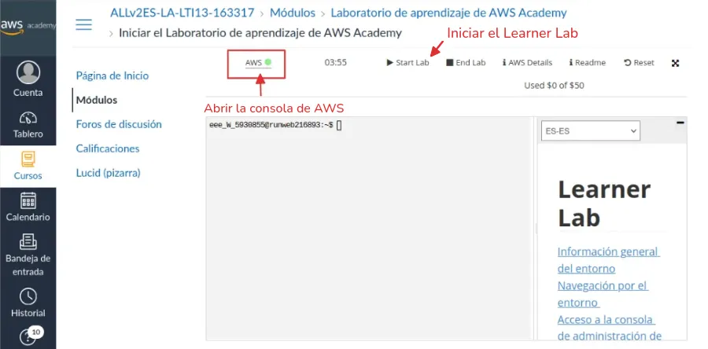
/// caption
**Figura 1**. Iniciar el laboratorio y abrir la consola
///

!!! info
    Cuando el indicador se muestre en color verde, hacemos clic en {++AWS :octicons-circle-16:++} para abrir la consola.

---

## 2. Acceder al servicio EC2

Una vez dentro de la consola, se busca **EC2** en el buscador superior y se selecciona el servicio **Amazon EC2** para ingresar a su panel de administración.

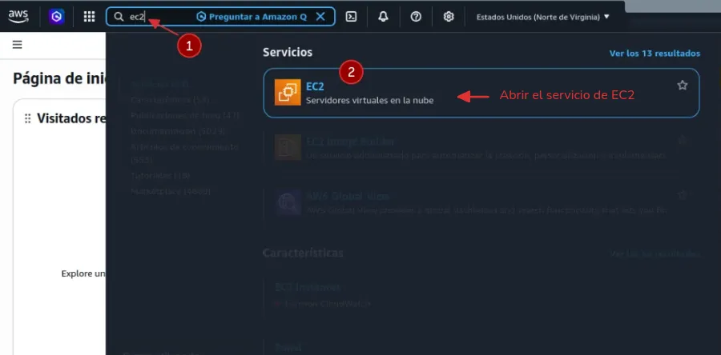
/// caption
**Figura 2**. Seleccionar el servicio de EC2
///

Se abrirá el panel principal de **Amazon EC2**, desde donde se pueden crear, administrar y monitorear las **instancias**.

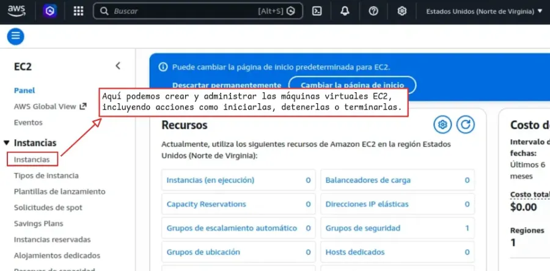
/// caption
**Figura 3**. Panel principal de EC2
///

---

## 3. Lanzar nueva instancia para configurar

Dentro del panel de EC2 nos desplazamos hasta encontrar el botón y hacemos clic en:

<a href="https://us-east-2.console.aws.amazon.com/ec2/home?region=us-east-2#LaunchInstances:" target="_blank" class="border-0"><span class="aws-button" style="cursor: pointer">Lanzar la instancia</span></a>

Para iniciar la configuración.

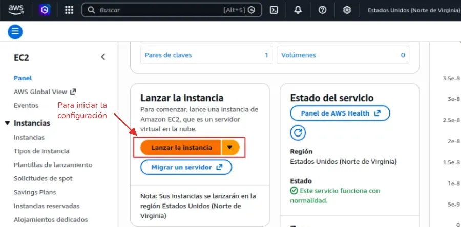
/// caption
**Figura 4**. Lanzar una nueva instancia EC2
///

---

## 4. Configurar el nombre

El nombre es simplemente una etiqueta para identificar esta instancia dentro de AWS.

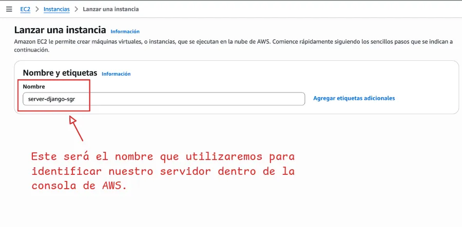
/// caption
**Figura 5**. Definir el nombre o etiqueta de la instancia
///

---

## 5. Seleccionar AMI compatible

Seleccionar una AMI ( Amazon Machine Image ), que es la plantilla del sistema operativo que se instalará.

Una opción muy cómoda es __Ubuntu Server__, porque es fácil de administrar, es ligero, estable y ampliamente utilizado en servidores.

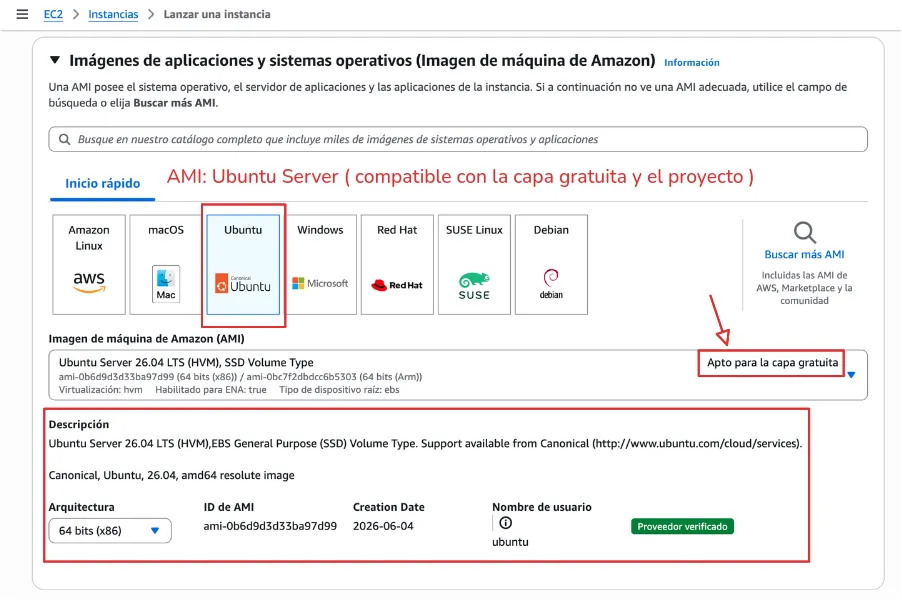
/// caption
**Figura 6**. Seleccionar AMI Ubuntu Server
///

---

## 6. Seleccionar tipo de instancia

El tipo de instancia determina los recursos asignados al servidor, como la CPU y la memoria RAM.

En este caso, seleccionaremos **`t3.micro`**, ya que se encuentra dentro de la capa gratuita y proporciona los recursos necesarios para ejecutar nuestro servidor sin utilizar una configuración de mayor capacidad y mal utilizar los créditos de la cuenta.

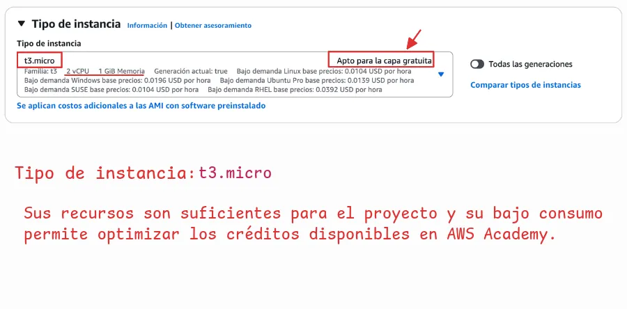
/// caption
**Figura 7**. Seleccionar tipo de instancia t3.micro
///

!!! warning "Cuidado con seleccionar otros tipos"

    Elegir otro tipo de instancia, podría consumir los créditos del laboratorio más rápidamente o incluso no estar permitido por las restricciones del entorno.

---

## 7. Crear par de claves (para conectarse)

El par de claves permite autenticarnos de forma segura al conectarnos a la instancia EC2 mediante SSH. Está compuesto por una **clave pública**, que se almacena en la instancia, y una **clave privada**, que debemos descargar y conservar en un lugar seguro. Esta última es necesaria para establecer la conexión, por lo que **si se pierde, no podremos utilizarla para autenticarnos nuevamente**.

Seleccionaremos **Crear un nuevo par de claves** y configuraremos:

1. **Nombre del par de claves:** un nombre descriptivo para identificarlo.
2. **Tipo de clave:** `RSA`, compatible con instancias Linux y Windows.
3. **Formato del archivo:** `PEM`, para utilizarlo mediante SSH.


/// caption
**Figura 8**. Crear par de claves para conectarse por ssh
///

Al seleccionar **Crear par de claves**, la clave privada se descargará automáticamente como un archivo `.pem`.

???+ warning "AWS no permite descargar nuevamente la clave"

    **Debemos guardarla en un lugar seguro**, ya que AWS no conserva una copia de esta clave y no será posible descargarla nuevamente desde la consola.

    Es recomendable moverla al directorio `~/.ssh/`, destinado al almacenamiento de claves y archivos de configuración utilizados por SSH.

    ```bash title="Terminal"
    mv nombre-clave.pem ~/.ssh/
    ```

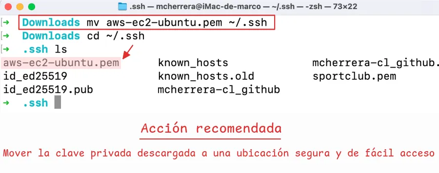
/// caption
**Figura 9**. Mover clave privada a otro destino
///

---

## 8. Configuración de red y acceso

AWS utiliza los **grupos de seguridad** (*security groups*) para controlar el tráfico de red hacia la instancia.

Las configuraciones más comunes son:

- SSH ( puerto 22 ): para conectarte al servidor
- HTTP ( puerto 80 ): para servidores web
- HTTPS ( puerto 443 ): para tráfico seguro

Para nuestro caso, desplegando Django en una EC2, tiene sentido habilitar las tres reglas de entrada.

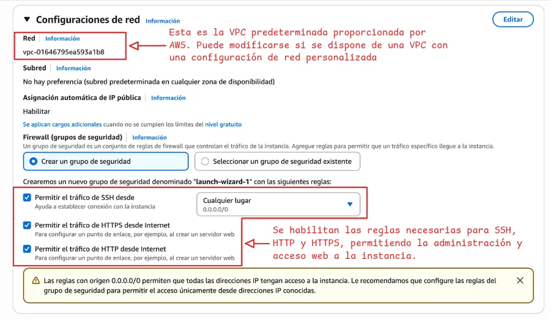
/// caption
**Figura 10**. Configuración de red y reglas de acceso
///

---

## 9. Lanzar instancia

Finalmente, se deja el almacenamiento con los parámetros básicos y se hace clic en:

<span class="aws-button">Lanzar la instancia</span>

El proceso suele tardar menos de un minuto.

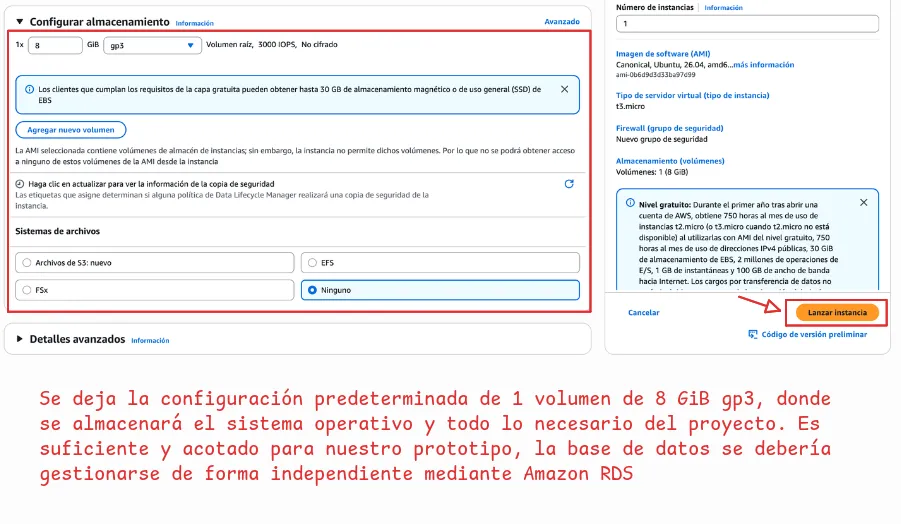
/// caption
**Figura 11**. Lanzar instancia
///

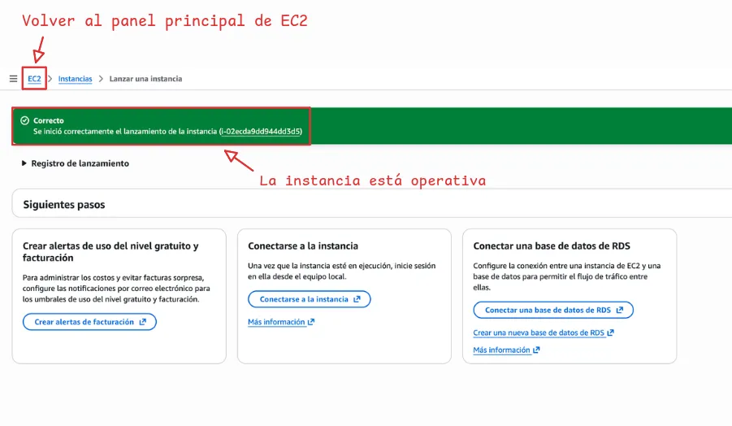
/// caption
**Figura 12**. Instancia operativa
///

Una vez lanzada la instancia, el siguiente paso será volver al panel de **EC2** para configurar una **IP elástica**.

---

## 10. Configurar y asignar una IP elástica

Este paso es clave porque la IP del EC2 cambia cada vez que se apaga o se reinicia. Hay que configurar y asignar una IP elástica (fija) para evitar que se caigan los servicios y para luego conectar por SSH siempre a la misma IP sin andar cambiándola a cada rato.

En el panel de EC2, se baja hasta la sección **Direcciones IP elásticas** para continuar con la configuración.

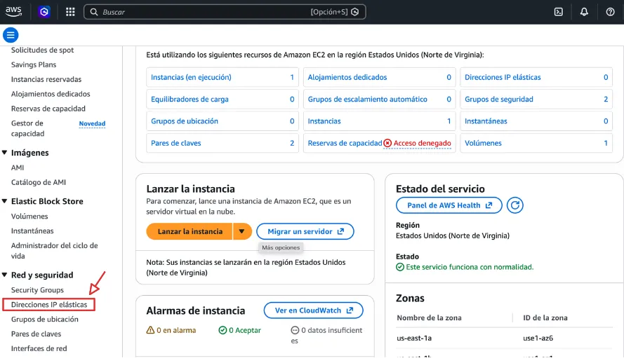
/// caption
**Figura 13**. Acceder a Direcciones IP elásticas
///

Luego, se hace clic en:

<span class="aws-button">Asignar dirección IP elástica</span>

Esto abrirá el formulario para configurar la nueva dirección IP.

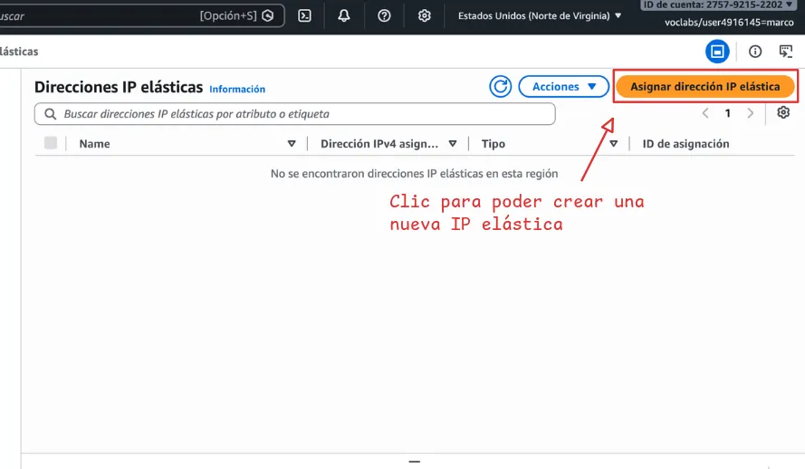
/// caption
**Figura 14**. Asignar nueva dirección IP elástica
///

Se mantiene la configuración predeterminada y se hace clic en:

<span class="aws-button">Asignar</span>

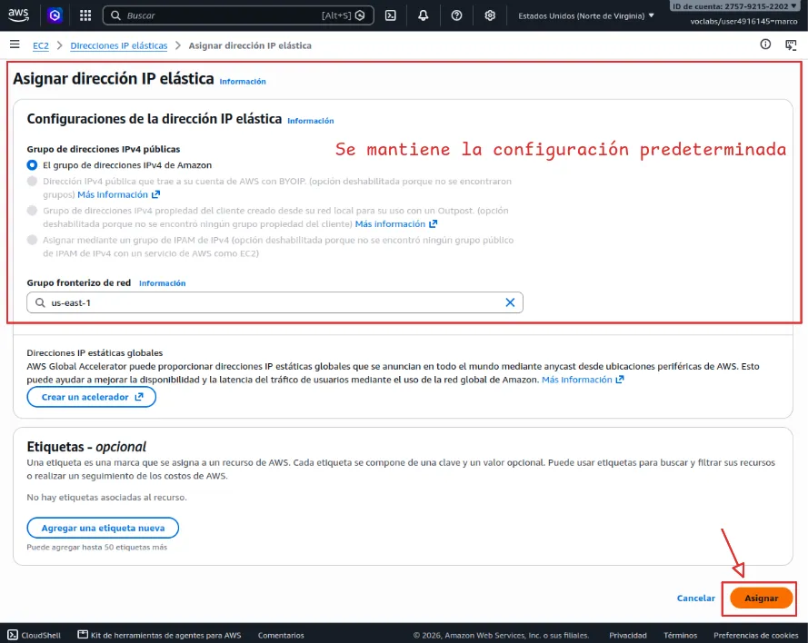
/// caption
**Figura 15**. Configurar y asignar
///

Una vez asignada la **IP elástica**, se hace clic sobre la IP para acceder a sus opciones.

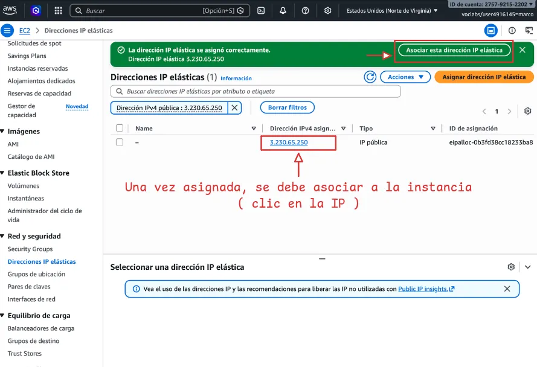
/// caption
**Figura 16**. Acceder a las opciones de la IP asignada
///

Dentro de sus opciones, se hace clic en:

<span class="aws-button">Dirección IP elástica asociada</span>

Para ingresar y vincularla a la instancia **EC2**.

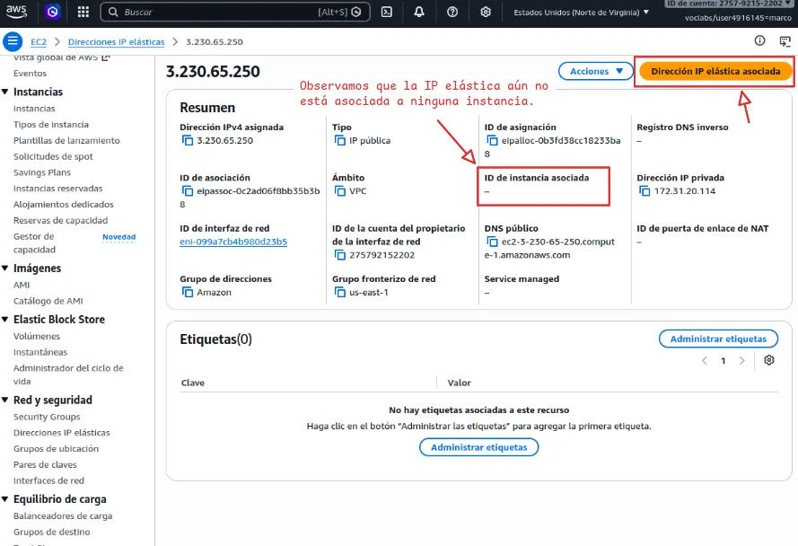
/// caption
**Figura 17**. Abrir el formulario para asociar esta IP elástica
///

En el formulario, se busca la instancia y se hace clic en:

<span class="aws-button">Asociado</span>

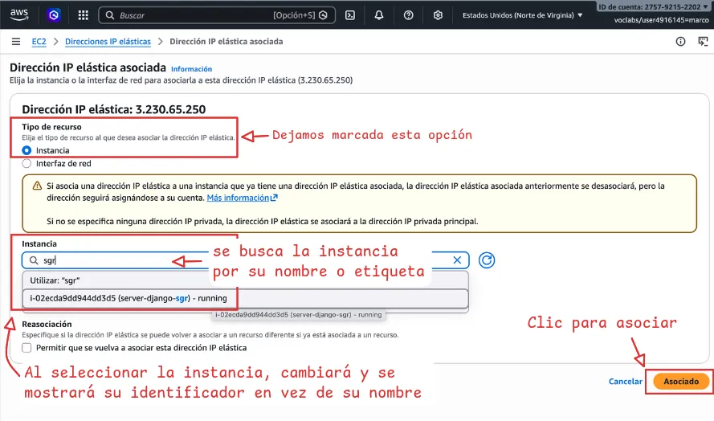
/// caption
**Figura 18**. Seleccionar instancia y asociar
///

---

## 11. Conectarse a la instancia

Con una IP elástica asociada a la instancia, la conexión será más sencilla, ya que se mantendrá la misma dirección IP para las conexiones futuras.

Ahora volvemos al panel principal de EC2 para acceder a la instancia.

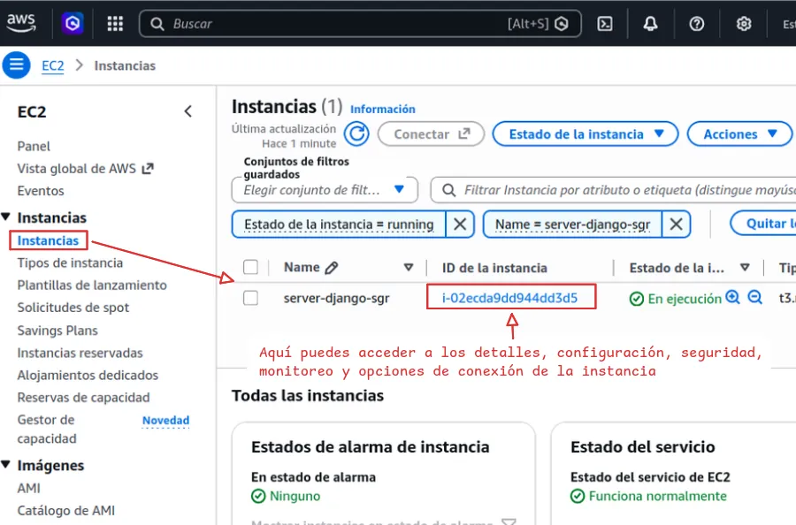
/// caption
**Figura 19**. Ingresar a los detalles de la instancia
///

Ahora, hacemos clic en **Conectar** para acceder a las opciones de conexión de la instancia.

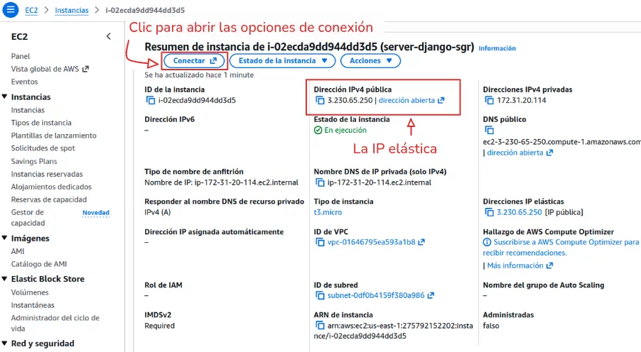
/// caption
**Figura 20**. Instrucciones para conectar por SSH
///

Como podemos observar, la instancia muestra la **IP elástica** que asignamos previamente.

Luego, en la pestaña **En el cliente SSH**, encontraremos las instrucciones y el comando necesario para conectarnos al servidor.

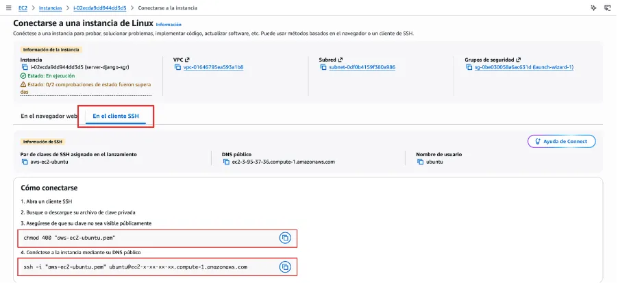
/// caption
**Figura 21**. Instrucciones para conectar por SSH
///

Ahora, debemos ubicarnos en la carpeta donde almacenamos la clave privada y utilizar **SSH** para conectarnos a la instancia mediante dicha clave.

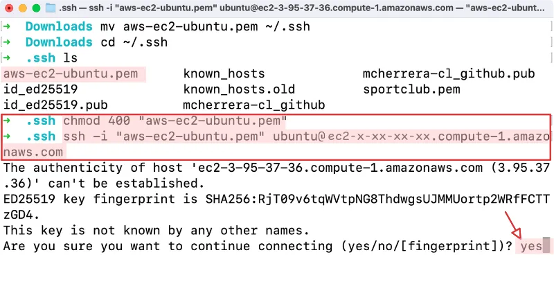
/// caption
**Figura 22**. Realizar primera conexión a la instancia
///

---

## 11. Instalar y actualizar las herramientas del sistema

Actualizamos los paquetes del sistema e instalamos Python, pip, el entorno virtual y Git.

```bash title="Terminal"
sudo apt update && sudo apt upgrade -y  # (1)!
```

1. Actualiza los paquetes del sistema.

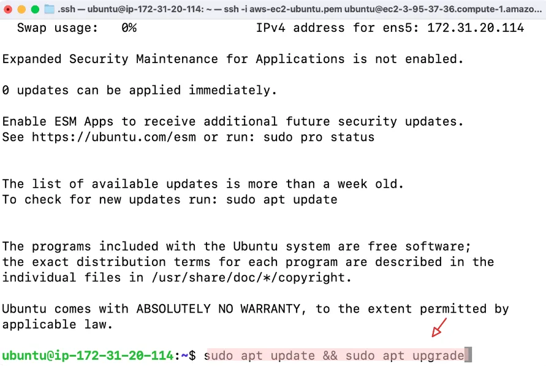
/// caption
**Figura 23**. Actualización de los paquetes del sistema
///

A continuación, instalamos las herramientas necesarias: Python, el paquete para gestionar entornos virtuales y Git.

```bash title="Terminal"
sudo apt install python3-pip python3-venv git -y  # (1)!
```

1. Instala Python, pip, entornos virtuales y Git.

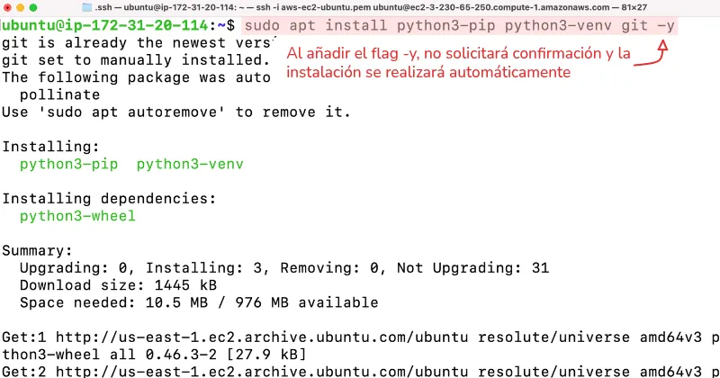
/// caption
**Figura 24**. Instalación de las herramientas necesarias
///

Luego, verificamos las versiones instaladas para comprobar que las herramientas se hayan instalado correctamente.

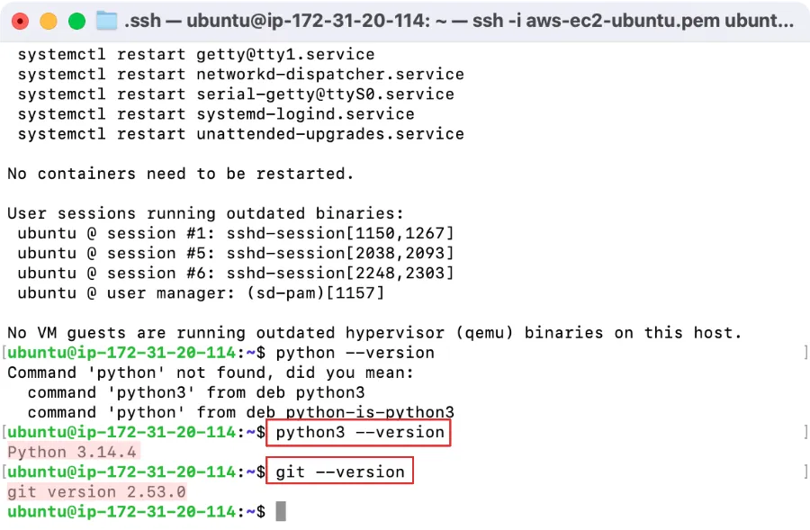
/// caption
**Figura 25**. Verificar las versiones de las herramientas
///

---

## 12. Configurar inicial del proyecto

Se crea el directorio `/var/www` para alojar el proyecto web y se asignan permisos al usuario actual para trabajar con sus archivos.

```bash title="Terminal"
sudo mkdir -p /var/www  # (1)!
sudo chown -R $USER:$USER /var/www  # (2)!
```

1. Crea el directorio `/var/www`, donde se alojará el proyecto web.
2. Asigna `/var/www` al usuario actual para permitirle crear y modificar archivos sin privilegios de administrador.

???+ info "Ubicación del proyecto"
    Aunque el proyecto puede ubicarse en cualquier directorio, `/var/www` es una ubicación habitual para alojar aplicaciones web en servidores Linux.

    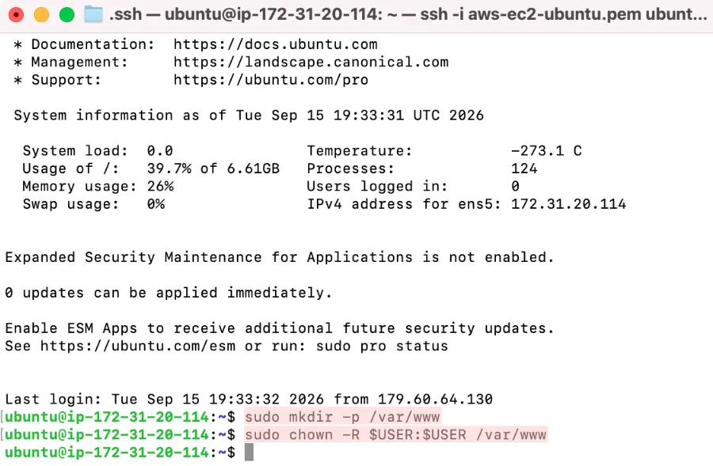

A continuación, se accede al directorio `/var/www` y se clona el repositorio del proyecto.

```bash title="Terminal"
cd /var/www
git clone https://github.com/usuario/proyecto-sgr-delegaciones.git
```

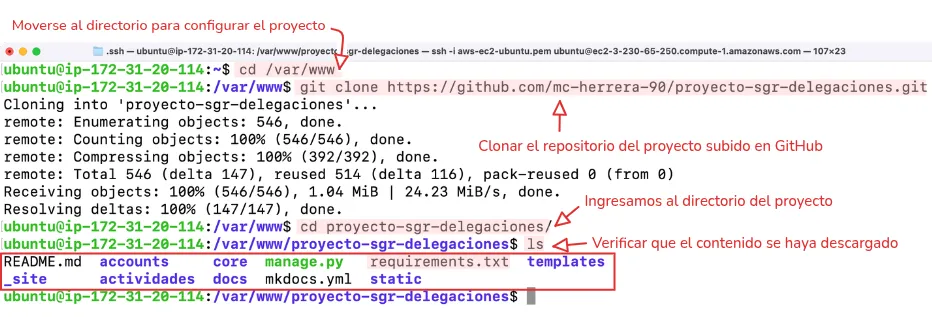
/// caption
**Figura 26**. Clonar proyecto desde GitHub
///

Se crea y activa un entorno virtual para aislar las dependencias del proyecto.

```bash title="Terminal"
python3 -m venv .venv
source .venv/bin/activate
```

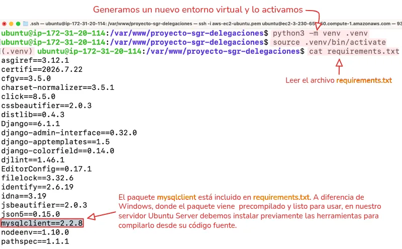
/// caption
**Figura 27**. Preparar entorno virtual y ver archivo requirements.txt
///

Luego, al intentar instalar las dependencias del archivo :octicons-file-16: `requirements.txt`, si no contamos con las herramientas y librerías necesarias para compilar `mysqlclient`, se producirá un error.

=== "Comando"

    ```bash
    (.venv) pip install -r requirements.txt
    ```
=== "Output"

    ```{ .bash .no-copy }
    Collecting asgiref==3.12.1 (from -r requirements.txt (line 1))
    Downloading asgiref-3.12.1-py3-none-any.whl.metadata (9.4 kB)
    Collecting certifi==2026.7.22 (from -r requirements.txt (line 2))
    Downloading certifi-2026.7.22-py3-none-any.whl.metadata (2.5 kB)
    Collecting cfgv==3.5.0 (from -r requirements.txt (line 3))
    Downloading cfgv-3.5.0-py2.py3-none-any.whl.metadata (8.9 kB)
    Collecting charset-normalizer==3.5.1 (from -r requirements.txt (line 4))
    Downloading charset_normalizer-3.5.1-cp314-cp314-manylinux2014_x86_64.manylinux_2_17_x86_64.manylinux_2_28_x86_64.whl.metadata (45 kB)
    Collecting click==8.5.0 (from -r requirements.txt (line 5))
    Downloading click-8.5.0-py3-none-any.whl.metadata (2.6 kB)
    Collecting cssbeautifier==2.0.3 (from -r requirements.txt (line 6))
    Downloading cssbeautifier-2.0.3-py3-none-any.whl.metadata (459 bytes)
    Collecting distlib==0.4.3 (from -r requirements.txt (line 7))
    Downloading distlib-0.4.3-py2.py3-none-any.whl.metadata (5.3 kB)
    Collecting Django==6.1.1 (from -r requirements.txt (line 8))
    Downloading django-6.1.1-py3-none-any.whl.metadata (3.9 kB)
    Collecting django-admin-interface==0.32.0 (from -r requirements.txt (line 9))
    Downloading django_admin_interface-0.32.0-py3-none-any.whl.metadata (17 kB)
    Collecting django-apptemplates==1.5 (from -r requirements.txt (line 10))
    Downloading django-apptemplates-1.5.tar.gz (5.1 kB)
    Installing build dependencies ... done
    Getting requirements to build wheel ... done
    Preparing metadata (pyproject.toml) ... done
    Collecting django-colorfield==0.14.0 (from -r requirements.txt (line 11))
    Downloading django_colorfield-0.14.0-py3-none-any.whl.metadata (11 kB)
    Collecting djlint==1.46.1 (from -r requirements.txt (line 12))
    Downloading djlint-1.46.1-cp314-cp314-manylinux2014_x86_64.manylinux_2_17_x86_64.manylinux_2_28_x86_64.whl.metadata (9.1 kB)
    Collecting EditorConfig==0.17.1 (from -r requirements.txt (line 13))
    Downloading editorconfig-0.17.1-py3-none-any.whl.metadata (3.9 kB)
    Collecting filelock==3.32.6 (from -r requirements.txt (line 14))
    Downloading filelock-3.32.6-py3-none-any.whl.metadata (2.0 kB)
    Collecting identify==2.6.19 (from -r requirements.txt (line 15))
    Downloading identify-2.6.19-py2.py3-none-any.whl.metadata (4.4 kB)
    Collecting idna==3.19 (from -r requirements.txt (line 16))
    Downloading idna-3.19-py3-none-any.whl.metadata (9.2 kB)
    Collecting jsbeautifier==2.0.3 (from -r requirements.txt (line 17))
    Downloading jsbeautifier-2.0.3-py3-none-any.whl.metadata (481 bytes)
    Collecting json5==0.15.0 (from -r requirements.txt (line 18))
    Downloading json5-0.15.0-py3-none-any.whl.metadata (37 kB)
    Collecting mysqlclient==2.2.8 (from -r requirements.txt (line 19))
    Downloading mysqlclient-2.2.8.tar.gz (92 kB)
    Installing build dependencies ... done
    Getting requirements to build wheel ... error
    error: subprocess-exited-with-error
    
    × Getting requirements to build wheel did not run successfully.
    │ exit code: 1
    ╰─> [35 lines of output]
        /bin/sh: 1: pkg-config: not found
        /bin/sh: 1: pkg-config: not found
        /bin/sh: 1: pkg-config: not found
        /bin/sh: 1: pkg-config: not found
        Trying pkg-config --exists mysqlclient
        Command 'pkg-config --exists mysqlclient' returned non-zero exit status 127.
        Trying pkg-config --exists mariadb
        Command 'pkg-config --exists mariadb' returned non-zero exit status 127.
        Trying pkg-config --exists libmariadb
        Command 'pkg-config --exists libmariadb' returned non-zero exit status 127.
        Trying pkg-config --exists perconaserverclient
        Command 'pkg-config --exists perconaserverclient' returned non-zero exit status 127.
        Traceback (most recent call last):
            File "/var/www/proyecto-sgr-delegaciones/.venv/lib/python3.14/site-packages/pip/_vendor/pyproject_hooks/_in_process/_in_process.py", line 389, in <module>
            main()
            ~~~~^^
            File "/var/www/proyecto-sgr-delegaciones/.venv/lib/python3.14/site-packages/pip/_vendor/pyproject_hooks/_in_process/_in_process.py", line 373, in main
            json_out["return_val"] = hook(**hook_input["kwargs"])
                                    ~~~~^^^^^^^^^^^^^^^^^^^^^^^^
            File "/var/www/proyecto-sgr-delegaciones/.venv/lib/python3.14/site-packages/pip/_vendor/pyproject_hooks/_in_process/_in_process.py", line 143, in get_requires_for_build_wheel
            return hook(config_settings)
            File "/tmp/pip-build-env-14gdpasp/overlay/lib/python3.14/site-packages/setuptools/build_meta.py", line 333, in get_requires_for_build_wheel
            return self._get_build_requires(config_settings, requirements=[])
                    ~~~~~~~~~~~~~~~~~~~~~~~~^^^^^^^^^^^^^^^^^^^^^^^^^^^^^^^^^^
            File "/tmp/pip-build-env-14gdpasp/overlay/lib/python3.14/site-packages/setuptools/build_meta.py", line 301, in _get_build_requires
            self.run_setup()
            ~~~~~~~~~~~~~~^^
            File "/tmp/pip-build-env-14gdpasp/overlay/lib/python3.14/site-packages/setuptools/build_meta.py", line 317, in run_setup
            exec(code, locals())  # noqa: S102 # exec is intentional here
            ~~~~^^^^^^^^^^^^^^^^
            File "<string>", line 156, in <module>
            File "<string>", line 49, in get_config_posix
            File "<string>", line 28, in find_package_name
        Exception: Can not find valid pkg-config name.
        Specify MYSQLCLIENT_CFLAGS and MYSQLCLIENT_LDFLAGS env vars manually
        [end of output]
    
    note: This error originates from a subprocess, and is likely not a problem with pip.
    error: subprocess-exited-with-error

    × Getting requirements to build wheel did not run successfully.
    │ exit code: 1
    ╰─> See above for output.

    note: This error originates from a subprocess, and is likely not a problem with pip.
    ```

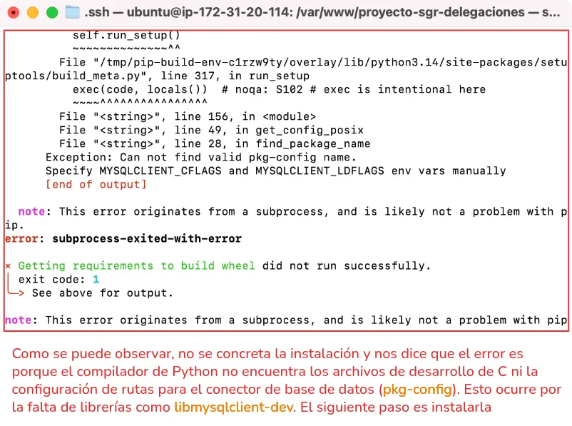
/// caption
**Figura 28**. Error al instalar las dependencias de mysqlclient
///

Para solucionarlo, procedemos a instalar las herramientas necesarias para compilar el driver de conexión.

=== "Comando"

    ```python
    (.venv) sudo apt install -y \
    build-essential \#(1)!
    pkg-config \#(2)!
    default-libmysqlclient-dev \#(3)!
    python3-dev \#(4)!
    ```

    1. Herramientas necesarias para compilar paquetes.
    2. Herramienta para gestionar la configuración de compilación.
    3. Archivos de desarrollo necesarios para compilar `mysqlclient`.
    4. Archivos de desarrollo de Python necesarios para compilar extensiones.

=== "Output"

    ```{ .bash .no-copy }
    build-essential is already the newest version (12.12ubuntu2.26.04.2).
    build-essential set to manually installed.
    The following package was automatically installed and is no longer required:
    pollinate
    Use 'sudo apt autoremove' to remove it.

    Installing:
    default-libmysqlclient-dev  pkg-config

    Installing dependencies:
    libmysqlclient-dev  libpkgconf7  libzstd-dev   pkgconf
    libmysqlclient24    libssl-dev   mysql-common  pkgconf-bin

    Suggested packages:
    libssl-doc

    Summary:
    Upgrading: 0, Installing: 10, Removing: 0, Not Upgrading: 3
    Download size: 6300 kB
    Space needed: 34.3 MB / 3922 MB available

    Get:1 http://us-east-1.ec2.archive.ubuntu.com/ubuntu resolute/main amd64v3 mysql-common all 5.8+1.1.1ubuntu2 [7002 B]
    Get:2 http://us-east-1.ec2.archive.ubuntu.com/ubuntu resolute-updates/main amd64v3 libmysqlclient24 amd64 8.4.11-0ubuntu0.26.04.1 [1259 kB]
    Get:3 http://us-east-1.ec2.archive.ubuntu.com/ubuntu resolute-updates/main amd64v3 libssl-dev amd64 3.5.5-1ubuntu3.5 [2940 kB]
    Get:4 http://us-east-1.ec2.archive.ubuntu.com/ubuntu resolute/main amd64v3 libzstd-dev amd64 1.5.7+dfsg-3 [364 kB]
    Get:5 http://us-east-1.ec2.archive.ubuntu.com/ubuntu resolute-updates/main amd64v3 libmysqlclient-dev amd64 8.4.11-0ubuntu0.26.04.1 [1637 kB]
    Get:6 http://us-east-1.ec2.archive.ubuntu.com/ubuntu resolute/main amd64v3 default-libmysqlclient-dev amd64 1.1.1ubuntu2 [3398 B]
    Get:7 http://us-east-1.ec2.archive.ubuntu.com/ubuntu resolute/main amd64v3 libpkgconf7 amd64 2.5.1-4 [38.8 kB]
    Get:8 http://us-east-1.ec2.archive.ubuntu.com/ubuntu resolute/main amd64v3 pkgconf-bin amd64 2.5.1-4 [22.8 kB]
    Get:9 http://us-east-1.ec2.archive.ubuntu.com/ubuntu resolute/main amd64v3 pkgconf amd64 2.5.1-4 [20.0 kB]
    Get:10 http://us-east-1.ec2.archive.ubuntu.com/ubuntu resolute/main amd64v3 pkg-config amd64 2.5.1-4 [7696 B]
    Fetched 6300 kB in 0s (51.9 MB/s)     
    Selecting previously unselected package mysql-common.
    (Reading database ... 131732 files and directories currently installed.)
    Preparing to unpack .../0-mysql-common_5.8+1.1.1ubuntu2_all.deb ...
    Unpacking mysql-common (5.8+1.1.1ubuntu2) ...
    Selecting previously unselected package libmysqlclient24:amd64.
    Preparing to unpack .../1-libmysqlclient24_8.4.11-0ubuntu0.26.04.1_amd64v3.deb ...
    Unpacking libmysqlclient24:amd64 (8.4.11-0ubuntu0.26.04.1) ...
    Selecting previously unselected package libssl-dev:amd64.
    Preparing to unpack .../2-libssl-dev_3.5.5-1ubuntu3.5_amd64v3.deb ...
    Unpacking libssl-dev:amd64 (3.5.5-1ubuntu3.5) ...
    Selecting previously unselected package libzstd-dev:amd64.
    Preparing to unpack .../3-libzstd-dev_1.5.7+dfsg-3_amd64v3.deb ...
    Unpacking libzstd-dev:amd64 (1.5.7+dfsg-3) ...
    Selecting previously unselected package libmysqlclient-dev.
    Preparing to unpack .../4-libmysqlclient-dev_8.4.11-0ubuntu0.26.04.1_amd64v3.deb ...
    Unpacking libmysqlclient-dev (8.4.11-0ubuntu0.26.04.1) ...
    Selecting previously unselected package default-libmysqlclient-dev:amd64.
    Preparing to unpack .../5-default-libmysqlclient-dev_1.1.1ubuntu2_amd64v3.deb ...
    Unpacking default-libmysqlclient-dev:amd64 (1.1.1ubuntu2) ...
    Selecting previously unselected package libpkgconf7:amd64.
    Preparing to unpack .../6-libpkgconf7_2.5.1-4_amd64v3.deb ...
    Unpacking libpkgconf7:amd64 (2.5.1-4) ...
    Selecting previously unselected package pkgconf-bin.
    Preparing to unpack .../7-pkgconf-bin_2.5.1-4_amd64v3.deb ...
    Unpacking pkgconf-bin (2.5.1-4) ...
    Selecting previously unselected package pkgconf:amd64.
    Preparing to unpack .../8-pkgconf_2.5.1-4_amd64v3.deb ...
    Unpacking pkgconf:amd64 (2.5.1-4) ...
    Selecting previously unselected package pkg-config:amd64.
    Preparing to unpack .../9-pkg-config_2.5.1-4_amd64v3.deb ...
    Unpacking pkg-config:amd64 (2.5.1-4) ...
    Setting up mysql-common (5.8+1.1.1ubuntu2) ...
    update-alternatives: using /etc/mysql/my.cnf.fallback to provide /etc/mysql/my.cnf (my.cnf) in aut
    o mode
    Setting up libzstd-dev:amd64 (1.5.7+dfsg-3) ...
    Setting up libpkgconf7:amd64 (2.5.1-4) ...
    Setting up libmysqlclient24:amd64 (8.4.11-0ubuntu0.26.04.1) ...
    Setting up libssl-dev:amd64 (3.5.5-1ubuntu3.5) ...
    Setting up pkgconf-bin (2.5.1-4) ...
    Setting up libmysqlclient-dev (8.4.11-0ubuntu0.26.04.1) ...
    Setting up default-libmysqlclient-dev:amd64 (1.1.1ubuntu2) ...
    Setting up pkgconf:amd64 (2.5.1-4) ...
    Setting up pkg-config:amd64 (2.5.1-4) ...
    Processing triggers for man-db (2.13.1-1build1) ...
    Processing triggers for libc-bin (2.43-2ubuntu2.4) ...
    Scanning processes...                                                                             
    Scanning candidates...                                                                            
    Scanning linux images...                                                                          

    Pending kernel upgrade!
    Running kernel version:
    7.0.0-1006-aws
    Diagnostics:
    The currently running kernel version is not the expected kernel version 7.0.0-1013-aws.

    Restarting the system to load the new kernel will not be handled automatically, so you should
    consider rebooting.

    Restarting services...

    Service restarts being deferred:
    /etc/needrestart/restart.d/dbus.service
    systemctl restart getty@tty1.service
    systemctl restart networkd-dispatcher.service
    systemctl restart serial-getty@ttyS0.service
    systemctl restart systemd-logind.service
    systemctl restart unattended-upgrades.service

    No containers need to be restarted.

    User sessions running outdated binaries:
    ubuntu @ session #1: sshd-session[1151,1310]
    ubuntu @ session #3: sshd-session[1360,1460]
    ubuntu @ user manager: (sd-pam)[1200]

    No VM guests are running outdated hypervisor (qemu) binaries on this host.
    ```

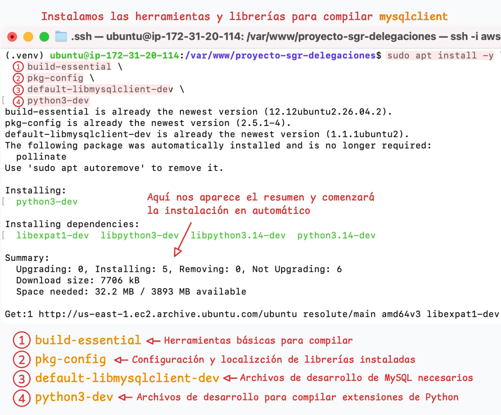
/// caption
**Figura 29**. Instalando las herramientas y librerías para compilar mysqlclient
///

Con la instalación anterior, podemos repetir el proceso de instalación de las dependencias del proyecto, comprobando que esta vez finalice correctamente.

--8<-- "snippets/posts/deploy-django-ec2/instalar-dependencias-con-exito.md"

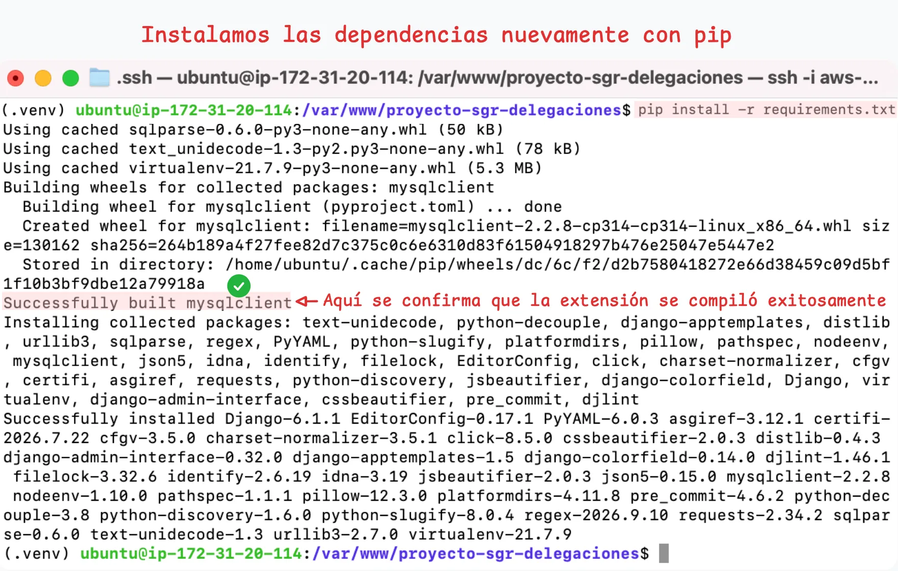
/// caption
**Figura 30**. Confirmar la instalación de las dependencias
///

???+ tip "Veriricar almacenamiento"

    Durante la instalación de dependencias y paquetes, es recomendable revisar periódicamente el espacio disponible ejecutando:

    === "Comando"

        ```bash
        df -h /
        ```

    === "Output"

        ```{ .bash .no-copy }
        ubuntu@ip-172-31-4-218$ df -h /
        Filesystem      Size  Used Avail Use% Mounted on
        /dev/root       6.7G  3.2G  3.5G  48% /
        ```
    
    Para estar consciente del espacio de almacenamiento disponible.

---

## 13. Instalación de MySQL

Como la aplicación Django y la base de datos se ejecutarán en la misma instancia EC2, instalaremos MySQL Server directamente dentro del servidor de ubuntu.

En los repositorios de Ubuntu Server podemos encontrar MySQL Server, ya que se encuentra disponible directamente en los repositorios oficiales de la distribución. Para instalarlo, ejecutamos:

--8<-- "snippets/posts/deploy-django-ec2/instalar-mysql-server.md"

Durante la instalación, `apt` descargará e instalará MySQL Server junto con las dependencias necesarias.

Una vez finalizada la instalación, podemos comprobar que el servicio se encuentre activo:

--8<-- "snippets/posts/deploy-django-ec2/estado-de-mysql-server.md"

Si aparece como `active (running)`, MySQL se encuentra funcionando correctamente y listo para poder conectarse.

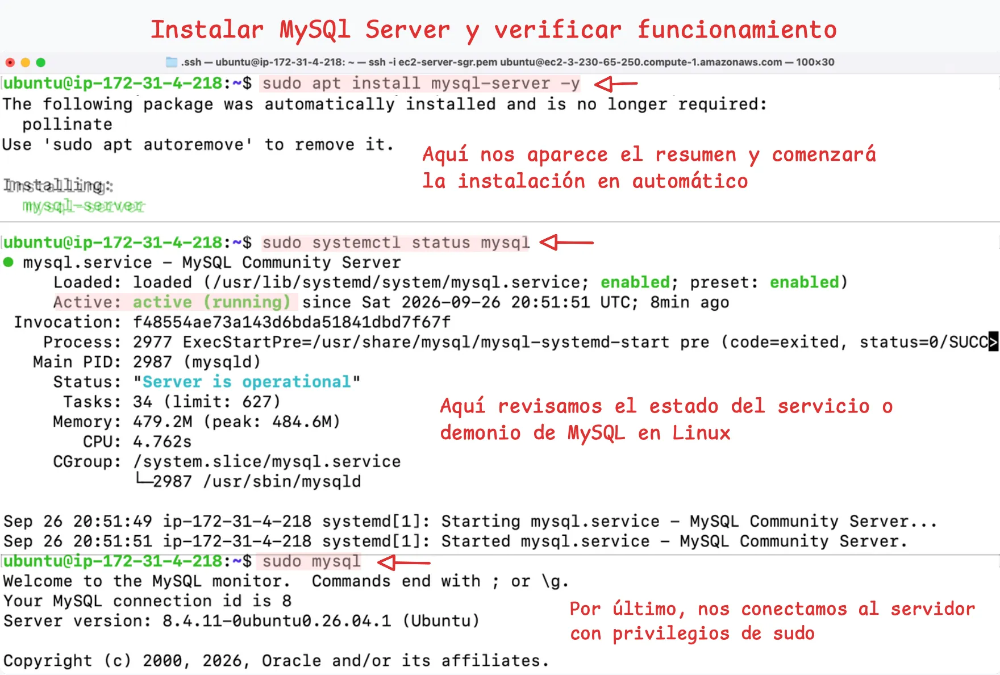
/// caption
**Figura 31**. Instalar MySQL Server y verificar funcionamiento
///

---

## 14. Configuración de la base de datos y usuario

Para conectar la aplicación Django con MySQL, primero crearemos un usuario y luego la base de datos que utilizará el sistema. Posteriormente, asignaremos al usuario todos los privilegios sobre la base de datos creada.

Primero nos conectamos a MySQL:

```bash title="Terminal"
sudo mysql
```

Luego, ejecutamos los siguientes comandos:


=== "Comando"

    ```sql
    CREATE USER 'sgr_user'@'localhost' IDENTIFIED BY 'TU_CONTRASEÑA_SEGURA';

    CREATE DATABASE sgr_db

    GRANT ALL PRIVILEGES ON sgr_db.* TO 'sgr_user'@'localhost';

    FLUSH PRIVILEGES;
    ```

=== "Output"
    
    ```{ .bash .no-copy hl_lines="1 14 17 20 23 26" }
    ubuntu@ip-172-31-4-218:~$ sudo mysql
    Welcome to the MySQL monitor.  Commands end with ; or \g.
    Your MySQL connection id is 9
    Server version: 8.4.11-0ubuntu0.26.04.1 (Ubuntu)

    Copyright (c) 2000, 2026, Oracle and/or its affiliates.

    Oracle is a registered trademark of Oracle Corporation and/or its
    affiliates. Other names may be trademarks of their respective
    owners.

    Type 'help;' or '\h' for help. Type '\c' to clear the current input statement.

    mysql> CREATE USER 'sgr_user'@'localhost' IDENTIFIED BY 'proPassword123_';
    Query OK, 0 rows affected (0.09 sec)

    mysql> CREATE DATABASE sgr_db;
    Query OK, 1 row affected (0.01 sec)

    mysql> GRANT ALL PRIVILEGES ON sgr_db.* TO 'sgr_user'@'localhost';
    Query OK, 0 rows affected (0.00 sec)

    mysql> FLUSH PRIVILEGES;
    Query OK, 0 rows affected (0.01 sec)

    mysql> exit
    Bye
    ```

De esta manera, la aplicación Django utilizará `sgr_user` para acceder exclusivamente a la base de datos `sgr_db`, manteniendo separado el acceso de la aplicación respecto del usuario administrativo `root`.

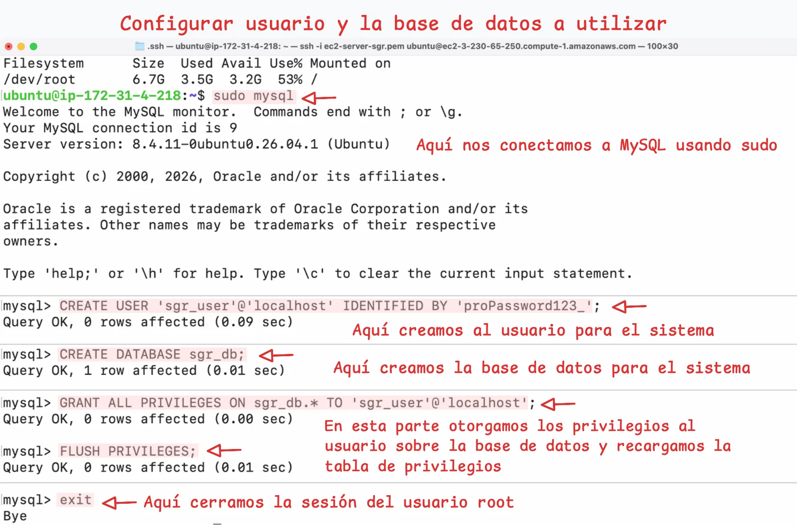
/// caption
**Figura 32**. Configurar usuario y base de datos del sistema
///

---

## 15. Configurar variables de entorno

Ahora debemos comenzar a configurar las variables de entorno para continuar con la inicialización del proyecto y, posteriormente, ejecutar las migraciones para crear las tablas en la base de datos.

El proyecto incluye un archivo :octicons-file-16: `.env.example` como referencia con las variables necesarias. A partir de este archivo, crearemos un archivo :octicons-file-16: `.env` y configuraremos sus valores de acuerdo con el entorno del servidor.

=== "Comando"

    ```bash
    (.venv) cp .env.example .env
    (.venv) nano .env
    ```

=== "Output"

    ```{.bash .no-copy hl_lines="1 5-9 11"}
    ubuntu@ip-172-31-4-218:/var/www/proyecto-sgr-delegaciones$ nano .env
    ┌──────────────────────────────────────────────────┐
    │ GNU nano 8.7.1          .env                   ◀ Archivo .env     
    ├──────────────────────────────────────────────────┤
    │ DB_NAME=sgr_db                                 ◀ Nombre de la base se datos
    │ DB_USER=sgr_user                               ◀ Nombre del usuario de MySQL
    │ DB_PASSWORD=proPassword123_                    ◀ Password del usuario de MySQL      
    │ DB_HOST=127.0.0.1                              ◀ Host de MySQL (dentro de ec2) 
    │ DB_PORT=3306                                   ◀ Puerto de MySQL (es predeterminado) 
    │ ENDPOINT_SERVICE_DRIVE=                        ◀ Servicio externo (opcional)
    │ ALLOWED_HOSTS=localhost,127.0.0.1,3.230.65.250 ◀ Hosts permitidos para la aplicación
    └──────────────────────────────────────────────────┘
    ```

|   Combinaciones en Nano     ||
| ---------- | --------- |
| ++ctrl+o++ | Guardar ( ++enter++ para confirmar ) |
| ++ctrl+x++ | Salir     |

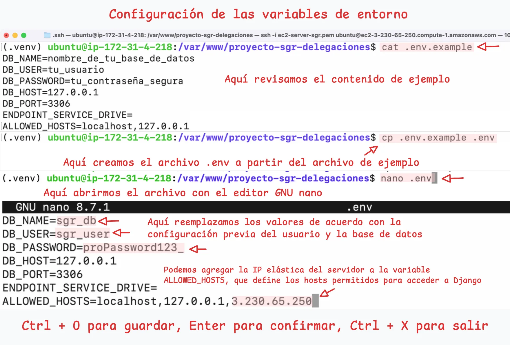
/// caption
**Figura 33**. Configuración de las variables de entorno
///

---

## 16. Ejecutar las migraciones

Con las variables de entorno configuradas, ejecutamos las migraciones de Django para crear las tablas necesarias en la base de datos MySQL.

--8<-- "snippets/posts/deploy-django-ec2/ejecutar-migraciones.md"

Este comando aplica las migraciones pendientes del proyecto y crea la estructura de la base de datos definida por los modelos de las aplicaciones.

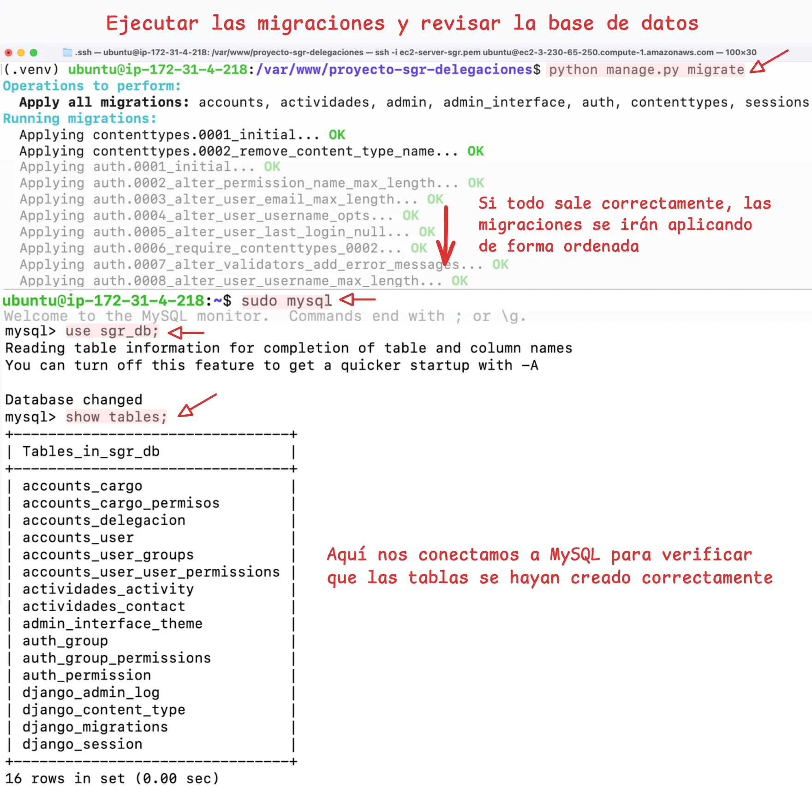
/// caption
**Figura 34**. Ejecutar migraciones y verificar en MySQL
///

---

## 17. Probar la aplicación

Antes de probar la aplicación, debemos permitir el acceso al puerto `8000` desde el **Grupo de Seguridad** asociado a la instancia EC2. Para ello, agregamos una regla de entrada para dicho puerto.

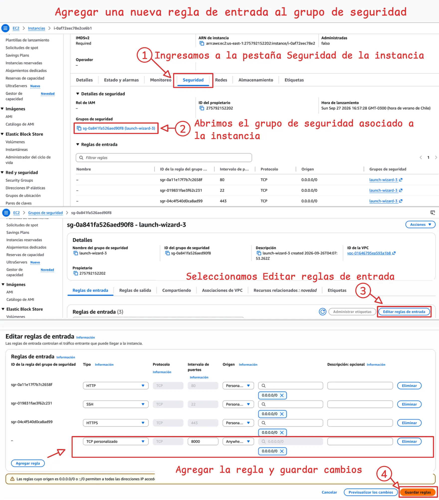
/// caption
**Figura 35**. Agregar nueva regla de entrada en el Grupo de Seguridad asociado a la instancia
///

Para realizar una prueba de funcionamiento, ejecutamos temporalmente el servidor de desarrollo con `runserver`:

=== "Comando"

    ```bash
    python manage.py runserver 0.0.0.0:8000
    ```
=== "Output"

    ```{.bash .no-copy hl_lines="1 8"}
    (.venv) ubuntu@ip-172-31-4-218:/var/www/proyecto-sgr-delegaciones$ python manage.py runserver 0.0.0.0:8000
    Watching for file changes with StatReloader
    Performing system checks...

    System check identified no issues (0 silenced).
    September 27, 2026 - 18:49:21
    Django version 6.1.1, using settings '_site.settings'
    Starting WSGI development server at http://0.0.0.0:8000/
    Quit the server with CONTROL-C.

    WARNING: This is a development server. Do not use it in a production setting. Use a production WSGI or ASGI server instead.
    For more information on production servers see: https://docs.djangoproject.com/en/6.1/howto/deployment/
    [27/Sep/2026 18:49:34] "GET / HTTP/1.1" 302 0
    [27/Sep/2026 18:49:35] "GET /accounts/login/?next=/ HTTP/1.1" 200 2652
    [27/Sep/2026 18:49:35] "GET /static/css/variables.css HTTP/1.1" 200 166
    [27/Sep/2026 18:49:35] "GET /static/css/login.css HTTP/1.1" 200 5600
    [27/Sep/2026 18:49:35] "GET /static/js/forms.js HTTP/1.1" 200 1332
    [27/Sep/2026 18:49:35] "GET /static/css/libs/fa.7.3.1.all.min.css HTTP/1.1" 200 90336
    [27/Sep/2026 18:49:35] "GET /static/img/left-bg.webp HTTP/1.1" 200 40816
    [27/Sep/2026 18:49:36] "GET /static/css/webfonts/fa-solid-900.woff2 HTTP/1.1" 200 119488
    ```
Luego, accedemos desde el navegador a la IP pública de la instancia usando `http`. Por ejemplo: `http://3.230.65.250:8000/`

De esta forma, comprobamos que la aplicación funciona correctamente antes de continuar con la configuración de Gunicorn y Nginx.

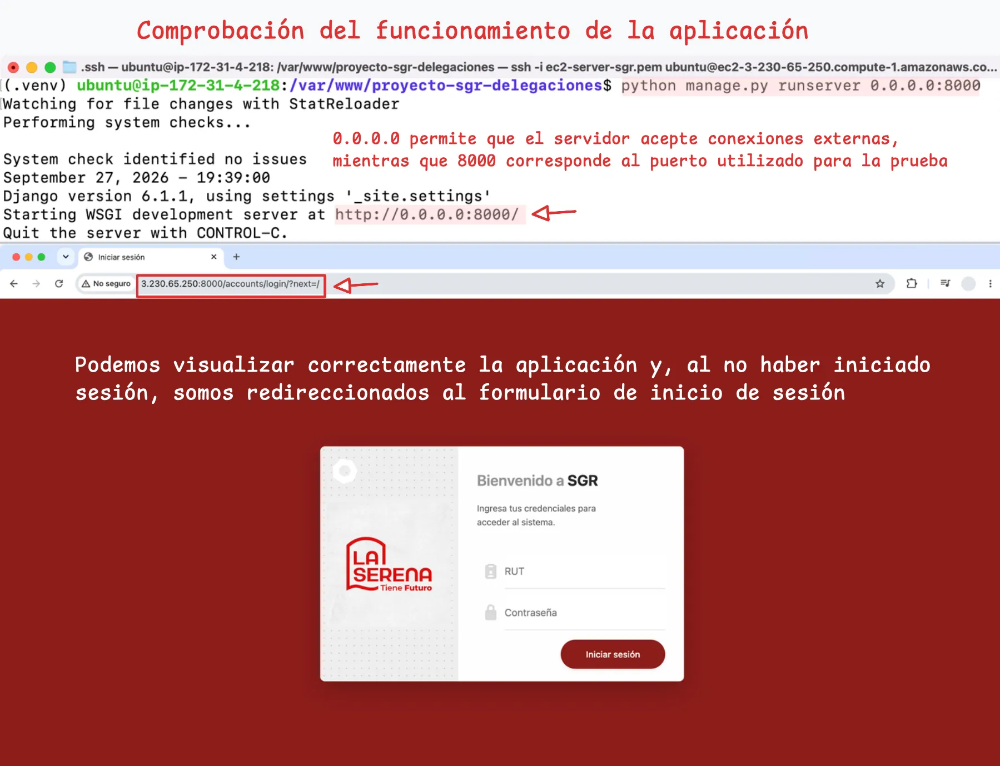
/// caption
**Figura 36**. Comprobación de funcionamiento de la aplicación
///

## 18. Configurar Gunicorn como Servicio Systemd

Configuramos **Gunicorn** como servidor de aplicaciones para ejecutar el proyecto Django en el servidor.

A diferencia del servidor de desarrollo que ejecutamos con `runserver`, Gunicorn es un servidor de aplicaciones, por lo que no se encarga de servir los archivos estáticos de la aplicación, aunque estos hayan sido generados mediante el comando `python manage.py collectstatic`.

Entonces, ejecutamos Gunicorn directamente para comprobar que pueda iniciar y atender las peticiones de Django:

=== "Comando"

    ```python
    gunicorn \
    --bind 0.0.0.0:8000 \#(1)!
    --access-logfile - \#(2)!
    _site.wsgi:application#(3)!
    ```

    1. Dirección y puerto de escucha.
    2. Registra las peticiones HTTP.
    3. **Indica la aplicación WSGI de Django**; reemplaza `_site` por el nombre del proyecto utilizado al ejecutar `django-admin startproject`.

=== "Output"

    ```{.bash .no-copy hl_lines="1-4"}
    (.venv) ubuntu@ip-172-31-4-218:/var/www/proyecto-sgr-delegaciones$ gunicorn \
    --bind 0.0.0.0:8000 \
    --access-logfile - \
    _site.wsgi:application
    [2026-09-28 01:29:21 +0000] [2010] [INFO] Starting gunicorn 26.2.0
    [2026-09-28 01:29:21 +0000] [2010] [INFO] Listening at: http://0.0.0.0:8000 (2010)
    [2026-09-28 01:29:21 +0000] [2010] [INFO] Using worker: sync
    [2026-09-28 01:29:21 +0000] [2011] [INFO] Booting worker with pid: 2011
    [2026-09-28 01:29:21 +0000] [2010] [INFO] Control socket listening at /run/user/1000/gunicorn.ctl
    179.60.64.130 - - [27/Sep/2026:22:29:30 -0300] "GET /accounts/login/?next=/ HTTP/1.1" 200 2652 "-" "Mozilla/5.0 (Macintosh; Intel Mac OS X 10_15_7) AppleWebKit/537.36 (KHTML, like Gecko) Chrome/152.0.0.0 Safari/537.36"
    Not Found: /static/css/variables.css
    179.60.64.130 - - [27/Sep/2026:22:29:30 -0300] "GET /static/css/variables.css HTTP/1.1" 404 3243 "http://3.230.65.250:8000/accounts/login/?next=/" "Mozilla/5.0 (Macintosh; Intel Mac OS X 10_15_7) AppleWebKit/537.36 (KHTML, like Gecko) Chrome/152.0.0.0 Safari/537.36"
    Not Found: /static/css/libs/fa.7.3.1.all.min.css
    179.60.64.130 - - [27/Sep/2026:22:29:30 -0300] "GET /static/css/libs/fa.7.3.1.all.min.css HTTP/1.1" 404 3279 "http://3.230.65.250:8000/accounts/login/?next=/" "Mozilla/5.0 (Macintosh; Intel Mac OS X 10_15_7) AppleWebKit/537.36 (KHTML, like Gecko) Chrome/152.0.0.0 Safari/537.36"
    Not Found: /static/css/login.css
    179.60.64.130 - - [27/Sep/2026:22:29:31 -0300] "GET /static/css/login.css HTTP/1.1" 404 3231 "http://3.230.65.250:8000/accounts/login/?next=/" "Mozilla/5.0 (Macintosh; Intel Mac OS X 10_15_7) AppleWebKit/537.36 (KHTML, like Gecko) Chrome/152.0.0.0 Safari/537.36"
    Not Found: /static/js/forms.js
    179.60.64.130 - - [27/Sep/2026:22:29:31 -0300] "GET /static/js/forms.js HTTP/1.1" 404 3225 "http://3.230.65.250:8000/accounts/login/?next=/" "Mozilla/5.0 (Macintosh; Intel Mac OS X 10_15_7) AppleWebKit/537.36 (KHTML, like Gecko) Chrome/152.0.0.0 Safari/537.36"
    Not Found: /favicon.ico
    179.60.64.130 - - [27/Sep/2026:22:29:31 -0300] "GET /favicon.ico HTTP/1.1" 404 3204 "http://3.230.65.250:8000/accounts/login/?next=/" "Mozilla/5.0 (Macintosh; Intel Mac OS X 10_15_7) AppleWebKit/537.36 (KHTML, like Gecko) Chrome/152.0.0.0 Safari/537.36"
    ```

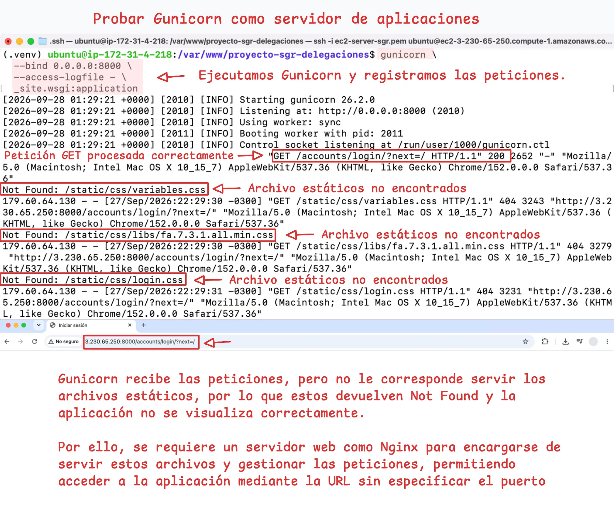
/// caption
**Figura 36**. Probando Gunicorn como servidor de aplicaciones
///

Una vez probado Gunicorn, lo configuramos como un servicio para mantenerlo disponible de forma permanente. Esto es fundamental para que posteriormente **Nginx pueda actuar como servidor proxy inverso**, recibiendo las peticiones y derivándolas hacia Gunicorn.

Para entender mejor el contexto, el esquema de comunicación sería:

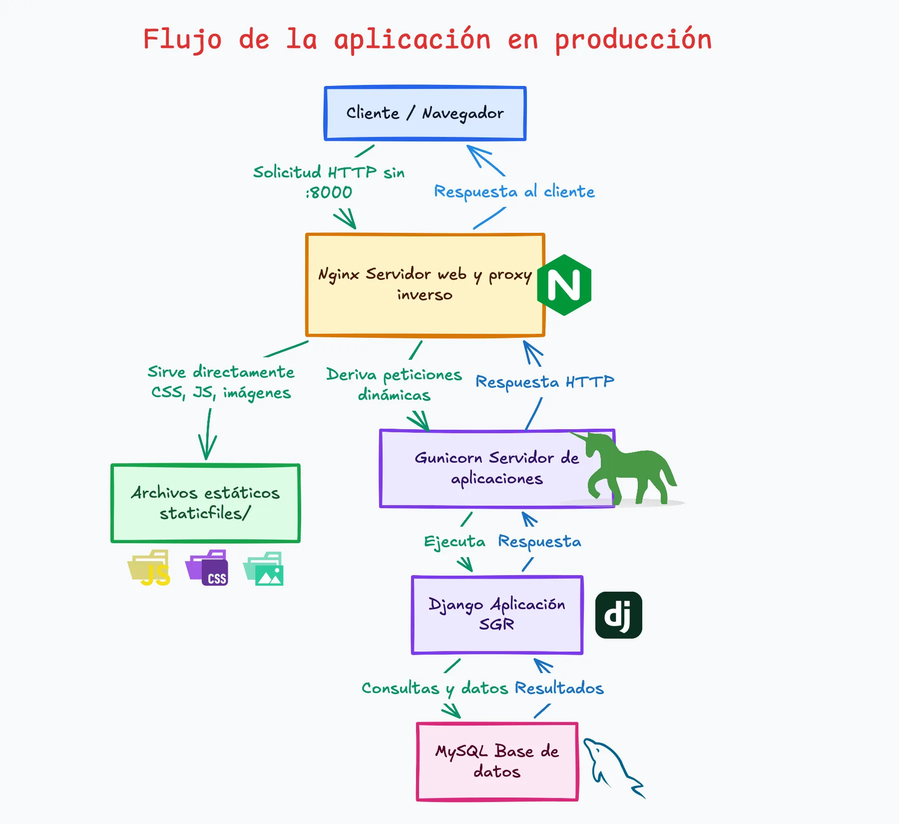
/// caption
**Figura 38**. Flujo de comunicación entre Nginx, Gunicorn, Django y MySQL
///

Primero detenemos el Gunicorn que dejamos ejecutándose manualmente con ++ctrl+c++.

Luego creamos el archivo `gunicorn.service` para agregar la configuración:

```bash title="Terminal"
sudo nano /etc/systemd/system/gunicorn.service
```

Reemplaza `</ruta/a/tu/proyecto>` y `<tu_proyecto>` con los valores reales.

```ini title="gunicorn.service" hl_lines="3 6-12 15" linenums="1"
[Unit]
Description=Gunicorn daemon for Django
After=network.target#(1)!

[Service]
User=ubuntu#(2)!
Group=www-data#(3)!
WorkingDirectory=</ruta/a/tu/proyecto>#(4)!
ExecStart=</ruta/a/tu/proyecto>/venv/bin/gunicorn \#(5)!
    --workers 3 \
    --bind unix:</ruta/a/tu/proyecto>/tu_proyecto.sock \
    <tu_proyecto>.wsgi:application

[Install]
WantedBy=multi-user.target#(6)!
```

1. **`After=network.target`**: Indica que systemd debe iniciar Gunicorn después de que la red del sistema haya sido levantada.
2. **`User=ubuntu`**: Gunicorn se ejecuta como el usuario ubuntu (o el usuario que tenga tu ec2).
3. **`Group=www-data`**: El proceso pertenece al grupo `www-data`. Esto facilita que **Nginx** pueda acceder al socket de Gunicorn
4. **`WorkingDirectory=`**: Indica desde qué directorio se ejecutará Gunicorn. En nuestro caso es:<br/>`/var/www/proyecto-sgr-delegaciones`.
5. **`ExecStart=`** Indica el comando que systemd debe ejecutar para iniciar Gunicorn. En nuestro caso es:<br/>`/var/www/proyecto-sgr-delegaciones/.venv/bin/gunicorn`.<br/><br/>**`--workers 3`**: Indica que Gunicorn ejecutará 3 procesos workers para atender las solicitudes de tu aplicación Django.<br/><br/>**`--bind unix`**: Indica dónde Gunicorn va a crear el socket Unix que permitirá que Nginx se comunique con Gunicorn.<br/><br/>**`<tu_proyecto>.wsgi:application`**: Le dice a Gunicorn qué aplicación Django debe ejecutar. En nuestro caso el dirtectorio del proyecto es `_site`, por ende quedaría como `_site.wsgi:application`
6. **`WantedBy=multi-user.target`**: Le indica a systemd que el servicio Gunicorn debe quedar asociado al arranque normal de un servidor Linux.


Luego, debemos recargar la configuración de `systemd`.

```bash title="Terminal"
sudo systemctl daemon-reload
```

Esto permite que systemd reconozca el archivo `gunicorn.service`.

Ahora iniciamos y habilitamos el servicio de Gunicorn.

```bash title="Terminal"
sudo systemctl start gunicorn
sudo systemctl enable gunicorn
```

Revisamos que se encuentra operativo.

=== "Comando"
    
    ```bash
    sudo systemctl status gunicorn
    ```

=== "Output"

    ```{.bash .no-copy hl_lines="4"}
    ubuntu@ip-172-31-4-218:~$ sudo systemctl status gunicorn
    ● gunicorn.service - Gunicorn daemon for SGR
        Loaded: loaded (/etc/systemd/system/gunicorn.service; enabled; preset: enabled)
        Active: active (running) since Mon 2026-09-28 02:46:41 UTC; 51s ago
    Invocation: 6dcd0e4ff21e4fa6ae2eec0b224a1b57
    Main PID: 638 (gunicorn)
        Tasks: 5 (limit: 627)
        Memory: 122.1M (peak: 126.7M)
            CPU: 1.550s
        CGroup: /system.slice/gunicorn.service
                ├─638 /var/www/proyecto-sgr-delegaciones/.venv/bin/python3 /var/www/proyecto-sgr-delegaciones/>
                ├─852 /var/www/proyecto-sgr-delegaciones/.venv/bin/python3 /var/www/proyecto-sgr-delegaciones/>
                ├─865 /var/www/proyecto-sgr-delegaciones/.venv/bin/python3 /var/www/proyecto-sgr-delegaciones/>
                └─879 /var/www/proyecto-sgr-delegaciones/.venv/bin/python3 /var/www/proyecto-sgr-delegaciones/>
    ```

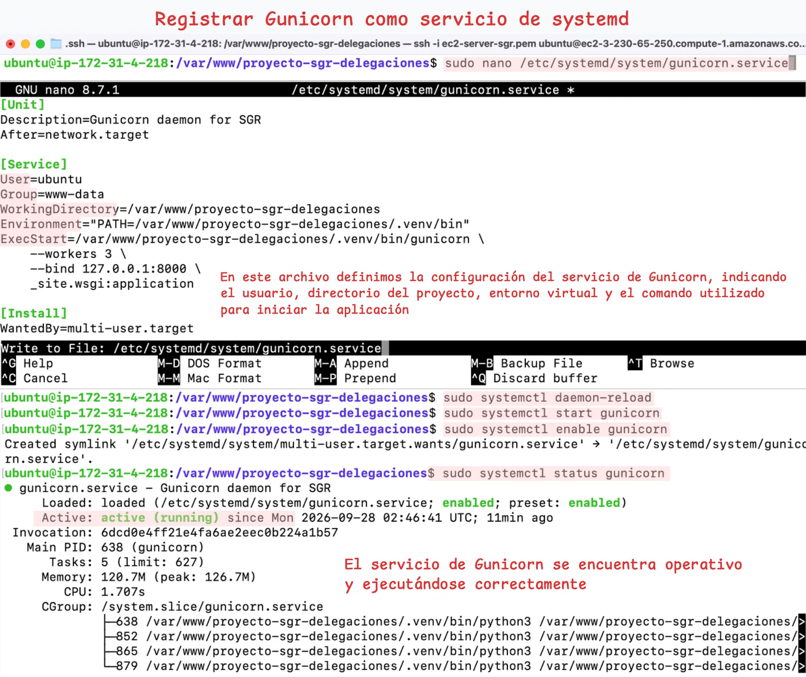
/// caption
**Figura 39**. Configurando Gunicorn como servicio
///

---

## 19. Configurar NGINX como proxy inverso

Una vez configurado Gunicorn como servicio, continuamos con la configuración de **NGINX** como proxy inverso. Este se encargará de recibir las solicitudes del cliente, servir los archivos estáticos y derivar las peticiones dinámicas hacia Gunicorn.

Primero instalamos NGINX en la instancia:

```bash title="Terminal"
sudo apt install nginx -y
```

Después verificamos que el servicio se encuentre operativo y lo habilitamos.

```bash title="Terminal"
sudo systemctl status nginx
sudo systemctl enable nginx
```

Creamos un archivo de configuración de Nginx para el sitio.

```bash title="Terminal"
sudo nano /etc/nginx/sites-available/django
```

Ahora el siguiente bloque remplazando `</ruta/a/tu/proyecto/>` por los valores para el proyecto.

```nginx title="/etc/nginx/sites-available/django" linenums="1" hl_lines="3 6 10 14"
server {
    listen 80;
    server_name ip-publica-del-ec2;

    location /static/ {
        alias /ruta/a/tu/proyecto/staticfiles/;
    }

    location /media/ {
        alias /ruta/a/tu/proyecto/media/;
    }

    location / {
        proxy_pass http://127.0.0.1:8000;

        proxy_set_header Host $host;
        proxy_set_header X-Real-IP $remote_addr;
        proxy_set_header X-Forwarded-For $proxy_add_x_forwarded_for;
        proxy_set_header X-Forwarded-Proto $scheme;
    }
}
```

Ahora, se habilita el sitio y reinicia NGINX.

```bash title="Terminal"
sudo ln -s /etc/nginx/sites-available/django /etc/nginx/sites-enabled/
sudo nginx -t
sudo systemctl restart nginx
```

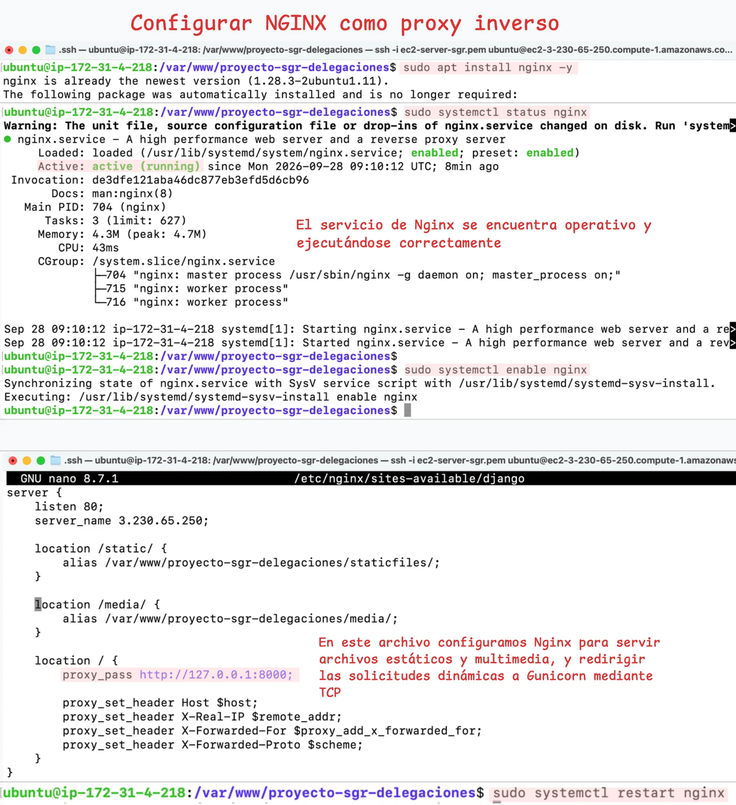
/// caption
**Figura 40**. Configurando Nginx como proxy inverso
///

Finalmente, podemos comprobar que la aplicación se encuentra operativa desde la IP pública.

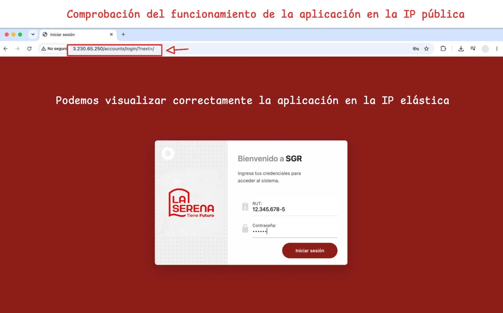
/// caption
**Figura 41**. Aplicación operativa en la IP pública
///
