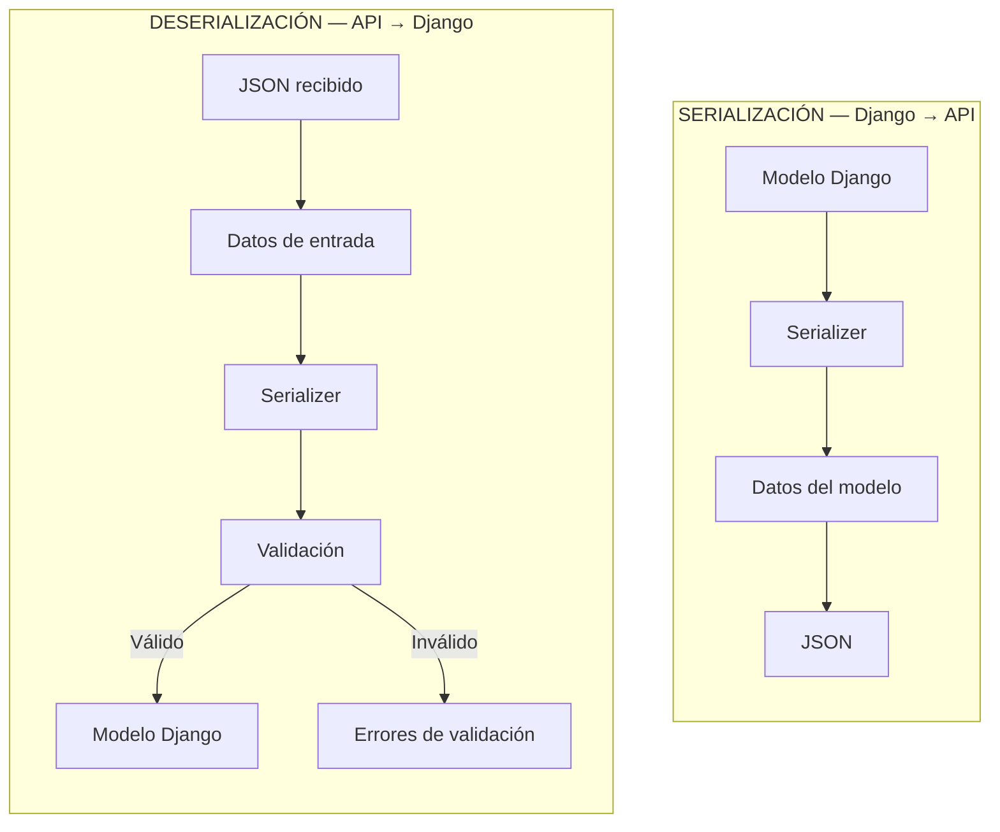
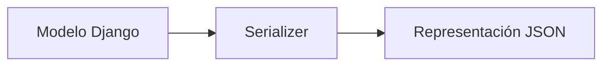
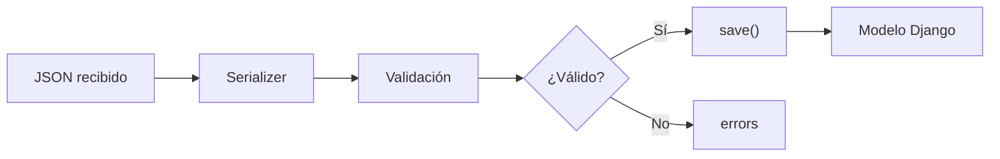
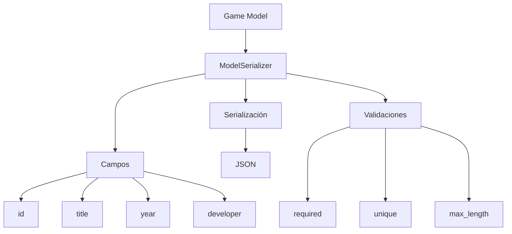

# Serializadores en Django REST Framework

Los **serializadores** son uno de los componentes fundamentales de Django REST Framework (DRF). Su función principal es actuar como puente entre los objetos de Django y los datos que intercambia una API.

<!-- more -->

En términos simples, permiten transformar objetos de Python, como instancias de modelos y QuerySets, en datos que pueden ser enviados mediante una API, normalmente en formato **JSON**. También realizan el proceso inverso: reciben datos enviados por el cliente, los validan y los convierten en estructuras que Django puede utilizar para crear o modificar objetos.



## ¿Por qué necesitamos serializadores?

Django trabaja principalmente con objetos Python y modelos del ORM. Por ejemplo, podemos tener un modelo:

```python title="games/models.py"
from django.db import models

class Game(models.Model):
    title = models.CharField(max_length=100)
    year = models.PositiveIntegerField()
    developer = models.CharField(max_length=100)

    def __str__(self):
        return self.title
```

Una consulta utilizando el ORM nos devuelve una instancia:

=== ":octicons-terminal-16: Shell Django"

    ```{ .python .no-copy hl_lines="1 2 4 5 7" }
    (.venv) python manage.py shell#(1)!
    >>> from games.models import Game#(2)!
    >>>
    >>> game = Game.objects.get(pk=1)#(3)!
    >>> game.title#(4)!
    'Super Mario Bros'#(5)!
    >>> game.year#(6)!
    1985#(7)!
    ```

    1. Ingresamos al Shell interactivo de Django.
    2. Importamos el modelo `Game` desde la aplicación `games`.
    3. Consultamos la base de datos y obtenemos el juego cuyo `id` es `1`.
    4. Accedemos al atributo `title` del objeto obtenido.
    5. Django devuelve el título almacenado para ese juego.
    6. Accedemos al atributo `year` del objeto obtenido.
    7. Django devuelve el año almacenado para ese juego.
   
=== ":octicons-code-16: Código Python"

    ```{ .python .select }
    from games.models import Game
    
    game = Game.objects.get(pk=1)
    game.title
    game.year
    ```

El objeto `game` es una instancia de Python. Sin embargo, una API REST normalmente necesita entregar los datos en un formato que pueda ser interpretado por el cliente:

```{ .json .select title="JSON" }
{
    "id": 1,
    "title": "Super Mario Bros",
    "year": 1985,
    "developer": "Nintendo"
}
```

El serializador se encarga precisamente de realizar esta transformación.

---

## Serialización

La **serialización** consiste en transformar objetos Python o instancias de modelos en un formato adecuado para ser enviado al cliente.

Por ejemplo:



Podemos utilizar un serializador para transformar una instancia del modelo:

```python title="games/serializers.py"
from rest_framework import serializers

from .models import Game

class GameSerializer(serializers.ModelSerializer):

    class Meta:
        model = Game
        fields = "__all__"
```

Posteriormente, realizamos la serialización, pasando como argumento al serializador la instancia del objeto que deseamos serializar.

=== ":octicons-terminal-16: Shell Django"

    ```{ .python .no-copy hl_lines="2-4 6-7 9" }
    (.venv) python manage.py shell
    >>> from games.models import Game#(1)!
    >>> from games.serializers import GameSerializer#(2)!
    >>> import json#(3)!
    >>>
    >>> game = Game.objects.get(pk=1)#(4)!
    >>> serializer = GameSerializer(game)#(5)!
    >>>
    >>> print(json.dumps(serializer.data, indent=2))#(6)!
    {
      "id": 1,
      "title": "Super Mario Bros",
      "year": 1985,
      "developer": "Nintendo"
    }
    ```

    1. Importamos el modelo `Game` para consultar un registro de la base de datos.
    2. Importamos `GameSerializer`, encargado de convertir el objeto `Game` a datos serializados.
    3. Importamos `json` para mostrar los datos serializados con formato JSON.
    4. Obtenemos desde la base de datos el juego cuyo `id` es `1`.
    5. Pasamos el objeto `Game` al serializador para obtener sus datos.
    6. Convertimos los datos serializados a una cadena JSON y los mostramos con una indentación de dos espacios.


=== ":octicons-code-16: Código Python"

    ```{ .python .select }
    from games.models import Game
    from games.serializers import GameSerializer
    import json

    game = Game.objects.get(pk=1)
    serializer = GameSerializer(game)

    print(json.dumps(serializer.data, indent=2))
    ```

El resultado será una estructura válida en JSON:

```python title="JSON"
{
  "id": 1,
  "title": "Super Mario Bros",
  "year": 1985,
  "developer": "Nintendo"
}
```

Cuando DRF genera la respuesta HTTP, estos datos pueden representarse como JSON.

---

## Deserialización

El proceso inverso se denomina **deserialización**.

En este caso, el cliente envía datos a la API:

```json title="JSON enviado desde un cliente"
{
    "title": "Super Mario World",
    "year": 1990,
    "developer": "Nintendo"
}
```

El serializador recibe esos datos:

```python
serializer = GameSerializer(data=request.data)
```

Pero recibir los datos no significa que sean válidos.

Antes de utilizarlos, debemos ejecutar:

```python
serializer.is_valid()
```

Por ejemplo:

```python
serializer = GameSerializer(data=request.data)

if serializer.is_valid():
    serializer.save()
```

El flujo completo sería:



---

## `Serializer` vs `ModelSerializer`

DRF proporciona diferentes clases para construir serializadores.

Las dos más importantes son:

* `serializers.Serializer`
* `serializers.ModelSerializer`

### Serializer

`Serializer` permite definir manualmente los campos que tendrá nuestra representación.

Por ejemplo:

```python hl_lines="1 3" title="games/serializers.py" linenums="1"
from rest_framework import serializers

class GameSerializer(serializers.Serializer):

    title = serializers.CharField(max_length=100)
    year = serializers.IntegerField()
    developer = serializers.CharField(max_length=100)
```

Este enfoque proporciona un control muy detallado sobre el comportamiento del serializador.

Sin embargo, cuando estamos trabajando directamente con modelos Django, tenemos una alternativa más conveniente.

---

### ModelSerializer

`ModelSerializer` está diseñado específicamente para trabajar con modelos de Django.

```python hl_lines="1 2 4 7" title="games/serializers.py" linenums="1"
from rest_framework import serializers
from .models import Game

class GameSerializer(serializers.ModelSerializer):

    class Meta:
        model = Game
        fields = (
            "id",
            "title",
            "year",
            "developer",
        )
```

DRF utiliza la definición del modelo para generar automáticamente los campos correspondientes.

Esto evita tener que declarar manualmente cada campo.



Por eso, `ModelSerializer` es generalmente la opción más utilizada cuando una API expone información de modelos Django.

---

## Selección de campos

Una buena práctica es especificar explícitamente qué campos queremos exponer.

Por ejemplo:

```python title="games/serializers.py"
class GameSerializer(serializers.ModelSerializer):

    class Meta:
        model = Game
        fields = (
            "id",
            "title",
            "year",
            "developer",
        )
```

También existe `"__all__"`:


```python title="games/serializers.py" hl_lines="5"
class GameSerializer(serializers.ModelSerializer):

    class Meta:
        model = Game
        fields = "__all__"
```

que incluye todos los campos del modelo.

Sin embargo, en APIs reales suele ser preferible definir los campos explícitamente.

Esto permite controlar exactamente qué información queda disponible públicamente.

---

# Campos de solo lectura

Podemos establecer determinados campos como **solo lectura**.

Por ejemplo, el identificador de un objeto normalmente no debería ser enviado por el cliente para crear un registro:

```python
class GameSerializer(serializers.ModelSerializer):

    class Meta:
        model = Game
        fields = (
            "id",
            "title",
            "year",
            "developer",
        )
        read_only_fields = (
            "id",
        )
```

De esta forma, `id` puede aparecer en las respuestas, pero no será utilizado como un campo modificable durante la creación o actualización.

---

# Validación

Una de las funciones más importantes de los serializadores es la validación.

Supongamos que queremos impedir que un juego tenga un año inferior a 1950:

```python
class GameSerializer(serializers.ModelSerializer):

    class Meta:
        model = Game
        fields = (
            "id",
            "title",
            "year",
            "developer",
        )

    def validate_year(self, value):
        if value < 1950:
            raise serializers.ValidationError(
                "El año debe ser igual o superior a 1950."
            )

        return value
```

Ahora, cuando el cliente envíe:

```json
{
    "title": "Juego antiguo",
    "year": 1800,
    "developer": "Nintendo"
}
```

la validación fallará.

Podemos consultar los errores:

```python
serializer.is_valid()

print(serializer.errors)
```

Y DRF devolverá información sobre el campo que no cumple las reglas.

---

# Validación de varios campos

También podemos validar una combinación de campos utilizando `validate()`.

Por ejemplo, podríamos impedir que el año de lanzamiento sea posterior al año actual:

```python
from datetime import date


class GameSerializer(serializers.ModelSerializer):

    class Meta:
        model = Game
        fields = (
            "id",
            "title",
            "year",
            "developer",
        )

    def validate(self, attrs):
        if attrs["year"] > date.today().year:
            raise serializers.ValidationError(
                "El año de lanzamiento no puede estar en el futuro."
            )

        return attrs
```

La diferencia importante es:

```python
def validate_year(self, value):
```

se utiliza para validar **un campo específico**.

Mientras que:

```python
def validate(self, attrs):
```

permite validar **varios campos en conjunto**.

---

# Mensajes de error

Cuando una validación falla, podemos generar errores específicos:

```python
raise serializers.ValidationError(
    "El año de lanzamiento no es válido."
)
```

DRF incorpora estos errores en la respuesta de la API.

Por ejemplo:

```json
{
    "year": [
        "El año de lanzamiento no es válido."
    ]
}
```

Esto resulta especialmente útil para que el frontend pueda identificar qué información debe corregir el usuario.

---

# Crear objetos con `save()`

Una vez que los datos han sido validados:

```python
serializer.is_valid()
```

podemos utilizar:

```python
serializer.save()
```

En un `ModelSerializer`, DRF utiliza los datos validados para crear la instancia correspondiente.

Conceptualmente:

```text
request.data
     │
     ▼
Serializer
     │
     ▼
is_valid()
     │
     ▼
validated_data
     │
     ▼
save()
     │
     ▼
Modelo Django
```

Por ejemplo:

```python
serializer = GameSerializer(data=request.data)

if serializer.is_valid():
    game = serializer.save()
```

La variable `game` contiene la instancia creada.

---

# Actualizar objetos

Los serializadores también permiten actualizar objetos existentes.

```python
game = Game.objects.get(pk=1)

serializer = GameSerializer(
    game,
    data=request.data,
)

if serializer.is_valid():
    serializer.save()
```

En este caso, el primer argumento representa la instancia que queremos modificar.

---

# Actualizaciones parciales

Si queremos modificar solamente algunos campos, podemos utilizar:

```python
partial=True
```

Por ejemplo:

```python
serializer = GameSerializer(
    game,
    data={
        "title": "Super Mario Bros. Deluxe",
    },
    partial=True,
)

if serializer.is_valid():
    serializer.save()
```

Esto permite actualizar únicamente `title` sin necesidad de enviar todos los campos obligatorios.

Esta operación está relacionada directamente con el método HTTP:

```text
PUT   → actualización completa
PATCH → actualización parcial
```

---

# Campos personalizados

Los serializadores no están limitados a representar directamente los campos del modelo.

Podemos agregar información calculada.

Por ejemplo:

```python
class GameSerializer(serializers.ModelSerializer):

    platform_name = serializers.CharField(
        source="platform.name",
        read_only=True,
    )

    class Meta:
        model = Game
        fields = (
            "id",
            "title",
            "year",
            "platform_name",
        )
```

De esta forma, podemos obtener:

```json
{
    "id": 1,
    "title": "Super Mario World",
    "year": 1990,
    "platform_name": "SNES"
}
```

Aunque `platform_name` no sea un campo directamente almacenado en el modelo `Game`, el serializador puede construirlo a partir de la relación.

---

# SerializerMethodField

Otra alternativa para generar información calculada es `SerializerMethodField`.

```python
class GameSerializer(serializers.ModelSerializer):

    description = serializers.SerializerMethodField()

    class Meta:
        model = Game
        fields = (
            "id",
            "title",
            "description",
        )

    def get_description(self, obj):
        return f"{obj.title} fue lanzado en {obj.year}."
```

La respuesta podría ser:

```json
{
    "id": 1,
    "title": "Super Mario World",
    "description": "Super Mario World fue lanzado en 1990."
}
```

Este recurso es útil cuando necesitamos construir información que no existe directamente como campo del modelo.

---

# Relaciones entre modelos

Los serializadores también permiten representar relaciones.

Supongamos que tenemos:

```python
class Game(models.Model):
    title = models.CharField(max_length=100)
    platform = models.ForeignKey(
        Platform,
        on_delete=models.PROTECT,
    )
```

Podemos representar la plataforma mediante su identificador:

```python
class GameSerializer(serializers.ModelSerializer):

    class Meta:
        model = Game
        fields = (
            "id",
            "title",
            "platform",
        )
```

La respuesta podría ser:

```json
{
    "id": 1,
    "title": "Super Mario World",
    "platform": 3
}
```

También podemos utilizar un serializador anidado:

```python
class PlatformSerializer(serializers.ModelSerializer):

    class Meta:
        model = Platform
        fields = (
            "id",
            "name",
        )


class GameSerializer(serializers.ModelSerializer):

    platform = PlatformSerializer()

    class Meta:
        model = Game
        fields = (
            "id",
            "title",
            "platform",
        )
```

La respuesta ahora podría ser:

```json
{
    "id": 1,
    "title": "Super Mario World",
    "platform": {
        "id": 3,
        "name": "SNES"
    }
}
```

Esto resulta útil cuando queremos entregar información más completa sobre una relación.

---

# Serialización de múltiples objetos

También podemos serializar un QuerySet completo.

```python
games = Game.objects.all()

serializer = GameSerializer(
    games,
    many=True,
)
```

El parámetro:

```python
many=True
```

indica que estamos trabajando con múltiples objetos.

El resultado tendrá una estructura similar a:

```json
[
    {
        "id": 1,
        "title": "Super Mario Bros.",
        "year": 1985
    },
    {
        "id": 2,
        "title": "Super Mario World",
        "year": 1990
    }
]
```

Sin `many=True`, DRF espera recibir una sola instancia.

---

# El atributo `.data`

Después de serializar una instancia:

```python
serializer = GameSerializer(game)
```

podemos acceder a:

```python
serializer.data
```

Este atributo contiene los datos ya preparados para ser representados en la respuesta de la API.

Por ejemplo:

```python
{
    "id": 1,
    "title": "Super Mario World",
    "year": 1990
}
```

Es importante diferenciarlo de:

```python
serializer.validated_data
```

que contiene los datos después de haber pasado correctamente por el proceso de validación.

```text
serializer.data
        │
        └── Datos serializados para representar

serializer.validated_data
        │
        └── Datos recibidos y validados
```

---

# `.is_valid()` y `raise_exception`

Normalmente podemos escribir:

```python
if serializer.is_valid():
    serializer.save()
```

Pero DRF también permite:

```python
serializer.is_valid(
    raise_exception=True,
)

serializer.save()
```

Si los datos no son válidos, DRF genera automáticamente una excepción de validación que puede convertirse en una respuesta HTTP adecuada.

Esta forma resulta especialmente conveniente dentro de las vistas de una API.

---

# Serializadores y seguridad

Los serializadores también cumplen un papel importante en la seguridad de una API.

No deberíamos exponer automáticamente toda la información de nuestros modelos.

Por ejemplo, si un modelo de usuario contiene:

```text
id
username
email
password
is_staff
is_superuser
```

no sería correcto exponer todos esos campos mediante un serializador público.

Por eso debemos seleccionar cuidadosamente los campos:

```python
class UserSerializer(serializers.ModelSerializer):

    class Meta:
        model = User
        fields = (
            "id",
            "username",
            "email",
        )
```

La regla práctica es:

> **Un modelo puede contener información que una API no necesariamente debe exponer.**

El serializador funciona como una capa de control entre nuestros modelos y los consumidores de la API.

---

# Flujo completo

Cuando un cliente consulta una API:

```text
Cliente
   │
   │ GET /api/games/
   ▼
View / ViewSet
   │
   ▼
ORM de Django
   │
   ▼
QuerySet
   │
   ▼
GameSerializer
   │
   ▼
JSON
   │
   ▼
Cliente
```

Cuando el cliente envía información:

```text
Cliente
   │
   │ POST /api/games/
   │ JSON
   ▼
View / ViewSet
   │
   ▼
GameSerializer
   │
   ▼
is_valid()
   │
   ├───────────────┐
   │               │
   ▼               ▼
Válido          Inválido
   │               │
   ▼               ▼
save()          errors
   │               │
   ▼               ▼
Modelo          Respuesta
Django          HTTP 400
```

---

# Resumen

Los serializadores son una pieza fundamental de Django REST Framework porque permiten controlar cómo los datos entran y salen de nuestra API.

Sus principales responsabilidades son:

* Convertir objetos Django a representaciones adecuadas para una API.
* Convertir datos recibidos desde el cliente en estructuras que Django pueda procesar.
* Validar los datos de entrada.
* Crear y actualizar instancias de modelos.
* Representar relaciones entre modelos.
* Agregar campos calculados o personalizados.
* Controlar qué información se expone mediante la API.

En la práctica, `ModelSerializer` será probablemente la clase que más utilicemos cuando construyamos APIs basadas en modelos Django.

La idea fundamental que debemos recordar es:

```text
                 SERIALIZADOR

       ┌───────────────────────────┐
       │                           │
       │       API REST            │
       │                           │
       └─────────────┬─────────────┘
                     │
              ┌──────▼──────┐
              │  Serializer  │
              └──────┬──────┘
                     │
          ┌──────────┴──────────┐
          │                     │
          ▼                     ▼
     Serialización        Deserialización
          │                     │
          ▼                     ▼
    Modelo → datos        datos → Modelo
                              │
                              ▼
                          Validación
```

Por lo tanto, el serializador no es simplemente un conversor de **Django → JSON**. También constituye una capa de **validación, transformación y control de los datos** que nuestra API recibe y entrega.
