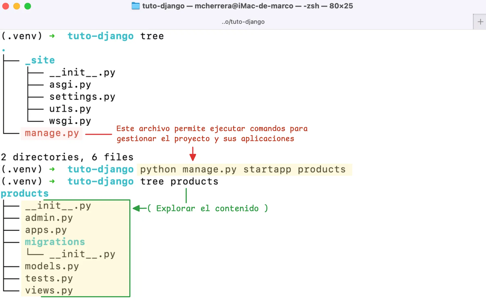
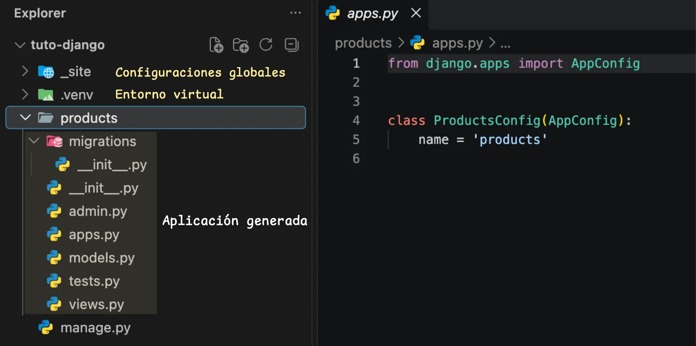

# Introducción a las aplicaciones

Las aplicaciones (*apps*) permiten organizar un proyecto Django en módulos independientes, cada uno responsable de una funcionalidad específica. Un proyecto puede contener varias aplicaciones, facilitando la organización, el mantenimiento y la reutilización del código.

Por ejemplo, una tienda en línea podría organizarse en las siguientes aplicaciones:

| Aplicación | Responsabilidad                       | Comando                              |
| ---------- | ------------------------------------- | ------------------------------------ |
| `accounts` | Gestionar usuarios y autenticación.   | `python manage.py startapp accounts` |
| `products` | Administrar el catálogo de productos. | `python manage.py startapp products` |
| `orders`   | Gestionar pedidos y compras.          | `python manage.py startapp orders`   |
| `payments` | Procesar pagos.                       | `python manage.py startapp payments` |


Aunque cada aplicación tiene una responsabilidad propia, todas pueden integrarse dentro de un mismo proyecto y compartir información cuando sea necesario.

## Crear una aplicación

Cuando necesitas incorporar una nueva funcionalidad al proyecto, puedes crear una aplicación utilizando el comando :octicons-terminal-16: `startapp`, una herramienta que genera automáticamente la estructura básica de archivos y directorios.

Por ejemplo, para desarrollar un módulo que gestione productos, ejecuta el siguiente comando desde el directorio que contiene el archivo :octicons-file-code-16: `manage.py`:

<div id="comando-startapp"></div>

```bash title="Terminal"
(.venv) python manage.py startapp products
```

Este comando genera el directorio `products` con los archivos iniciales para desarrollar la aplicación.


///caption
Creación de la aplicación `products` mediante el comando `startapp`.
///

### Estructura de la aplicación

Al crear la aplicación, se genera un nuevo directorio en la raíz del proyecto, al mismo nivel que el directorio de configuración, con los archivos y subdirectorios iniciales de la aplicación.



### Archivos de la aplicación

| Archivo       | Descripción                               | Finalidad                                                    |
| ------------- | ----------------------------------------- | ------------------------------------------------------------ |
| :octicons-file-code-16: `admin.py`    | Configura Django Admin.                   | Administrar productos desde el panel de administración.      |
| :octicons-file-code-16: `apps.py`     | Define la configuración de la aplicación. | Establecer el nombre y los metadatos de la aplicación.       |
| :octicons-file-code-16: `models.py`   | Define los modelos de datos.              | Representar productos y sus atributos en la base de datos.   |
| :octicons-file-code-16: `tests.py`    | Contiene pruebas automatizadas.           | Verificar el funcionamiento mediante pruebas unitarias.      |
| :octicons-file-code-16: `views.py`    | Define las vistas.                        | Procesar solicitudes y devolver respuestas al usuario.       |
| <span style="white-space: nowrap;">:octicons-file-directory-16: `migrations/`</span> | Almacena las migraciones.                 | Crear, modificar o eliminar estructuras de la base de datos. |

## Registrar una aplicación

Crear una aplicación no la incorpora automáticamente al proyecto. Para que Django la reconozca, debes registrarla en la opción `INSTALLED_APPS` del archivo :octicons-file-code-16: `settings.py`.

<div class="grid" markdown>

```py title="settings.py" hl_lines="7" linenums="33" 
INSTALLED_APPS = [
    # Aplicaciones de Django
    "django.contrib.admin",
    "django.contrib.auth",

    # Aplicaciones propias
    "products"
]
```

```{ .python .no-copy title="Abrir el archivo settings.py" hl_lines="5" }
 myproject
├──  _site
│   ├──  __init__.py
│   ├──  asgi.py
│   ├──  settings.py
│   ├──  urls.py
│   └──  wsgi.py
└──  manage.py
```

</div>

También puedes registrar la clase de configuración definida en `apps.py`:

```py title="settings.py" hl_lines="7"
INSTALLED_APPS = [
    # Aplicaciones de Django
    "django.contrib.admin",
    "django.contrib.auth",

    # Aplicaciones propias
    "products.apps.ProductsConfig"
]
```

???+ info "¿Cuándo utilizar cada opción?"

    Ambas formas son válidas. Registrar la ruta de `AppConfig` resulta útil cuando necesitas definir opciones adicionales para la aplicación.

    El archivo `apps.py` contiene la clase `AppConfig`, que permite definir metadatos y opciones de configuración de la aplicación.

    ```python linenums="1" title="products/apps.py"
    from django.apps import AppConfig


    class ProductsConfig(AppConfig):
        default_auto_field = "django.db.models.BigAutoField"
        name = "products"
        verbose_name = "Productos"
    ```

    En este ejemplo:

    - `default_auto_field` define el tipo de clave primaria automática predeterminada para los modelos.
    - `name` indica la ruta de importación de la aplicación.
    - `verbose_name` establece el nombre legible que se muestra en interfaces como Django Admin.

## Integrar aplicaciones

Las aplicaciones pueden definir sus propias rutas y conectarse con el enrutador principal del proyecto. Para ello, puedes utilizar `include()` en el archivo `urls.py` del proyecto.

<div class="grid" markdown>

```python title="_site/urls.py" hl_lines="2 7"
from django.contrib import admin
from django.urls import include, path

urlpatterns = [
    path("admin/", admin.site.urls),

    path("products/", include("products.urls")),
]
```

```{ .python .no-copy title="Abrir el archivo urls.py" hl_lines="6" }
 myproject
├──  _site
│   ├──  __init__.py
│   ├──  asgi.py
│   ├──  settings.py
│   ├──  urls.py
│   └──  wsgi.py
└──  manage.py
```

</div>

La aplicación debe contar con su propio archivo `urls.py`, donde se definen las rutas correspondientes a sus funcionalidades.

```py title="products/urls.py" hl_lines="1"
from django.urls import path

from . import views

app_name = "products"

urlpatterns = [
    path("", views.product_list, name="list"),
]
```

De esta manera, las rutas de productos quedan agrupadas bajo el prefijo `/products/`, mientras que la aplicación mantiene el control sobre sus propias URLs.

## Reutilizar aplicaciones

Una de las ventajas de Django es que sus aplicaciones pueden diseñarse para reutilizarse en distintos proyectos. Por ejemplo, una aplicación de autenticación, notificaciones o gestión de productos puede empaquetarse y distribuirse como una dependencia.

Para facilitar su reutilización, conviene:

- Mantener una responsabilidad bien definida.
- Evitar dependencias innecesarias del proyecto que la utiliza.
- Documentar su configuración y funcionalidades.
- Incluir pruebas automatizadas.
- Definir correctamente sus dependencias y archivos de distribución.

No todas las aplicaciones necesitan publicarse como paquetes. En muchos proyectos, basta con mantenerlas como módulos internos bien organizados.
