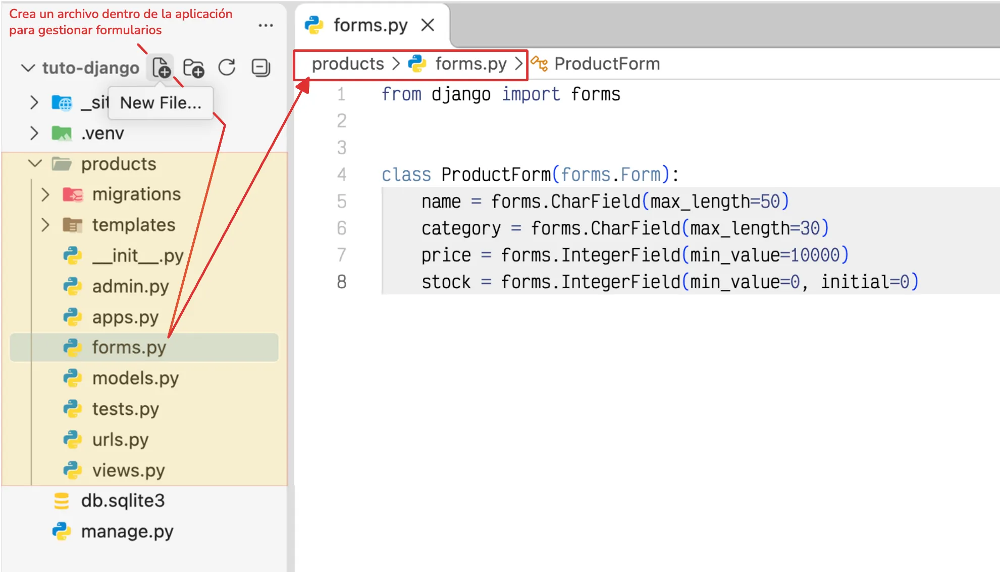
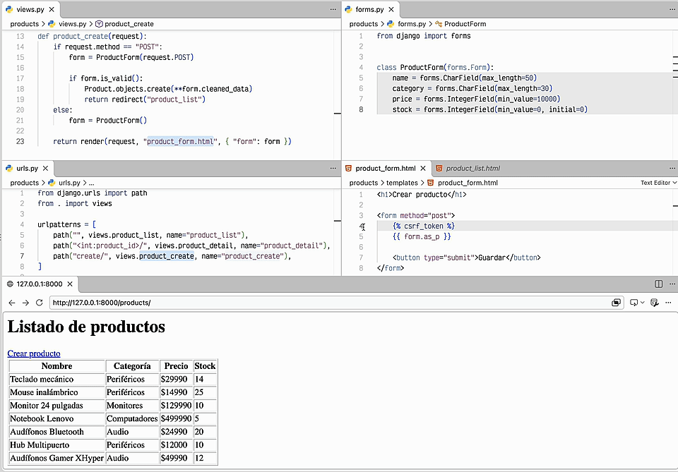
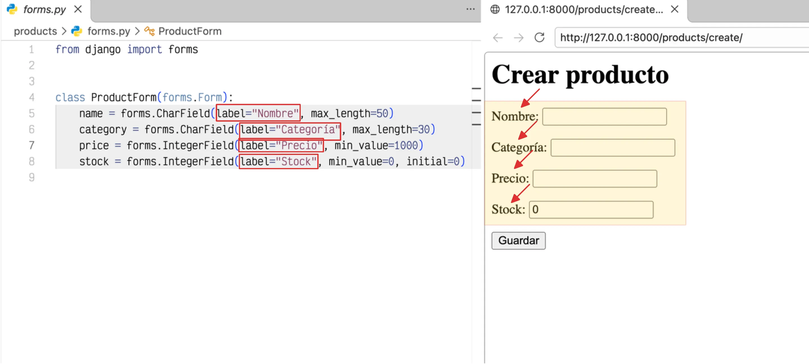

# Introducción a los formularios

Los formularios permiten recopilar, validar y procesar datos enviados por los usuarios. En Django, puedes utilizar formularios para crear registros, actualizar información y comprobar que los datos ingresados cumplan con las reglas definidas por la aplicación.

Por ejemplo, siguiendo con el caso de la tienda, los formularios pueden utilizarse para registrar productos, gestionar pedidos o actualizar los datos de una cuenta.

## Tipos de formularios

Django proporciona el módulo `django.forms` para definir formularios y validar los datos antes de utilizarlos. Para ello, existen dos alternativas principales:

| Tipo | Descripción | Uso habitual |
| ---- | ----------- | ------------ |
| `forms.Form` | Define campos y reglas de validación independientes de los modelos. | Formularios de búsqueda, contacto o filtros. |
| <span style="white-space: nowrap">`forms.ModelForm`</span> | Genera campos a partir de un modelo existente. | Crear y actualizar registros de la base de datos. |

Ambas clases permiten validar datos. La diferencia principal es que `ModelForm` facilita la interacción con los modelos y permite guardar los datos validados directamente en la base de datos.

## Crear un formulario

Para definir un formulario, se debe crear el archivo :octicons-file-code-16: `forms.py` dentro de la aplicación. Django no lo genera automáticamente cuando usas el comando :octicons-terminal-16: `startapp`, por lo que debemos crearlo manualmente desde el editor o con un comando.

=== "Linux/macOS"

    ```bash
    (.venv) touch products/forms.py
    ```

=== "Windows"

    ```powershell
    (.venv) echo.> products/forms.py
    ```

### Crear un formulario con la clase `forms.Form`

Ahora, para recopilar la información de un producto, podemos definir un formulario utilizando los siguientes campos:

```python title="products/forms.py" linenums="1"
from django import forms


class ProductForm(forms.Form):
    name = forms.CharField(max_length=50)
    category = forms.CharField(max_length=30)
    price = forms.IntegerField(min_value=1000)
    stock = forms.IntegerField(min_value=0, initial=0)
```

En este caso, :octicons-package-16: `ProductForm` define 4 campos: un nombre, categoría, precio y stock que se corresponden con los atributos del [modelo :octicons-package-16: `Product`](modelos.md#modelo-product){data-preview}.


/// caption
Crear el archivo `forms.py` y definir un formulario
///

Para mostrar y procesar el formulario, necesitamos una vista que lo envíe a una plantilla, valide los datos recibidos y cree un nuevo registro cuando sean válidos.

```py title="products/views.py" hl_lines="2 6-17" linenums="1" 
from django.shortcuts import render, redirect
from .forms import ProductForm#(1)!
from .models import Product


def product_create(request):
    if request.method == "POST":#(2)!
        form = ProductForm(request.POST)

        if form.is_valid():#(3)!
            Product.objects.create(**form.cleaned_data)
            return redirect("product_list")

    else:
        form = ProductForm()

    return render(request, "product_form.html", { "form": form })

def product_list(request):
    products = Product.objects.all()
    return render(request, "product_list.html", {"products": products})
```

1. Importar la clase del formulario
2. Si la solicitud es por `POST`, se reciben los datos, creando una instancia del formulario con esos datos.
3. Si el formulario es válido en los datos, creamos un nuevo registro y retornamos a la página de productos.

Cuando la solicitud utiliza el método :octicons-paper-airplane-16: `POST` para cargar datos, se crea el formulario con los datos recibidos y se validan mediante el método :octicons-code-16: `is_valid()`. Si son válidos, podemos ejecutar `form.cleaned_data` que proporciona los valores para crear el producto en la base de datos. 

!!! info

    Los datos en la propiedad `form.cleaned_data` vienen en un diccionario con el nombre del campo como clave y el valor ingresado en el formulario como valor, por eso conviene **mantener los nombres de los campos alineados con los atributos del modelo** cuando quieras crear registros directamente con `**form.cleaned_data`.

En caso contrario, o si la solicitud utiliza otro método, se crea una instancia del formulario vacío para mostrarlo.

Ahora creamos esa plantilla dentro de la aplicación:

<div class="grid" markdown>

```html title="products/templates/product_form.html" hl_lines="3-8"
<h1>Formulario de contacto</h1>

<form method="post">
    
    {{ form.as_p }}

    <button type="submit">Enviar</button>
</form>
```

```{ .bash .no-copy title="Archivos de la aplicación" hl_lines="3 5" }
 products
├──  migrations
├──  templates
│   ├──  product_list.html
│   └──  product_form.html
├──  __init__.py
├──  admin.py
├──  apps.py
```

</div>

El formulario utiliza el método `POST` para enviar los datos a la vista. `` agrega el token de seguridad requerido por Django y `{{ form.as_p }}` muestra los campos del formulario dentro de párrafos. El botón permite enviar los datos.

Por último, debemos añadir una ruta en el archivo :octicons-file-code-16: `urls.py` de la aplicación :octicons-file-directory-16: `products` para acceder a la vista que muestra y procesa el formulario.

```py title="products/urls.py" hl_lines="2 7" linenums="1"
from django.urls import path
from . import views

urlpatterns = [
    path("", views.product_list, name="product_list"),
    path("<int:product_id>/", views.product_detail, name="product_detail"),
    path("create/", views.product_create, name="product_create"),
]
```

!!! note "Importante"
    Recuerda que el archivo `products/urls.py` debe estar [incluido en el enrutamiento principal](vistas.md#incluir-las-rutas-de-la-aplicacion-en-el-proyecto){data-preview} del proyecto mediante `include()`.

Para facilitar el acceso al formulario, añadiremos un enlace en el listado de productos que permita registrar nuevos productos. Así, al seleccionarlo, se mostrará el formulario de creación.

```html title="products/templates/product_list.html" linenums="1" hl_lines="3"
<h1>Listado de productos</h1>

<a href="">Crear producto</a>

<table border="1">
    <tr>
        <th>Nombre</th>
        <th>Categoría</th>
        <th>Precio</th>
        <th>Stock</th>
    </tr>
    
        <tr>
            <td>{{ product.name }}</td>
            <td>{{ product.category }}</td>
            <td>${{ product.price }}</td>
            <td>{{ product.stock }}</td>
        </tr>
    
</table>
```


/// caption
Registrar y guardar un producto mediante un formulario
///

Como podemos observar, las etiquetas de los campos se muestran en inglés. Para personalizarlas, podemos utilizar el argumento `label` en cada campo del formulario y definir los nombres en español.

```python title="products/forms.py" linenums="1" hl_lines="5-8"
from django import forms


class ProductForm(forms.Form):
    name = forms.CharField(label="Nombre", max_length=50)
    category = forms.CharField(label="Categoría", max_length=30)
    price = forms.IntegerField(label="Precio", min_value=1000)
    stock = forms.IntegerField(label="Stock", min_value=0, initial=0)
```


/// caption
Cambiando el label del formulario
///

### Crear un formulario con la clase `forms.ModelForm`

En el mismo archivo :octicons-file-code-16: `forms.py`, ahora definimos el formulario basado en el modelo de `Product`:

```python title="products/forms.py" linenums="1"
from django import forms

from .models import Product


class ProductForm(forms.ModelForm):
    class Meta:
        model = Product
        fields = ["name", "category", "price", "stock"]
```

En este ejemplo:

- `ModelForm` crea un formulario asociado a un modelo.
- `model` indica el modelo del que se obtienen los campos.
- `fields` especifica los campos que estarán disponibles en el formulario.

Django genera los campos y aplica las validaciones correspondientes según la definición del modelo, como los tipos de datos, las longitudes máximas y los validadores configurados.

## Utilizar el formulario en una vista

Una vez definido el formulario, podemos utilizarlo en una vista para mostrar los campos, validar los datos enviados y guardar el producto cuando sean válidos.

```python title="products/views.py" linenums="1" hl_lines="2 6 8-10 12"
from django.shortcuts import render, redirect
from .forms import ProductForm


def product_create(request):
    form = ProductForm(request.POST or None)

    if request.method == "POST" and form.is_valid():
        form.save()
        return redirect("products:list")

    return render(request, "product_form.html", { "form": form })
```

El funcionamiento es el siguiente:

1. `ProductForm(request.POST or None)` recibe los datos enviados o crea un formulario vacío.
2. `form.is_valid()` comprueba que los datos cumplan las reglas de validación.
3. `form.save()` guarda el producto en la base de datos si los datos son válidos.
4. `render()` envía el formulario a la plantilla para mostrarlo.

Si los datos no son válidos, Django conserva los valores ingresados y proporciona los errores correspondientes para mostrarlos en la plantilla.

## Mostrar el formulario en una plantilla

Para mostrar los campos del formulario, crea la plantilla `product_form.html` dentro del directorio de plantillas de la aplicación.

```html title="products/templates/products/product_form.html" linenums="1"
<h1>Crear producto</h1>

<form method="post">
    
    {{ form.as_p }}

    <button type="submit">Guardar</button>
</form>
```

En este ejemplo:

- `` incorpora el token de protección contra solicitudes CSRF.
- `{{ form.as_p }}` muestra los campos del formulario dentro de párrafos.
- El botón `Guardar` envía los datos mediante una solicitud `POST`.

Django también permite mostrar los campos individualmente o utilizar otros métodos de representación, lo que facilita personalizar la estructura y el diseño del formulario.

## Validar los datos

Los formularios de Django permiten validar los datos antes de guardarlos. Además de las validaciones derivadas del modelo, puedes definir reglas personalizadas dentro del formulario.

Por ejemplo, para comprobar que el nombre del producto no contenga únicamente espacios, agrega el método `clean_name()` a `ProductForm`:

```python title="products/forms.py" linenums="1" hl_lines="10-11 13-16"
from django import forms
from .models import Product


class ProductForm(forms.ModelForm):
    class Meta:
        model = Product
        fields = ["name", "category", "price", "stock"]

    def clean_name(self):
        name = self.cleaned_data["name"].strip()

        if not name:
            raise forms.ValidationError(
                "El nombre del producto es obligatorio."
            )

        return name
```

El método `clean_name()` se ejecuta durante la validación del campo `name`. La propiedad `cleaned_data` contiene los datos que Django ha procesado y validado, mientras que `forms.ValidationError` permite indicar que un valor no cumple con las reglas definidas.

Cuando la validación falla, Django asocia el error al formulario y evita que se guarde el registro hasta que los datos sean corregidos.

## Resumen

Los formularios permiten separar la recepción y validación de datos de la lógica de las vistas. Para elegir el tipo adecuado, considera lo siguiente:

- Utiliza `forms.Form` cuando necesites definir campos y validaciones sin vincularlos directamente a un modelo.
- Utiliza `forms.ModelForm` cuando el formulario esté relacionado con un modelo y necesites crear o actualizar registros.
- Utiliza `is_valid()` para validar los datos y `save()` para guardar los cambios cuando trabajes con `ModelForm`.
