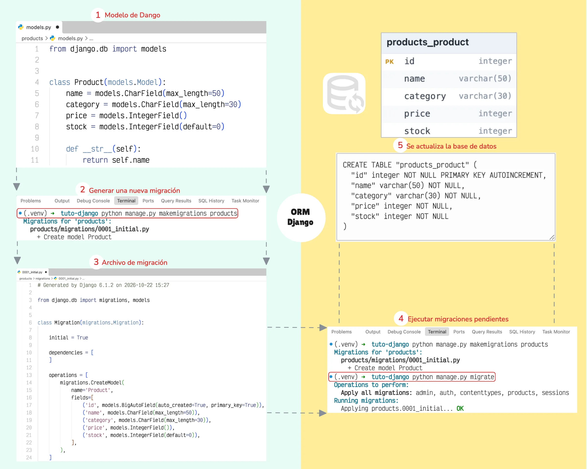
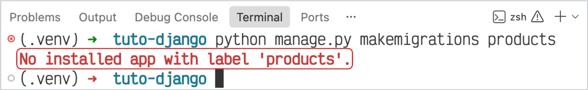

# Introducción a los Modelos en Django

Los modelos son un componente fundamental de las aplicaciones en Django, ya que permiten definir y organizar los datos que estas gestionan. Esto gracias a las clases de Python y el ORM ( *Object-Relational Mapping* ) integrado, establecen la estructura de la información y facilitan su interacción con la base de datos.

En resumen, los modelos de Django son clases que representan la estructura de los datos de una aplicación y permiten interactuar con la base de datos mediante el ORM de Django, sin necesidad de escribir SQL directamente.

## ¿Dónde se definen los Modelos?

Los modelos se definen en el archivo :octicons-file-code-16: `models.py` de una aplicación. Se implementan como subclases de [`django.db.models.Model`](https://github.com/django/django/blob/stable/6.1.x/django/db/models/base.py#L501-L615){:target='_blank'} y pueden incluir **campos**, **métodos**, **metadatos** y **reglas de validación** de los datos antes de guardarlos en la base de datos.

Por ejemplo, dentro de la aplicación :octicons-file-directory-16: `products`, podemos definir un modelo a través de una clase :octicons-package-16: `Product` en el archivo :octicons-file-code-16: `models.py` para representar los productos y sus respectivos campos:

<div id="modelo-product"></div>

```py title="products/models.py"
from django.db import models


class Product(models.Model):
    name = models.CharField(max_length=50)
    category = models.CharField(max_length=30)
    price = models.IntegerField()
    stock = models.IntegerField(default=0)

    def __str__(self):
        return self.name
```

## ¿Qué son las Migraciones?

Las migraciones en Django nos permiten trasladar los cambios definidos en los modelos a la estructura de la base de datos. A través del **ORM**, Django genera archivos de migración que describen las operaciones necesarias para crear o modificar tablas y campos, evitando tener que escribir manualmente las sentencias SQL correspondientes.

El proceso comienza con la definición de un modelo en el archivo :octicons-file-code-16: `models.py`. Luego, mediante el comando :octicons-terminal-16: `python manage.py makemigrations`, Django genera un archivo de migración que registra los cambios realizados en los modelos. Posteriormente, el comando :octicons-terminal-16: `python manage.py migrate` ejecuta las migraciones pendientes y aplica dichos cambios en la base de datos.


/// caption
Flujo de migración del modelo Product en Django
///

Este mecanismo permite mantener sincronizados los modelos de la aplicación con la estructura de la base de datos, facilitando la evolución del sistema y el control de los cambios a lo largo del desarrollo.

???+ warning "La aplicación debe estar registrada"
    Antes de generar las migraciones, asegúrate de registrar la aplicación en `INSTALLED_APPS`, dentro del archivo :octicons-file-code-16: `settings.py`. De lo contrario, Django no reconocerá la aplicación y no podrá detectar sus modelos.

    

!!! tip "Ver más sobre el ORM de Django"
    Para profundizar en el funcionamiento de las migraciones en Django, consulta el siguiente artículo de este mismo sitio: [Shell de Django, Orm y QuersySet](../blog/posts/orm/orm-django.md){data-preview}.

## Campos

Un modelo puede tener un número arbitrario de campos, de diferentes tipo y cada uno representa una columna de datos que queremos almacenar en una tabla de la base de datos.

Por ejemplo, en la aplicación `products`, podemos definir un modelo para representar productos:

```python title="products/models.py" hl_lines="6-10"
from django.db import models


class Product(models.Model):

    # Campos
    name = models.CharField(max_length=50)
    category = models.CharField(max_length=50)
    price = models.IntegerField()
    stock = models.PositiveIntegerField(default=0)

    def __str__(self):
        return self.name
```

En este modelo, `name`, `category`, `price` y `stock` son campos que representan los atributos de cada producto. Django utiliza sus definiciones para determinar los tipos de datos y las restricciones ( *constraints* ) correspondientes en la base de datos.

### Tipos de campos

Django proporciona diferentes clases de campos según el tipo de información que se necesita almacenar.

| Campo                                                                                                                          | Descripción                                     | Input en el formulario |
| ------------------------------------------------------------------------------------------------------------------------------ | ----------------------------------------------- | ---------------------- |
| [`CharField`](https://docs.djangoproject.com/en/6.1/ref/models/fields/?utm_source=chatgpt.com#charfield)                       | Texto corto, como nombres o categorías.         | `text`                 |
| [`TextField`](https://docs.djangoproject.com/en/6.1/ref/models/fields/?utm_source=chatgpt.com#textfield)                       | Texto extenso, como descripciones.              | `textarea`             |
| [`IntegerField`](https://docs.djangoproject.com/en/6.1/ref/models/fields/?utm_source=chatgpt.com#integerfield)                 | Números enteros.                                | `number`               |
| [`PositiveIntegerField`](https://docs.djangoproject.com/en/6.1/ref/models/fields/?utm_source=chatgpt.com#positiveintegerfield) | Números enteros no negativos.                   | `number`               |
| [`DecimalField`](https://docs.djangoproject.com/en/6.1/ref/models/fields/?utm_source=chatgpt.com#decimalfield)                 | Números decimales con precisión definida.       | `number`               |
| [`FloatField`](https://docs.djangoproject.com/en/6.1/ref/models/fields/?utm_source=chatgpt.com#floatfield)                     | Números de punto flotante.                      | `number`               |
| [`BooleanField`](https://docs.djangoproject.com/en/6.1/ref/models/fields/?utm_source=chatgpt.com#booleanfield)                 | Valores booleanos: `True` o `False`.            | `checkbox`             |
| [`DateField`](https://docs.djangoproject.com/en/6.1/ref/models/fields/?utm_source=chatgpt.com#datefield)                       | Fechas sin hora.                                | `date`                 |
| [`DateTimeField`](https://docs.djangoproject.com/en/6.1/ref/models/fields/?utm_source=chatgpt.com#datetimefield)               | Fechas con hora.                                | `datetime-local`       |
| [`EmailField`](https://docs.djangoproject.com/en/6.1/ref/models/fields/?utm_source=chatgpt.com#emailfield)                     | Direcciones de correo electrónico.              | `email`                |
| [`URLField`](https://docs.djangoproject.com/en/6.1/ref/models/fields/?utm_source=chatgpt.com#urlfield)                         | Direcciones URL.                                | `url`                  |
| [`SlugField`](https://docs.djangoproject.com/en/6.1/ref/models/fields/?utm_source=chatgpt.com#slugfield)                       | Identificadores de texto adecuados para URL.    | `text`                 |
| [`UUIDField`](https://docs.djangoproject.com/en/6.1/ref/models/fields/?utm_source=chatgpt.com#uuidfield)                       | Identificadores únicos de tipo UUID.            | `text`                 |
| [`ForeignKey`](https://docs.djangoproject.com/en/6.1/ref/models/fields/?utm_source=chatgpt.com#foreignkey)                     | Relación con otro modelo.                       | `select`               |
| [`FileField`](https://docs.djangoproject.com/en/6.1/ref/models/fields/?utm_source=chatgpt.com#filefield)                       | Archivos.                                       | `file`                 |
| [`ImageField`](https://docs.djangoproject.com/en/6.1/ref/models/fields/?utm_source=chatgpt.com#imagefield)                     | Imágenes, con validación del formato de imagen. | `file`                 |

### Atributos comunes de los campos

Los campos admiten argumentos que permiten establecer restricciones, valores predeterminados y opciones de presentación.

| Atributo       | Descripción                                               | Ejemplo                                        |
| -------------- | --------------------------------------------------------- | ---------------------------------------------- |
| `max_length`   | Longitud máxima del texto.                                | `max_length=100`                               |
| `null`         | Permite almacenar `NULL` en la base de datos.             | `null=True`                                    |
| `blank`        | Permite dejar el campo vacío durante la validación.       | `blank=True`                                   |
| `default`      | Define el valor predeterminado del campo.                 | `default=0`                                    |
| `unique`       | Exige que el valor sea único.                             | `unique=True`                                  |
| `primary_key`  | Define el campo como clave primaria.                      | `primary_key=True`                             |
| `db_index`     | Solicita un índice para facilitar determinadas consultas. | `db_index=True`                                |
| `choices`      | Limita las opciones disponibles a un conjunto definido.   | `choices=[("A", "Activo"), ("I", "Inactivo")]` |
| `validators`   | Permite agregar funciones de validación.                  | `validators=[MinValueValidator(1)]`            |
| <span style="white-space: pre">`verbose_name`</span> | Define un nombre descriptivo para el campo.               | `verbose_name="Nombre del producto"`           |
| `help_text`    | Proporciona información de ayuda para formularios.        | `help_text="Introduce el nombre del producto"` |

???+ info
    Los ejemplos muestran valores habituales para cada atributo. Para utilizar `MinValueValidator`, debes importarlo desde `django.core.validators`.

    ```python
    from django.core.validators import MinValueValidator
    ```

!!! example "Ejemplo de configuración"

    ```python
    name = models.CharField(
        max_length=100,
        unique=True,
        verbose_name="Nombre del producto",
        help_text="Introduce el nombre del producto.",
    )
    ```

    En este caso, el nombre admite hasta 100 caracteres y no puede repetirse entre los registros. Los argumentos `verbose_name` y `help_text` proporcionan información descriptiva para las interfaces que utilizan estos metadatos.

### Diferencia entre `null` y `blank`

Aunque ambos atributos permiten representar la ausencia de un valor en determinados contextos, cumplen funciones distintas.

| Configuración | Efecto |
|---|---|
| `null=True` | Permite almacenar `NULL` en la base de datos. |
| `blank=True` | Permite dejar el campo vacío durante la validación. |
| `default=0` | Asigna `0` cuando no se proporciona un valor. |

Por ejemplo:

```python
description = models.TextField(blank=True)
```

La descripción puede omitirse en los formularios que respetan la validación del modelo. Sin embargo, esto no significa que la base de datos almacene necesariamente `NULL`.

En campos de texto, normalmente se recomienda utilizar `blank=True` sin `null=True` para representar valores vacíos de manera consistente.

## Opciones de los modelos

Además de los campos, Django permite configurar el comportamiento general de un modelo mediante la clase interna `Meta`.

```python title="models.py"
class Product(models.Model):
    name = models.CharField(max_length=100)
    price = models.DecimalField(max_digits=10, decimal_places=2)

    class Meta:
        ordering = ["name"]
        verbose_name = "Producto"
        verbose_name_plural = "Productos"
```

| Opción | Descripción |
|---|---|
| `ordering` | Establece el orden predeterminado de los resultados. |
| `verbose_name` | Define el nombre descriptivo del modelo. |
| `verbose_name_plural` | Define el nombre descriptivo en plural. |
| `db_table` | Especifica el nombre de la tabla en la base de datos. |
| `constraints` | Define restricciones a nivel de base de datos. |
| `indexes` | Permite declarar índices para las consultas. |

Estas opciones permiten controlar aspectos como la presentación, el orden de los registros y determinadas características de la estructura de la base de datos.

## Validación de datos

Los modelos también permiten definir reglas para comprobar que los datos cumplen determinadas condiciones. Django ofrece validadores integrados y permite implementar validaciones personalizadas.

Por ejemplo, podemos exigir que el precio sea mayor que cero y que el stock no admita números negativos:

```python
from django.core.validators import MinValueValidator
from django.db import models


class Product(models.Model):
    name = models.CharField(max_length=100)
    price = models.DecimalField(
        max_digits=10,
        decimal_places=2,
        validators=[MinValueValidator(0.01)],
    )
    stock = models.PositiveIntegerField(default=0)
```

`MinValueValidator(0.01)` establece una validación para impedir precios inferiores a `0.01` cuando se ejecuta el proceso de validación del campo.

Para reglas que dependen de varios atributos, se puede implementar el método `clean()`:

```python
def clean(self):
    super().clean()

    if self.stock > 0 and not self.name:
        raise ValidationError(
            "El producto debe tener un nombre."
        )
```

Para utilizar `ValidationError`, es necesario importarlo desde `django.core.exceptions`. El método `clean()` debe adaptarse a las reglas reales del modelo.

**Importante:** definir validaciones en un modelo no significa que se ejecuten automáticamente al llamar a `save()`. Para ejecutar el proceso completo de validación del modelo se utiliza `full_clean()`, o se delega esa responsabilidad a mecanismos como los formularios de Django.

## Relaciones entre modelos

Los modelos pueden relacionarse para representar asociaciones entre entidades. Django proporciona tres tipos principales de relaciones.

| Campo | Relación | Ejemplo |
|---|---|---|
| `ForeignKey` | Muchos a uno | Muchos productos pertenecen a una categoría. |
| `OneToOneField` | Uno a uno | Un usuario tiene un perfil. |
| `ManyToManyField` | Muchos a muchos | Muchos productos pertenecen a varias etiquetas. |

Por ejemplo, podemos separar las categorías de los productos mediante `ForeignKey`:

```python
class Category(models.Model):
    name = models.CharField(max_length=50)

    def __str__(self):
        return self.name


class Product(models.Model):
    name = models.CharField(max_length=100)
    category = models.ForeignKey(
        Category,
        on_delete=models.PROTECT,
        related_name="products",
    )
```

En este caso, cada producto pertenece a una categoría y una categoría puede estar asociada a varios productos. La opción `on_delete=models.PROTECT` impide eliminar una categoría mientras existan productos relacionados con ella.

???+ success "Actualizar migraciones"

    Para que los cambios en los modelos se reflejen en la base de datos, recuerda actualizar las migraciones de Django:

    ```bash title="Terminal"
    python manage.py makemigrations
    python manage.py migrate
    ```
