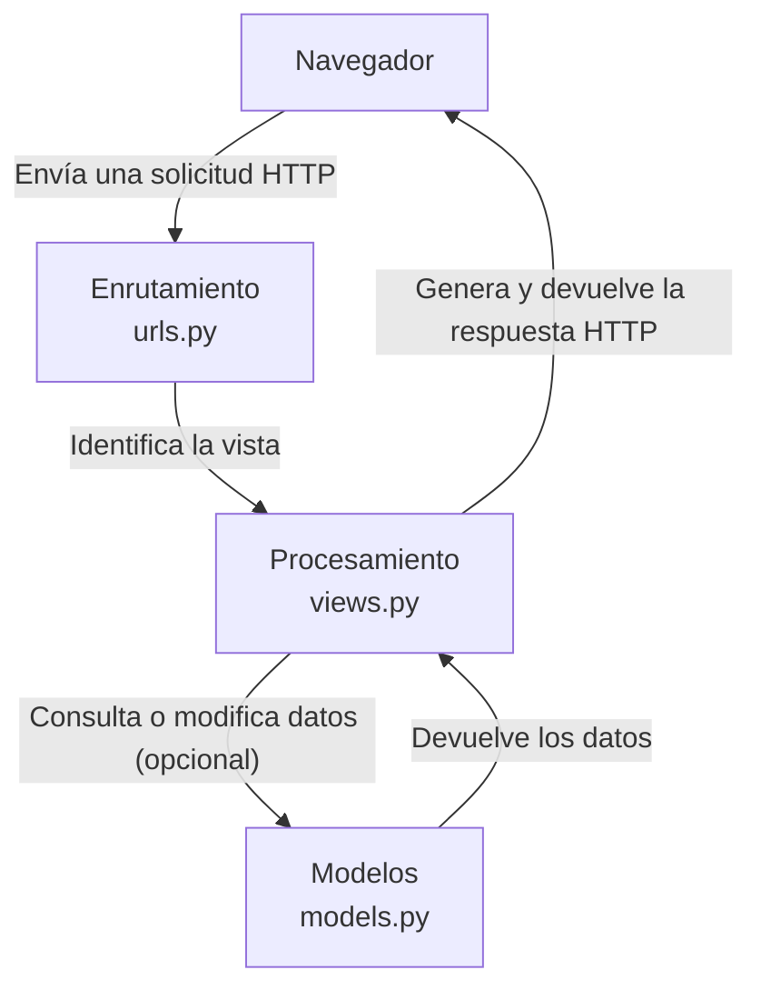
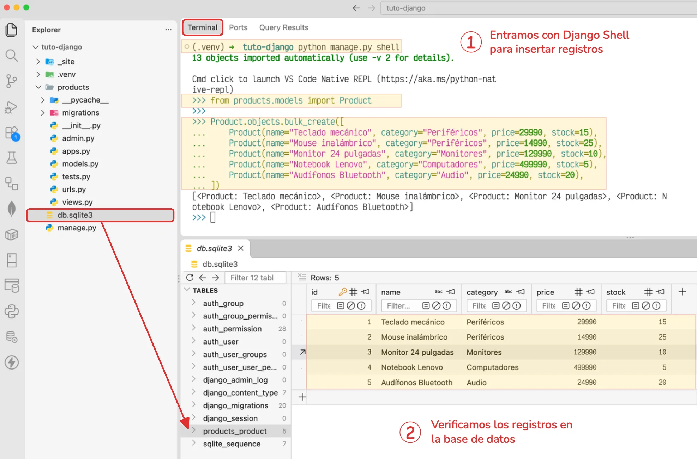
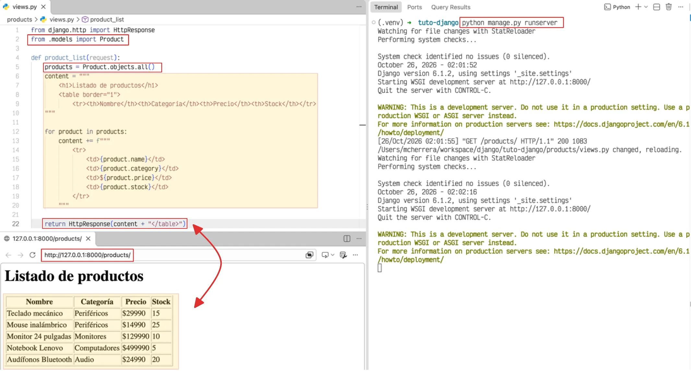
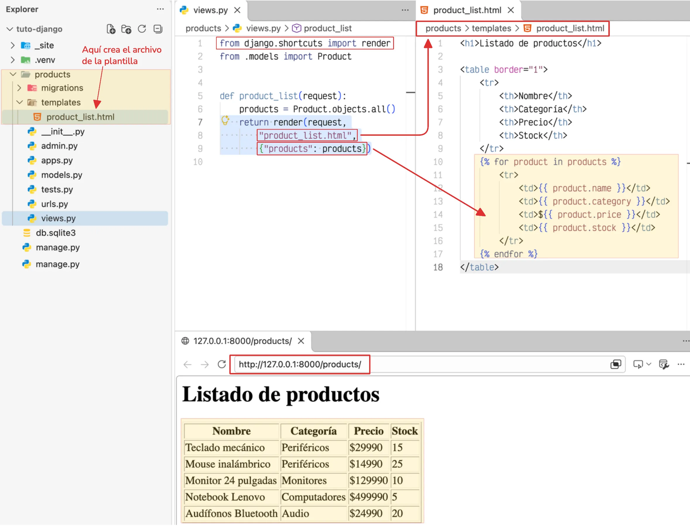
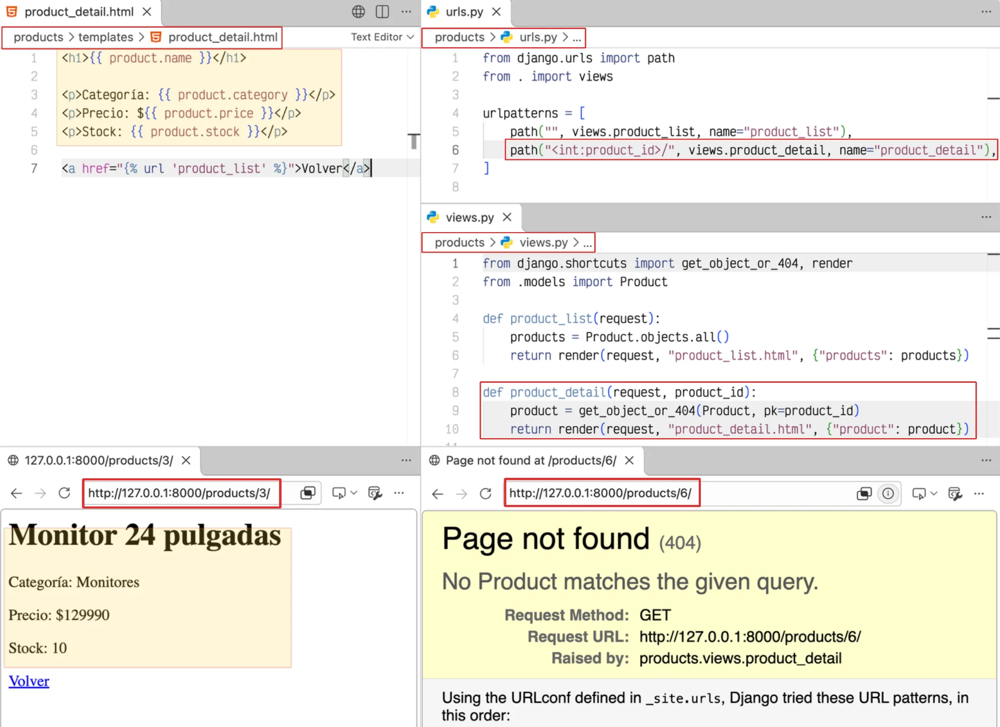

# Introducción a las vistas de Django

Las vistas son un componente fundamental en el patrón de arquitectura de Django, ya que procesan las solicitudes HTTP y determinan la respuesta que recibirá el usuario. Mediante funciones o clases de Python, permiten consultar datos, ejecutar operaciones y devolver contenido HTML, JSON u otros tipos de respuesta.

## ¿Cómo funcionan las vistas?

Cuando un usuario accede a una página, Django recibe una solicitud HTTP y busca la ruta correspondiente en la configuración de URLs. Una vez identificada, ejecuta la vista asociada, que procesa la solicitud y devuelve una respuesta al navegador.

Para procesar una petición HTTP y generar una respuesta, intervienen los siguientes componentes:



En este proceso, cada componente cumple una función específica:

- **`urls.py`:** determina qué vista debe atender la solicitud según la URL solicitada.
- **`views.py`:** ejecuta la lógica necesaria para procesar la solicitud.
- **`models.py`:** permite consultar o modificar los datos almacenados en la base de datos cuando es necesario.
- **Respuesta HTTP:** contiene el resultado que Django devuelve al navegador, como una página HTML o datos en formato JSON.

!!!info

    Una vista no necesita consultar un modelo en todos los casos. Puede devolver una respuesta directamente, utilizar una plantilla para generar contenido HTML o redirigir a otra página. Por ejemplo, una vista para cerrar la sesión del usuario.

    ```py title="views.py"
    from django.contrib.auth import logout
    from django.shortcuts import redirect

    def logout_view(request):
        logout(request)
        return redirect("login")#(1)!
    ```

    1. `redirect()` utiliza el nombre de la ruta (`name`) definido en `urls.py`, no el nombre de la función de la vista. Por ejemplo:
    ```py
    path("login/", views.login_view, name="login")
    ```

## ¿Dónde se definen las vistas?

Las vistas se definen en el archivo :octicons-file-code-16: `views.py` de una aplicación. Reciben un objeto :octicons-package-16: `HttpRequest` y devuelven un objeto :octicons-package-16: `HttpResponse` o alguna de sus variantes.

Por ejemplo, dentro de la aplicación `products`, podemos definir una vista mediante una función (:material-function:) llamada `product_list` en el archivo :octicons-file-code-16: `views.py`:

<div id="product-view"></div>

```{ .python title="products/views.py" hl_lines="1 5" linenums="1" }
from django.http import HttpResponse


def product_list(request):
    return HttpResponse("<h1>Listado de productos</h1>")
```

En este caso, la vista recibe la solicitud y devuelve una respuesta HTTP con un encabezado HTML y el texto indicado.

### Respuestas HTTP

Django proporciona diferentes clases y funciones para generar respuestas según el contenido que se necesita entregar.

| Clase o función | Descripción |
|---|---|
| `HttpResponse` | Devuelve contenido directamente en la respuesta. |
| `render()` | Renderiza una plantilla HTML con un contexto de datos. |
| `redirect()` | Redirige al usuario hacia otra URL. |
| `JsonResponse` | Devuelve datos en formato JSON. |
| `HttpResponseNotFound` | Devuelve una respuesta con estado HTTP 404. |

Sin embargo, definir la vista no es suficiente; también debemos conectarla con el sistema de enrutamiento de la aplicación.

---

## ¿Dónde se conectan las vistas?

Las vistas se conectan con las URL mediante el archivo `urls.py` de la aplicación, donde se define qué vista debe ejecutarse cuando un usuario accede a una ruta determinada.

Por ejemplo, en la aplicación :octicons-file-directory-16: `products`, podemos asociar una vista `product_list` con un ruta principal dentro del archivo :octicons-file-code-16: `urls.py`. Para ello:

### Crea un archivo `urls.py` dentro de la aplicación

Este archivo **no se genera automáticamente** al utilizar el comando :octicons-terminal-16: [`startapp`](aplicaciones.md#comando-startapp){data-preview} y se debe crear el archivo manualmente desde el editor o con un comando.

=== "Linux/macOS"

    ```bash
    (.venv) touch products/urls.py
    ```

=== "Windows"

    ```powershell
    (.venv) echo.> products/urls.py
    ```

Después, se definen las rutas en este archivo y se vinculan con sus respectivas vistas.

```py title="products/urls.py" hl_lines="1 2 5"  linenums="1"
from django.urls import path
from . import views

urlpatterns = [
    path("", views.product_list, name="product_list"),#(1)!
]
```

1. La función `path()` recibe tres argumentos principales:  
\- `route`: define la ruta URL que se desea reconocer.  
\- `view`: indica la vista que se ejecutará cuando la URL coincida. 
\- `name`: se usa para referenciar en otras partes del proyecto.

En este caso, `path()` recibe la ruta, la vista que debe ejecutarse y un nombre para identificarla. Cuando un usuario accede a la ruta raíz, Django ejecuta la vista [`product_list`](#product-view){data-preview}.


### Incluir las rutas de la aplicación en el proyecto

Ahora tenemos definida una ruta en la aplicación, pero debemos incluirla en el enrutamiento principal del proyecto para que Django pueda reconocerla.

```python title="_site/urls.py" hl_lines="2 6"
from django.contrib import admin
from django.urls import include, path #(1)!

urlpatterns = [
    path("admin/", admin.site.urls),
    path("products/", include("products.urls")),#(2)!
]
```

1. importamos `include()` para conectar las rutas de `products/urls.py` al enrutamiento principal, bajo la URL `/products/`.
2. `include()`: recibe el módulo que contiene las rutas que queremos incorporar al enrutamiento principal.

Se utiliza `include()` para mantener las rutas de cada aplicación separadas y organizadas, evitando tener que definirlas todas en el archivo principal del proyecto.

Así, al acceder a `/products/`, Django dirige la solicitud a la ruta raíz de la aplicación, que es procesada por la vista `product_list` de la aplicación `products`.


<div class="grid cards" markdown>

- :material-file-code-outline: &nbsp; **1. Incluir las rutas de la aplicación**

    ---

    En `_site/urls.py`, se utiliza `include()` para conectar las rutas de `products`.

- :material-link-variant: &nbsp; **2. Asociar la ruta con una vista**

    ---

    En `products/urls.py`, `path()` vincula la URL con la vista `product_list`.

- :material-eye-outline: &nbsp; **3. Definir la vista**

    ---

    En `products/views.py`, `product_list` devuelve el contenido HTML mediante `HttpResponse`.

- :material-console: &nbsp; **4. Ejecutar el servidor**

    ---

    El comando `python manage.py runserver` inicia el servidor de desarrollo.

- :material-web: &nbsp; **5. Acceder a la ruta principal**

    ---

    Al visitar `http://127.0.0.1:8000/`, Django muestra un error 404 porque la ruta no está definida.

- :material-check-circle-outline: &nbsp; **6. Visualizar el resultado**

    ---

    Al visitar `http://127.0.0.1:8000/products/`, se muestra la respuesta que contiene HTML.

</div>

---

## Enviar datos en una respuesta

Las vistas pueden consultar los datos almacenados en la base de datos mediante los modelos y construir una respuesta HTTP generando contenido HTML dinámicamente a partir de esos datos. Por ejemplo, podemos registrar cinco productos en la base de datos utilizando el ORM a través del Shell de Django:

???+ example "Ejemplo: inserción de datos con el ORM"

    === ":octicons-code-16: Código Python"

        ```py
        from products.models import Product

        Product.objects.bulk_create([
            Product(name="Teclado mecánico", category="Periféricos", price=29990, stock=15),
            Product(name="Mouse inalámbrico", category="Periféricos", price=14990, stock=25),
            Product(name="Monitor 24 pulgadas", category="Monitores", price=129990, stock=10),
            Product(name="Notebook Lenovo", category="Computadores", price=499990, stock=5),
            Product(name="Audífonos Bluetooth", category="Audio", price=24990, stock=20),
        ])
        ```

    === ":octicons-terminal-16: Shell Django"

        ```{ .python .no-copy hl_lines="1 5 7-13" }
        --8<-- "snippets/outputs/django-shell.txt"
        >>> from products.models import Product
        >>> 
        >>> Product.objects.bulk_create([
        ...     Product(name="Teclado mecánico", category="Periféricos", price=29990, stock=15),
        ...     Product(name="Mouse inalámbrico", category="Periféricos", price=14990, stock=25),
        ...     Product(name="Monitor 24 pulgadas", category="Monitores", price=129990, stock=10),
        ...     Product(name="Notebook Lenovo", category="Computadores", price=499990, stock=5),
        ...     Product(name="Audífonos Bluetooth", category="Audio", price=24990, stock=20),
        ... ])
        [<Product: Teclado mecánico>, <Product: Mouse inalámbrico>, <Product: Monitor 24 pulgadas>, <Product: N
        otebook Lenovo>, <Product: Audífonos Bluetooth>]
        >>> exit()
        ```


///caption
Insertar datos con Django Shell
///

Ahora se puede importar el modelo `Product` y utilizar `Product.objects.all()` para construir el contenido de la respuesta en la vista.

```python title="products/views.py" hl_lines="2 6-11 13-21 23" linenums="1"
from django.http import HttpResponse
from .models import Product


def product_list(request):
    products = Product.objects.all()
    content = """
        <h1>Listado de productos</h1>
        <table border="1">
            <tr><th>Nombre</th><th>Categoría</th><th>Precio</th><th>Stock</th></tr>
    """

    for product in products:
        content += f"""
            <tr>
                <td>{product.name}</td>
                <td>{product.category}</td>
                <td>${product.price}</td>
                <td>{product.stock}</td>
            </tr>
        """

    return HttpResponse(content + "</table>")
```

En este ejemplo, la vista obtiene todos los registros del modelo :octicons-package-16: `Product` y genera una tabla HTML con los nombres de los campos en la cabecera y los datos de cada producto en sus respectivas filas.


///caption
Visualización de los datos de los productos en una tabla HTML.
///

Sin embargo, construir HTML directamente en Python dificulta el mantenimiento y la separación entre la lógica y la presentación. Para solucionar esto, Django permite utilizar plantillas HTML y enviarles los datos desde las vistas mediante la función `render()`.

## Renderizar datos en una plantilla con `render`

En lugar de generar el HTML directamente en el código Python, es habitual utilizar la función `render()` para cargar una plantilla HTML con los datos que necesita mostrar.

Por ejemplo, podemos modificar la vista para que entregue un listado de productos a una plantilla:

```python title="products/views.py" hl_lines="1 7" linenums="1"
from django.shortcuts import render
from .models import Product


def product_list(request):
    products = Product.objects.all()
    return render(request, "product_list.html", {"products": products})
```

En este ejemplo, `render()` recibe la solicitud, la ruta de la plantilla y un diccionario con los datos que estarán disponibles para su representación.

Esta plantilla debe crearse en la siguiente ruta:

```{ .bash .no-copy title="Archivos del proyecto" hl_lines="5 6 7" }
 proyecto
├──  _site
├──  products
│   ├──  migrations
│   ├──  templates
│   │   └──  products
│   │       └──  product_list.html
│   ├──  __init__.py
│   ├──  admin.py
│   ├──  apps.py
│   ├──  models.py
│   ├──  tests.py
│   └──  views.py
├──  .venv
└──  manage.py
```

Dentro del archivo, lo dejamos de la siguiente manera:

```html title="products/templates/product_list.html" linenums="1"
<h1>Listado de productos</h1>

<table border="1">
    <tr>
        <th>Nombre</th>
        <th>Categoría</th>
        <th>Precio</th>
        <th>Stock</th>
    </tr>
    
        <tr>
            <td>{{ product.name }}</td>
            <td>{{ product.category }}</td>
            <td>${{ product.price }}</td>
            <td>{{ product.stock }}</td>
        </tr>
    
</table>
```

Gracias al [motor de plantillas de Django](https://docs.djangoproject.com/es/6.1/topics/templates/){:target='_blank'} podemos combinar HTML con etiquetas y expresiones especiales para generar contenido dinámico.

- ``: recorre la lista de productos recibida desde la vista y genera una fila por cada registro.
- `{{ }}`: muestra los valores de los campos de cada producto, como su nombre, categoría, precio y stock.

De esta forma, la plantilla define la estructura HTML y Django incorpora los datos al generar la respuesta.


///caption
Visualización de los datos de los productos desde un template.
///

---

## Recibir parámetros desde la URL

Django permite recibir datos directamente desde la URL y utilizarlos en las vistas para realizar operaciones específicas. Para ello, se definen parámetros en las rutas que luego se reciben como argumentos en la función o método de la vista.

Por ejemplo, podemos recibir el identificador de un producto para consultar sus datos.

```python title="products/urls.py" linenums="1" hl_lines="6"
from django.urls import path
from . import views

urlpatterns = [
    path("", views.product_list, name="product_list"),
    path("<int:product_id>/", views.product_detail, name="product_detail"),
]
```

En este caso, `<int:product_id>` indica que la URL debe contener un número entero, que Django entregará a la vista como argumento `product_id`.


```python title="products/views.py" linenums="1" hl_lines="1 8-10"
from django.shortcuts import get_object_or_404, render
from .models import Product

def product_list(request):
    products = Product.objects.all()
    return render(request, "product_list.html", {"products": products})

def product_detail(request, product_id):
    product = get_object_or_404(Product, pk=product_id)#(1)!
    return render(request, "product_detail.html", {"product": product})
```

1. **`get_object_or_404()`** recibe dos argumentos principales:  
**`Product`**: el modelo en el que se buscará el registro.  
**`pk=product_id`**: `pk` es la clave primaria del registro y `product_id` es el valor recibido desde la URL.

La vista utiliza ese identificador recibido para buscar el producto y enviar sus datos a la plantilla. Si el registro no existe, `get_object_or_404()` devuelve una respuesta HTTP 404.

El archivo de plantilla `product_detail.html`. Muestra los datos de un producto específico:

<div class="grid" markdown>

```html title="products/templates/product_detail.html"
<h1>{{ product.name }}</h1>

<p>Categoría: {{ product.category }}</p>
<p>Precio: ${{ product.price }}</p>
<p>Stock: {{ product.stock }}</p>

<a href="">Volver</a>
```

```{ .bash .no-copy title="Archivos de la aplicación" hl_lines="5" }
 products
├──  migrations
├──  templates
│   ├──  product_list.html
│   └──  product_detail.html
├──  __init__.py
├──  admin.py
```

</div>

Por ejemplo, al acceder a `/products/3/`, se buscará el producto con identificador `3`. Si no existe un producto con el identificador indicado, se devolverá una respuesta HTTP 404.


/// caption
Visualización del detalle de un producto y respuesta 404 cuando el registro no existe.
///

---

## Vistas basadas en clases

Django permite definir vistas mediante clases ( *Class-Based Views* o CBV ), que facilitan la reutilización de código y ofrecen funcionalidades genéricas para operaciones CRUD.

Por ejemplo, para el mantenedor de productos, podemos utilizar las siguientes vistas genéricas:

| Clase | Operación | Descripción |
|---|---|---|
| `ListView` | Listar | Muestra todos los productos registrados. |
| `DetailView` | Consultar | Muestra los datos de un producto específico. |
| `CreateView` | Crear | Permite registrar un producto mediante un formulario. |
| `UpdateView` | Actualizar | Permite modificar un producto existente. |
| `DeleteView` | Eliminar | Permite eliminar un producto. |

### Implementación

En el archivo `views.py`, definimos una clase para cada operación:

```python linenums="1" title="products/views.py" hl_lines="1-4 8-11 13-15 17-21 23-27 29-32"
from django.urls import reverse_lazy
from django.views.generic import (
    ListView, DetailView, CreateView, UpdateView, DeleteView
)
from .models import Product


class ProductListView(ListView):
    model = Product
    template_name = "product_list.html"
    context_object_name = "products"

class ProductDetailView(DetailView):
    model = Product
    template_name = "product_detail.html"

class ProductCreateView(CreateView):
    model = Product
    fields = ["name", "category", "price", "stock"]
    template_name = "product_form.html"
    success_url = reverse_lazy("product_list")

class ProductUpdateView(UpdateView):
    model = Product
    fields = ["name", "category", "price", "stock"]
    template_name = "product_form.html"
    success_url = reverse_lazy("product_list")

class ProductDeleteView(DeleteView):
    model = Product
    template_name = "product_confirm_delete.html"
    success_url = reverse_lazy("product_list")
```

En este ejemplo:

- `model` indica el modelo que se utilizará
- `template_name` especifica la plantilla
- `fields` define los campos incluidos en los formularios de creación y edición
- `success_url` establece la dirección a la que se redirige al completar una operación.

### Configurar las rutas

En el archivo `urls.py` de la aplicación, asociamos cada vista con una URL:

```python title="products/urls.py" linenums="1" hl_lines="2-5 8-12"
from django.urls import path
from .views import (
    ProductListView, ProductDetailView, ProductCreateView,
    ProductUpdateView, ProductDeleteView
)

urlpatterns = [
    path("", ProductListView.as_view(), name="product_list"),
    path("<int:pk>/", ProductDetailView.as_view(), name="product_detail"),
    path("create/", ProductCreateView.as_view(), name="product_create"),
    path("<int:pk>/update/", ProductUpdateView.as_view(), name="product_update"),
    path("<int:pk>/delete/", ProductDeleteView.as_view(), name="product_delete"),
]
```

El método `as_view()` permite utilizar una clase como vista de Django. El parámetro `pk` identifica el producto que se desea consultar, modificar o eliminar.

Para completar el ejemplo del CRUD, puedes reutilizar `product_form.html` para crear y actualizar productos, ya que `CreateView` y `UpdateView` generan un formulario a partir de los mismos campos del modelo. Las otras operaciones tendrán sus propias plantillas.

### Estructura de las plantillas

```{ .bash .no-copy title="Plantillas de la aplicación productos" }
 products
└──  templates
    ├──  product_list.html
    ├──  product_detail.html
    ├──  product_form.html
    └──  product_confirm_delete.html
```

### 1. Listar productos

Archivo `product_list.html`. Muestra todos los productos y permite acceder a las demás operaciones del CRUD.

```html title="products/templates/product_list.html" linenums="1"
<h1>Listado de productos</h1>

<a href="">Crear producto</a>

<table border="1">
    <tr>
        <th>Nombre</th>
        <th>Categoría</th>
        <th>Precio</th>
        <th>Stock</th>
        <th>Acciones</th>
    </tr>
    
        <tr>
            <td>{{ product.name }}</td>
            <td>{{ product.category }}</td>
            <td>${{ product.price }}</td>
            <td>{{ product.stock }}</td>
            <td>
                <a href="">Ver</a>
                <a href="">Editar</a>
                <a href="">Eliminar</a>
            </td>
        </tr>
    
</table>
```

### 2. Consultar un producto

Archivo `product_detail.html`. Muestra los datos de un producto específico.

```html title="products/templates/product_detail.html" linenums="1"
<h1>{{ product.name }}</h1>

<p>Categoría: {{ product.category }}</p>
<p>Precio: ${{ product.price }}</p>
<p>Stock: {{ product.stock }}</p>

<a href="">Volver</a>
```

### 3. Crear y actualizar productos

Archivo `product_form.html`. Esta misma plantilla sirve para ambas operaciones: Django genera el formulario vacío al crear un producto y lo rellena con los datos existentes al editarlo.

```html title="products/templates/product_form.html" linenums="1"
<h1>{{ view.title|default:"Producto" }}</h1>

<form method="post">
    
    {{ form.as_p }}
    <button type="submit">Guardar</button>
</form>

<a href="">Cancelar</a>
```

No necesitas definir `view.title` en las clases; para evitar depender de ese atributo, puedes utilizar simplemente `<h1>Producto</h1>` como título.

### 4. Eliminar un producto

Archivo `product_confirm_delete.html`. Solicita confirmación antes de eliminar el registro.

```html title="products/templates/product_confirm_delete" linenums="1"
<h1>Eliminar producto</h1>

<p>¿Deseas eliminar "{{ product }}"?</p>

<form method="post">
    
    <button type="submit">Confirmar eliminación</button>
</form>

<a href="">Cancelar</a>
```

## ¿Qué aprovechamos de Django?

- `ListView` y `DetailView` consultan los registros automáticamente.
- `CreateView` y `UpdateView` generan y procesan formularios utilizando el modelo `Product`.
- Ambas vistas comparten `product_form.html`, evitando duplicar la plantilla.
- `DeleteView` gestiona la confirmación y eliminación del registro mediante una solicitud `POST`.

Así puedes implementar un CRUD funcional reutilizando las funcionalidades genéricas de Django y escribiendo menos código que si gestionaras cada operación manualmente.
