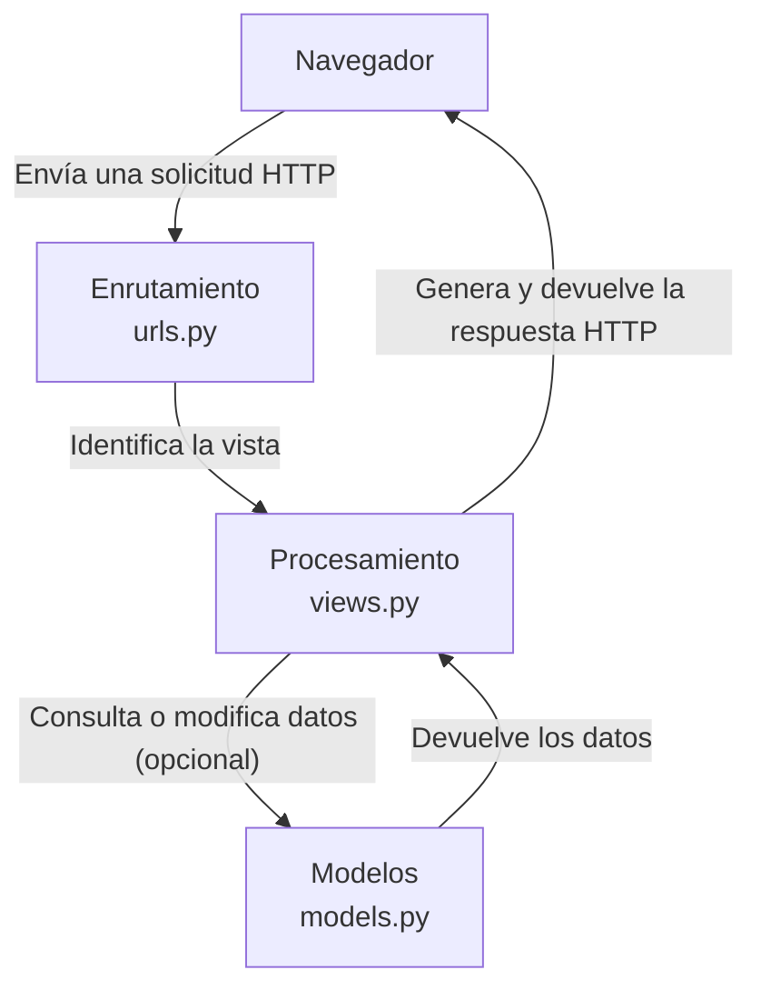
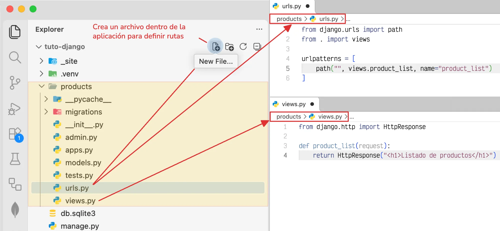
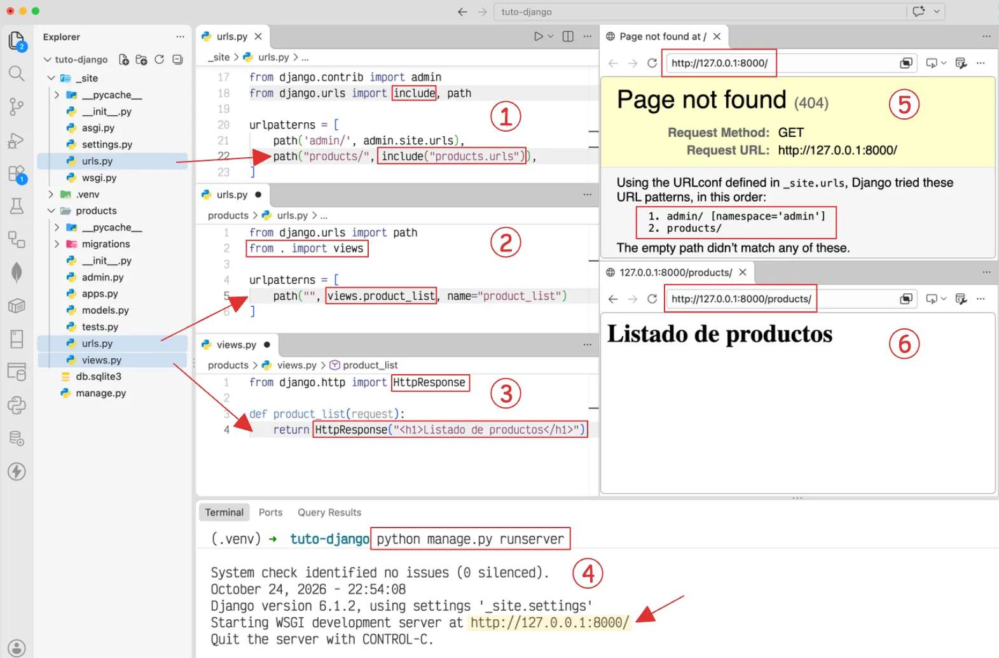

# Introducción a las vistas de Django

Las vistas son un componente fundamental en el patrón de arquitectura de Django, ya que procesan las solicitudes HTTP y determinan la respuesta que recibirá el usuario. Mediante funciones o clases de Python, permiten consultar datos, ejecutar operaciones y devolver contenido HTML, JSON u otros tipos de respuesta.

## ¿Cómo funcionan las vistas?

Cuando un usuario accede a una página, Django recibe una solicitud HTTP y busca la ruta correspondiente en la configuración de URLs. Una vez identificada, ejecuta la vista asociada, que procesa la solicitud y devuelve una respuesta al navegador.

Para procesar una petición HTTP y generar una respuesta, intervienen los siguientes componentes:



En este proceso, cada componente cumple una función específica:

- **`urls.py`:** determina qué vista debe atender la solicitud según la URL solicitada.
- **`views.py`:** ejecuta la lógica necesaria para procesar la solicitud.
- **`models.py`:** permite consultar o modificar los datos almacenados en la base de datos cuando es necesario.
- **Respuesta HTTP:** contiene el resultado que Django devuelve al navegador, como una página HTML o datos en formato JSON.

!!!info

    Una vista no necesita consultar un modelo en todos los casos. Puede devolver una respuesta directamente, utilizar una plantilla para generar contenido HTML o redirigir a otra página. Por ejemplo, una vista para cerrar la sesión del usuario.

    ```py title="views.py"
    from django.contrib.auth import logout
    from django.shortcuts import redirect

    def logout_view(request):
        logout(request)
        return redirect("login")#(1)!
    ```

    1. `redirect()` utiliza el nombre de la ruta (`name`) definido en `urls.py`, no el nombre de la función de la vista. Por ejemplo:
    ```py
    path("login/", views.login_view, name="login")
    ```

## ¿Dónde se definen las vistas?

Las vistas se definen en el archivo :octicons-file-code-16: `views.py` de una aplicación. Reciben un objeto `HttpRequest` y devuelven un objeto :octicons-package-16: `HttpResponse` o alguna de sus variantes.

Por ejemplo, dentro de la aplicación `products`, podemos definir una vista mediante una función (:material-function:) llamada `product_list` en el archivo :octicons-file-code-16: `views.py`:

<div id="product-view"></div>

```{ .python title="products/views.py" hl_lines="1 5" linenums="1" }
from django.http import HttpResponse


def product_list(request):
    return HttpResponse("<h1>Listado de productos</h1>")
```

En este caso, la vista recibe la solicitud y devuelve una respuesta HTTP con un encabezado HTML y el texto indicado.

### Respuestas HTTP

Django proporciona diferentes clases y funciones para generar respuestas según el contenido que se necesita entregar.

| Clase o función | Descripción |
|---|---|
| `HttpResponse` | Devuelve contenido directamente en la respuesta. |
| `render()` | Renderiza una plantilla HTML con un contexto de datos. |
| `redirect()` | Redirige al usuario hacia otra URL. |
| `JsonResponse` | Devuelve datos en formato JSON. |
| `HttpResponseNotFound` | Devuelve una respuesta con estado HTTP 404. |

Sin embargo, definir la vista no es suficiente; también debemos conectarla con el sistema de enrutamiento de la aplicación.

## ¿Dónde se conectan las vistas?

Las vistas se conectan con las URL mediante el archivo `urls.py` de la aplicación, donde se define qué vista debe ejecutarse cuando un usuario accede a una ruta determinada.

Por ejemplo, en la aplicación :octicons-file-directory-16: `products`, podemos asociar una vista `product_list` con un ruta principal dentro del archivo :octicons-file-code-16: `urls.py`. Para ello:

### Crea un archivo `urls.py` dentro de la aplicación

Este archivo **no se genera automáticamente** al utilizar el comando :octicons-terminal-16: [`startapp`](aplicaciones.md#comando-startapp){data-preview} y se debe crear el archivo manualmente desde el editor o con un comando.

=== "Linux/macOS"

    ```bash
    (.venv) touch products/urls.py
    ```

=== "Windows"

    ```powershell
    (.venv) echo.> products/urls.py
    ```

Después, se definen las rutas en este archivo y se vinculan con sus respectivas vistas.

```py title="products/urls.py" hl_lines="1 2 5"  linenums="1"
from django.urls import path
from . import views

urlpatterns = [
    path("", views.product_list, name="product_list"),#(1)!
]
```

1. La función `path()` recibe tres argumentos principales:  
\- `route`: define la ruta URL que se desea reconocer.  
\- `view`: indica la vista que se ejecutará cuando la URL coincida. 
\- `name`: se usa para referenciar en otras partes del proyecto.

En este caso, `path()` recibe la ruta, la vista que debe ejecutarse y un nombre para identificarla. Cuando un usuario accede a la ruta raíz, Django ejecuta la vista [`product_list`](#product-view){data-preview}.



Ahora tenemos definida una ruta en la aplicación, pero debemos incluirla en el enrutamiento principal del proyecto para que Django pueda reconocerla.

```python title="_site/urls.py" hl_lines="2 6"
from django.contrib import admin
from django.urls import include, path #(1)!

urlpatterns = [
    path("admin/", admin.site.urls),
    path("products/", include("products.urls")),#(2)!
]
```

1. importamos `include()` para conectar las rutas de `products/urls.py` al enrutamiento principal, bajo la URL `/products/`.
2. `include()`: recibe el módulo que contiene las rutas que queremos incorporar al enrutamiento principal.

Se utiliza `include()` para mantener las rutas de cada aplicación separadas y organizadas, evitando tener que definirlas todas en el archivo principal del proyecto.

Así, al acceder a `/products/`, Django dirige la solicitud a la ruta raíz de la aplicación, que es procesada por la vista `product_list` de la aplicación `products`.



<div class="grid cards" markdown>

- :material-file-code-outline: &nbsp; **1. Incluir las rutas de la aplicación**

    ---

    En `_site/urls.py`, se utiliza `include()` para conectar las rutas de `products`.

- :material-link-variant: &nbsp; **2. Asociar la ruta con una vista**

    ---

    En `products/urls.py`, `path()` vincula la URL con la vista `product_list`.

- :material-eye-outline: &nbsp; **3. Definir la vista**

    ---

    En `products/views.py`, `product_list` devuelve el contenido HTML mediante `HttpResponse`.

- :material-console: &nbsp; **4. Ejecutar el servidor**

    ---

    El comando `python manage.py runserver` inicia el servidor de desarrollo.

- :material-web: &nbsp; **5. Acceder a la ruta principal**

    ---

    Al visitar `http://127.0.0.1:8000/`, Django muestra un error 404 porque la ruta no está definida.

- :material-check-circle-outline: &nbsp; **6. Visualizar el resultado**

    ---

    Al visitar `http://127.0.0.1:8000/products/`, se muestra el listado de productos.

</div>

### Renderizar una plantilla

En lugar de generar el HTML directamente en el código Python, es habitual utilizar `render()` para combinar una plantilla con los datos que necesita mostrar.

Por ejemplo, podemos definir una vista que entregue un listado de productos a una plantilla:

```python title="products/views.py"
from django.shortcuts import render


def product_list(request):
    products = [
        {"name": "Teclado", "price": 19990},
        {"name": "Mouse", "price": 9990},
    ]

    return render(
        request,
        "products/product_list.html",
        {"products": products},
    )
```

En este ejemplo, `render()` recibe la solicitud, la ruta de la plantilla y un diccionario con los datos que estarán disponibles para su representación.

## Vistas basadas en funciones

Las vistas basadas en funciones (*Function-Based Views*, FBV) son funciones de Python que reciben una solicitud HTTP y devuelven una respuesta. Son una alternativa sencilla para implementar la lógica de una página o una operación.

Por ejemplo, podemos definir una vista para mostrar los detalles de un producto:

```python title="products/views.py"
from django.http import HttpResponse


def product_detail(request, product_id):
    return HttpResponse(f"Detalle del producto {product_id}")
```

El parámetro `product_id` permite recibir el identificador del producto desde la URL, siempre que este se encuentre definido en la configuración de rutas.

## Vistas basadas en clases

Las vistas basadas en clases (*Class-Based Views*, CBV) permiten organizar la lógica de una vista mediante clases y reutilizar comportamientos proporcionados por Django.

Por ejemplo, `TemplateView` permite mostrar una plantilla sin necesidad de definir manualmente una función para renderizarla:

```python title="products/views.py"
from django.views.generic import TemplateView


class ProductListView(TemplateView):
    template_name = "products/product_list.html"
```

Django proporciona otras vistas genéricas, como `ListView`, `DetailView`, `CreateView`, `UpdateView` y `DeleteView`, que facilitan la implementación de operaciones habituales sobre los datos.
