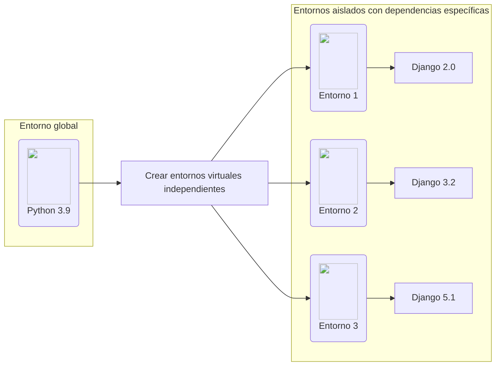

# Gestionar y confugurar un entorno virtual

Cuando instalamos [Python3](https://www.python.org/ "Sitio web de Python"){:target='blank'}, se crea un único entorno global compartido por todos los proyectos y todo el código de Python. Aunque es posible instalar [Django](https://www.djangoproject.com/ "Sitio web de Django"){:target=':_blank'} y otros paquetes en el entorno global, esto limita la posibilidad de gestionar múltiples versiones de cada paquete.

!!! warning "Cuidado al trabajar en el entorno global"

    Los paquetes instalados globalmente pueden **generar conflictos entre versiones**, especialmente al trabajar con varios proyectos que requieren diferentes versiones de una misma biblioteca.

Como resultado, los desarrolladores experimentados suelen **configurar y ejecutar** las aplicaciones Python dentro de [entornos virtuales de Python](https://docs.python.org/es/3/tutorial/venv.html){:target='blank' data-preview } independientes.

## ¿Qué es un Entornos Virtual de Python?

Un entorno virtual en Python es una instancia aislada que se crea a partir de una copia de nuestro Python global. Su principal ventaja es que permite trabajar de forma ordenada en un proyecto específico, utilizando únicamente los módulos y librerías necesarios para ese caso, sin afectar a otros proyectos ni a la instalación global del sistema.

A continuación, se muestra un ejemplo de cómo luce un entorno virtual, lo que nos ayudará a comprender mejor su finalidad.



## Gestionar un Entorno Virtual

Existen varias herramientas para crear y gestionar entornos virtuales en Python. No hay un número único, pero estas son las principales que conviene conocer.

### Herramientas más utilizadas

| Herramienta | Descripción | Comando habitual |
| --- | --- | --- |
| [`venv`](#administrar-entornos-con-venv){data-preview} | Módulo estándar de Python; en Linux puede requerir instalación adicional. | `python -m venv .venv` |
| [`virtualenv`](#administrar-entornos-con-virtualenv){data-preview} | Alternativa a `venv`, con compatibilidad adicional. | `virtualenv .venv` |
| [`Pipenv`](#administrar-entornos-con-pipenv){data-preview} | Combina entornos virtuales y gestión de dependencias.                        | `pipenv install`                       |
| [`Poetry`](#administrar-entornos-con-poetry){data-preview} | Gestiona dependencias, entornos y empaquetado de proyectos. | `poetry install`                       |
| [`uv`](#administrar-entornos-con-uv){data-preview} | Herramienta rápida para Python; gestiona versiones, entornos y dependencias. | `uv venv` |

???+ "Info"
    Ten presente que no todas estas herramientas son equivalentes: algunas crean entornos virtuales y otras también administran dependencias, versiones de Python y empaquetado.

### Administrar entornos con `venv`

--8<-- "snippets/tools/venv.md"

---

### Administrar entornos con `virtualenv`

--8<-- "snippets/tools/virtualenv.md"

---

### Administrar entornos con `Pipenv`

[__Pipenv__](https://pipenv-es.readthedocs.io/es/latest/){: target='_blank'} es una gran herramienta para gestionar entornos virtuales y dependencias de Python, destacando por integrar ambas tareas de forma flexible y sencilla.

???+ tip "Administración de entornos simplificado"
    **Pipenv** automáticamente crea y maneja un entorno virtual para tus proyectos, también como *agregar/remover* paquetes desde un archivo `Pipfile.lock`, que es usado para producir un determinado build.

**Versiones requeridas para instalar Pipenv** 

[{:style="height: 27px"}](https://www.python.org/){:target='_blank'}

Para la mayoría de los casos, se recomienda instalar Pipenv usando `pip` pero igual se puede instalar de otras manera según el Sistema Operativo:

--8<-- "snippets/tools/pipenv.md"

---

### Administrar entornos con `Poetry`

--8<-- "snippets/tools/poetry.md"

### Administrar entornos con `uv`

--8<-- "snippets/tools/uv.md"

## Buenas prácticas

- [x] Utilizar `.venv` como nombre convencional del entorno.
- [x] Agregar `.venv/` al archivo `.gitignore`.
- [x] Mantener las dependencias del proyecto en `requirements.txt`.
- [x] Utilizar un entorno independiente para cada proyecto.

## ¿Cuál te recomiendo?

**1. `venv` — para aprender y proyectos sencillos**

Ya viene con Python. Es una excelente opción para Django y proyectos académicos.

```bash title="Terminal"
python -m venv .venv
source .venv/bin/activate
pip install -r requirements.txt
```

**2. `uv` — para desarrollo moderno**

Es rápido y permite gestionar Python, entornos virtuales y dependencias desde una sola herramienta.

```bash title="Terminal"
uv venv
source .venv/bin/activate
uv pip install -r requirements.txt
```

Mi recomendación para tus proyectos Django: continúa con `venv` si quieres mantener una configuración sencilla. Si buscas una herramienta más completa y rápida, vale la pena aprender `uv`.
