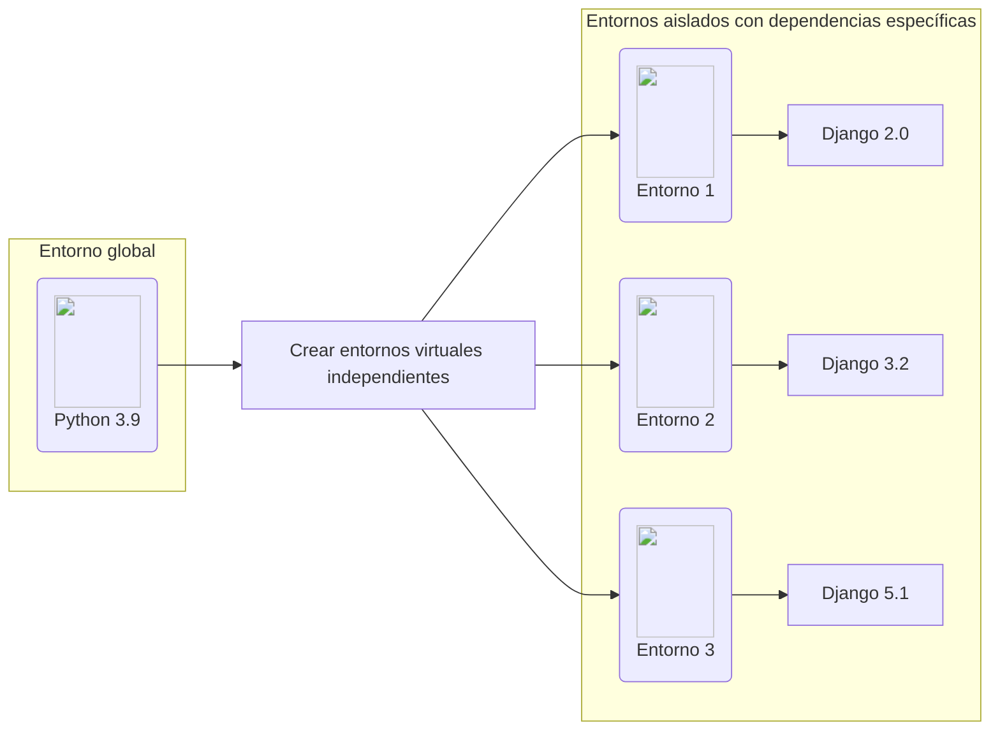

# Gestionar y confugurar un entorno virtual

Cuando instalamos [Python3](https://www.python.org/ "Sitio web de Python"){:target='blank'}, se crea un único entorno global compartido por todos los proyectos y todo el código de Python. Aunque es posible instalar [Django](https://www.djangoproject.com/ "Sitio web de Django"){:target=':_blank'} y otros paquetes en el entorno global, esto limita la posibilidad de gestionar múltiples versiones de cada paquete.

!!! warning "Cuidado al trabajar en el entorno global"

    Los paquetes instalados globalmente pueden **generar conflictos entre versiones**, especialmente al trabajar con varios proyectos que requieren diferentes versiones de una misma biblioteca.

Como resultado, los desarrolladores experimentados suelen **configurar y ejecutar** las aplicaciones Python dentro de [entornos virtuales de Python](https://docs.python.org/es/3/tutorial/venv.html){:target='blank' data-preview } independientes.

## ¿Qué es un Entornos Virtual de Python?

Un entorno virtual en Python es una instancia aislada que se crea a partir de una copia de nuestro Python global. Su principal ventaja es que permite trabajar de forma ordenada en un proyecto específico, utilizando únicamente los módulos y librerías necesarios para ese caso, sin afectar a otros proyectos ni a la instalación global del sistema.

A continuación, se muestra un ejemplo de cómo luce un entorno virtual, lo que nos ayudará a comprender mejor su finalidad.



## Gestionar un Entorno Virtual

Existen varias herramientas para crear y gestionar entornos virtuales en Python. No hay un número único, pero estas son las principales que conviene conocer.

### Herramientas más utilizadas

| Herramienta  | Descripción                                                                  | Comando habitual                       |
| ------------ | ---------------------------------------------------------------------------- | -------------------------------------- |
| [`venv`](#administrar-entornos-con-venv){data-preview} | Módulo estándar de Python; en Linux puede requerir instalación adicional. | `python -m venv .venv` |
| [`virtualenv`](#administrar-entornos-con-virtualenv){data-preview} | Alternativa a `venv`, con compatibilidad adicional.                          | `virtualenv .venv`                     |
| [`Pipenv`](#administrar-entornos-con-pipenv){data-preview} | Combina entornos virtuales y gestión de dependencias.                        | `pipenv install`                       |
| [`Poetry`](#administrar-entornos-con-poetry){data-preview}     | Gestiona dependencias, entornos y empaquetado de proyectos. | `poetry install`                       |
| `uv`         | Herramienta rápida para Python; gestiona versiones, entornos y dependencias. | `uv venv`                              |
| `Hatch`      | Gestiona entornos, proyectos y procesos de desarrollo.                       | `hatch env create`                     |
| `PDM`        | Gestor de dependencias y proyectos Python.                                   | `pdm install`                          |
| `Rye`        | Herramienta de gestión de proyectos Python, actualmente sucedida por `uv`.   | —                                      |


???+ "Info"
	Ten presente que no todas estas herramientas son equivalentes: algunas crean entornos virtuales y otras también administran dependencias, versiones de Python y empaquetado.

### Administrar entornos con `venv`

El paquete `venv` ya forma parte de la biblioteca estándar de Python desde la versión 3.3. Viene habitualmente incluido en la [instalación estándar de Python en Windows](https://speakerdeck.com/player/bc729009adbc4ca78c81dfade6b9133b){ data-dialog="iframe" data-dialog-title="Instalación de Python" }, mientras que en algunas distribuciones de Linux puede requerir la instalación de un paquete por separado.

Para comprobarlo, ejecuta el siguiente comando:

=== ":fontawesome-brands-windows: Windows"

	```bash
	python -m venv --help
	```

=== ":fontawesome-brands-linux: Linux /:fontawesome-brands-apple: macOS"

	```bash
	python3 -m venv --help
	```

=== ":material-console: Output"

	```{.plaintext .no-copy hl_lines="1" }
	python -m venv --help
	usage: python -m venv [-h] [--system-site-packages] [--symlinks |
						--copies] [--clear] [--upgrade]
						[--without-pip] [--prompt PROMPT]
						[--upgrade-deps] [--without-scm-ignore-files]
						ENV_DIR [ENV_DIR ...]

	Creates virtual Python environments in one or more target
	directories.

	positional arguments:
	ENV_DIR               A directory to create the environment in.

	options:
	-h, --help            show this help message and exit
	--system-site-packages
							Give the virtual environment access to the
							system site-packages dir.
	--symlinks            Try to use symlinks rather than copies, when
							symlinks are not the default for the
							platform.
	--copies              Try to use copies rather than symlinks, even
							when symlinks are the default for the
							platform.
	--clear               Delete the contents of the environment
							directory if it already exists, before
							environment creation.
	--upgrade             Upgrade the environment directory to use
							this version of Python, assuming Python has
							been upgraded in-place.
	--without-pip         Skips installing or upgrading pip in the
							virtual environment (pip is bootstrapped by
							default)
	--prompt PROMPT       Provides an alternative prompt prefix for
							this environment.
	--upgrade-deps        Upgrade core dependencies (pip) to the
							latest version in PyPI
	--without-scm-ignore-files
							Skips adding SCM ignore files to the
							environment directory (Git is supported by
							default).

	Once an environment has been created, you may wish to activate it,
	e.g. by sourcing an activate script in its bin directory.
	```


En caso de no tener instalado `venv`, puedes usar los siguientes comandos:

=== ":material-debian: Debian / Ubuntu"

    ```bash
    sudo apt update
    sudo apt install python3-venv
    ```

=== ":material-fedora: Fedora"

    ```bash
    sudo dnf install python3
    ```

Para gestionar un entorno virtual usando el paquete `venv`, ubicate en la carpeta donde quieres configurarlo y sigue los pasos según tu plataforma:

--8<-- "snippets/commands/python-venv.md"

!!! info "Nombre del entorno"

	Se recomienda utilizar `venv` o `.venv` como nombre del entorno virtual. La opción `.venv` es habitual porque se considera una carpeta oculta en sistemas Unix y ayuda a mantenerla separada del código del proyecto.

---

### Administrar entornos con `virtualenv`

`virtualenv` es una herramienta alternativa a `venv` que permite crear y gestionar entornos virtuales aislados de Python. A diferencia de `venv`, que viene incluido en Python desde la versión 3.3, `virtualenv` se instala por separado y ofrece la creación más rápida de entornos.

Para instalarlo, ejecuta el siguiente comando:

=== ":simple-pypi: PyPi"

    ```bash
	# Windows
    pip install virtualenv
	# Linux
    pip3 install virtualenv
    ```

=== ":fontawesome-brands-apple: macOS"

    ```bash
	brew install virtualenv
    ```

=== ":material-ubuntu: Debian / Ubuntu"

    ```bash
    sudo apt update
    sudo apt install python3-virtualenv
    ```

=== ":material-fedora: Fedora"

    ```bash
    sudo dnf install python3-virtualenv
    ```

???+ abstract "Administrar entornos con virtualenv"

    === ":fontawesome-brands-windows: Windows"

        **1. Crear Entorno Virtual**

        ```{ .powershell .cmd .mt-0 }
        virtualenv .venv
        ```

        **2. Activar el Entorno Virtual**

        ```{ .powershell .cmd .mt-0 }
        .venv\Scripts\activate.bat
        ```

        **3. Desactivar el Entorno Virtual**

        ```{ .powershell .cmd .mt-0 }
        deactivate
        ```

        **4. Limpiar el Entorno Virtual (recrearlo desde cero)**

        ```{ .powershell .cmd .mt-0 }
        virtualenv --clear .venv
        ```

		La opción `--clear` elimina el contenido existente del directorio del entorno antes de reconstruirlo.

        **5. Eliminar el Entorno Virtual**

        ```{ .powershell .cmd .mt-0 }
		(.venv) deactivate
		rmdir /s /q .venv
        ```

    === ":fontawesome-brands-linux: Linux / :fontawesome-brands-apple: macOS"

        **1. Crear Entorno Virtual**

        ```bash title="Terminal"
        virtualenv .venv
        ```

        **2. Activar el Entorno Virtual**

        ```bash title="Terminal"
        source .venv/bin/activate
        ```

        **3. Desactivar el Entorno Virtual**

        ```bash title="Terminal"
        deactivate
        ```

        **4. Limpiar el Entorno Virtual (recrearlo desde cero)**

        ```bash title="Terminal"
        virtualenv --clear .venv
        ```

		La opción `--clear` elimina el contenido existente del directorio del entorno antes de reconstruirlo.


        **5. Eliminar el Entorno Virtual**

        ```bash title="Terminal"
        rm -rf .venv
        ```

---

### Administrar entornos con `Pipenv`

[__Pipenv__](https://pipenv-es.readthedocs.io/es/latest/){: target='_blank'} es una gran herramienta para gestionar entornos virtuales y dependencias de Python, destacando por integrar ambas tareas de forma flexible y sencilla.

???+ tip "Administración de entornos simplificado"
	__Pipenv__ automáticamente crea y maneja un entorno virtual para tus proyectos, también como *agregar/remover* paquetes desde un archivo `Pipfile.lock`, que es usado para producir un determinado build.

**Versiones requeridas para instalar Pipenv** 

[{:style="height: 27px"}](https://www.python.org/){:target='_blank'}

Para la mayoría de los casos, se recomienda instalar Pipenv usando `pip` pero igual se puede instalar de otras manera según el Sistema Operativo:

=== ":simple-pypi: PyPi"

    ```bash
	# Windows
    pip install --user pipenv
	# Linux
    pip3 install --user pipenv
    ```

	???+ info "Información"
		Al instalar Pipenv con la opción `--user`, es posible que deba agregar el directorio de los ejecutables al `PATH` para poder utilizar el comando `pipenv` desde la terminal.

		En Linux y macOS, se puede consultar la ruta de instalación con:

		```bash title="Terminal"
		python3 -m site --user-base
		# Output: /Users/mcherrera/Library/Python/3.14
		```

		Normalmente, los ejecutables se encuentran en el directorio `bin` dentro de esa ruta. Para agregarlo al `PATH` en Bash o Zsh, ejecute:

		```bash title="Terminal"
		echo 'export PATH="$HOME/Library/Python/3.9/bin:$PATH"' >> ~/.bashrc
		source ~/.bashrc # o .zshrc si usas zsh
		```

		Finalmente, comprobamos que Pipenv esté disponible:

		```bash title="Terminal"
		pipenv --version
		# Output: pipenv, version 2025.0.4
		```

=== ":fontawesome-brands-apple: macOS"

    ```bash
	brew install pipenv
    ```

	???+ warning "Advertencia"
		No se recomienda la instalación mediante Homebrew, ya que funciona mejor instalar pipenv usando pip en macOS.

=== ":material-ubuntu: Debian / Ubuntu"

    ```bash
    sudo apt update
    sudo apt install pipenv
    ```

=== ":material-fedora: Fedora"

    ```bash
    sudo dnf install pipenv
    ```

???+ abstract "Administrar entornos con Pipenv"

    === ":fontawesome-brands-windows: Windows"

		**1. Crear un nuevo Entorno Virtual**

		```{ .powershell .cmd .mt-0 .mb-0 }
		pipenv install
		```

		???+ info "Información"
			Si no existe un archivo `Pipfile` en el directorio del proyecto, Pipenv lo crea. Si ya existe, crea el entorno virtual e instala las dependencias definidas en el archivo, utilizando el archivo `Pipfile.lock` si está disponible.

        **2. Activar el Entorno Virtual**

        ```{ .powershell .cmd .mt-0 }
        pipenv shell
        ```

        **3. Desactivar el Entorno Virtual**

        ```{ .powershell .cmd .mt-0 }
        (.venv) exit
        ```

        **4. Limpiar la caché de dependencias**

        ```bash title="Terminal"
        pipenv --clear
        ```

        **5. Eliminar el Entorno Virtual asociado al proyecto**

        ```{ .powershell .cmd .mt-0 }
		(.venv) exit
		pipenv --rm
        ```

    === ":fontawesome-brands-linux: Linux / :fontawesome-brands-apple: macOS"

        **1. Crear un nuevo Entorno Virtual**

        ```bash title="Terminal"
        pipenv install
        ```

        **2. Activar el Entorno Virtual**

        ```bash title="Terminal"
        pipenv shell
        ```

        **3. Desactivar el Entorno Virtual**

        ```bash title="Terminal"
        (.venv) exit
        ```

        **4. Limpiar la caché de dependencias**

        ```bash title="Terminal"
        pipenv --clear
        ```

        **5. Eliminar el Entorno Virtual asociado al proyecto**

        ```bash title="Terminal"
		(.venv) exit
        pipenv --rm
        ```

???+ abstract "Administrar dependencias con Pipenv"
	
	**1. Instalar un paquete (se registrará en el archivo `Pipfile` y `Pipfile.lock`)**

	```bash title="Terminal"
	pipenv install requests
	```

	**2. Eliminar un paquete o eliminar todos los paquetes**

	```bash title="Terminal"
	pipenv uninstall requests
	pipenv uninstall --all
	```

---

### Administrar entornos con `Poetry`

[**Poetry**](https://python-poetry.org/docs/){:target='_blank'} es una herramienta de Python que gestiona dependencias, entornos virtuales y empaqueta proyectos.

???+ info "Información"
	Su diferencia principal con **Pipenv** es que **Poetry** permite construir y publicar librerías directamente en PyPI, mientras que Pipenv solo sirve para administrar dependencias de aplicaciones locales.

Poetry proporciona un instalador oficial que instala la herramienta en un entorno virtual independiente y administra su propio entorno.

En Linux, macOS y Windows mediante [WSL](https://mcherrera.dev/posts/wsl-introduccion/){data-iframe="}, ejecuta el siguiente comando:

```bash title="Terminal"
curl -sSL https://install.python-poetry.org | python3 -
```

???+ info
	Si el comando `poetry` no se reconoce, se debe agregar el directorio de instalación al `PATH`.

	En Linux y macOS, normalmente puedes utilizar:

	```bash title="Terminal"
	export PATH="$HOME/.local/bin:$PATH"
	```

	Para conservar el cambio, añade esa línea al archivo `~/.bashrc` o `~/.zshrc`, según la terminal que utilices:

	```bash title="Terminal"
	echo 'export PATH="$HOME/.local/bin:$PATH"' >> ~/.zshrc
	```

	Verificar la instalación:

	```bash title="Terminal"
	poetry --version
	# Output: Poetry (version 2.5.1)
	```

	Documentación oficial: [Instalación de Poetry](https://python-poetry.org/docs/#installation){:target='_blank'}.

## Buenas prácticas

- [x] Utilizar `.venv` como nombre convencional del entorno.
- [x] Agregar `.venv/` al archivo `.gitignore`.
- [x] Mantener las dependencias del proyecto en `requirements.txt`.
- [x] Utilizar un entorno independiente para cada proyecto.

### Administrar entornos con `virtualenvwrapper`

Este paquete es una extensión de `virtualenv` que facilita la gestión y organiza todos tus entornos virtuales en un solo lugar. Para instalarlo, ejecuta el siguiente comando:

=== ":material-apple: macOS"

	```bash title="terminal"
	pip3 install virtualenvwrapper
	```

=== ":simple-linux: Linux"

	```bash title="terminal"
	sudo pip3 install virtualenvwrapper
	```

Ahora, añade las siguientes líneas en el archivo de inicio del shell (`.bashrc` o `.zshrc` si usas [zsh](https://en.wikipedia.org/wiki/Z_shell)):

=== ":octicons-file-code-16: `.bashrc`"
	```bash hl_lines="1 3"
	export WORKON_HOME=$HOME/.virtualenvs # (1)!
	export VIRTUALENVWRAPPER_PYTHON=/usr/bin/python3
	source /usr/local/bin/virtualenvwrapper.sh #(2)!
	```

	1.  La variable `WORKON_HOME` determina en qué directorio se deben crear los entornos virtuales de Python.
	
	2. Por último, se debe agregar esta línea al archivo `~/.bashrc` para especificar en dónde está ubicado el ejecutable de virtualenvwrapper.

#### **Comandos adicionales**

`virtualenvwrapper` agrega varios comandos útiles para gestionar entornos virtuales de manera más eficiente. Algunos de los más utilizados son:

- `mkvirtualenv`: Crea un nuevo entorno virtual.
- `lsvirtualenv`: Muestra todos los entornos virtuales existentes.
- `workon`: Permite activar fácilmente cualquier entorno virtual.
- `rmvirtualenv`: Elimina un entorno virtual.
- `deactivate`: Desactiva el entorno virtual activo.

#### **1. Crear un entorno virtual**

```bash title="terminal"
mkvirtualenv nombre_entorno
```

#### **2. Activar un entorno virtual**


=== "Activar el entorno"

	```bash title="terminal"
	workon django-test
	```
=== "Salida"

	```title="terminal"
	created virtual environment CPython3.9.2.final.0-64 in 9185ms
	  creator CPython3Posix(dest=/home/enidev911/.virtualenvs/django-test, clear=False, no_vcs_ignore=False, global=False)
	  seeder FromAppData(download=False, pip=bundle, setuptools=bundle, wheel=bundle, via=copy, app_data_dir=/home/enidev911/.local/share/virtualenv)
	    added seed packages: pip==24.1, setuptools==70.1.0, wheel==0.43.0
	  activators BashActivator,CShellActivator,FishActivator,NushellActivator,PowerShellActivator,PythonActivator
	virtualenvwrapper.user_scripts creating /home/enidev911/.virtualenvs/django-test/bin/predeactivate
	virtualenvwrapper.user_scripts creating /home/enidev911/.virtualenvs/django-test/bin/postdeactivate
	virtualenvwrapper.user_scripts creating /home/enidev911/.virtualenvs/django-test/bin/preactivate
	virtualenvwrapper.user_scripts creating /home/enidev911/.virtualenvs/django-test/bin/postactivate
	virtualenvwrapper.user_scripts creating /home/enidev911/.virtualenvs/django-test/bin/get_env_detail
	```

#### **3. Eliminar un entorno virtual**


```bash title="bash"
rmvirtualenv nombre_entorno
```

## ¿Cuál te recomiendo?

1\. `venv` — para aprender y proyectos sencillos

Ya viene con Python. Es una excelente opción para Django y proyectos académicos.

```
python -m venv .venv
source .venv/bin/activate
pip install -r requirements.txt
```

2\. `uv` — para desarrollo moderno

Es rápido y permite gestionar Python, entornos virtuales y dependencias desde una sola herramienta.

```
uv venv
source .venv/bin/activate
uv pip install -r requirements.txt
```

3\. Conda — para ciencia de datos

Resulta especialmente útil cuando necesitas gestionar Python junto con bibliotecas científicas y dependencias externas.

Mi recomendación para tus proyectos Django: continúa con `venv` si quieres mantener una configuración sencilla. Si buscas una herramienta más completa y rápida, vale la pena aprender `uv`.

Una vez instalados Python y pip, contamos con paquetes que nos permiten configurar entornos virtuales. Algunos de estos paquetes vienen integrados con Python, como [`venv`](https://docs.python.org/es/3.13/library/venv.html){:target='_blank'}, mientras que otros, como [`virtualenv`](https://pypi.org/project/virtualenv/){:target='_blank'}, deben instalarse por separado. Ambos nos facilitan la creación de entornos aislados para nuestros proyectos, evitando conflictos entre dependencias.
