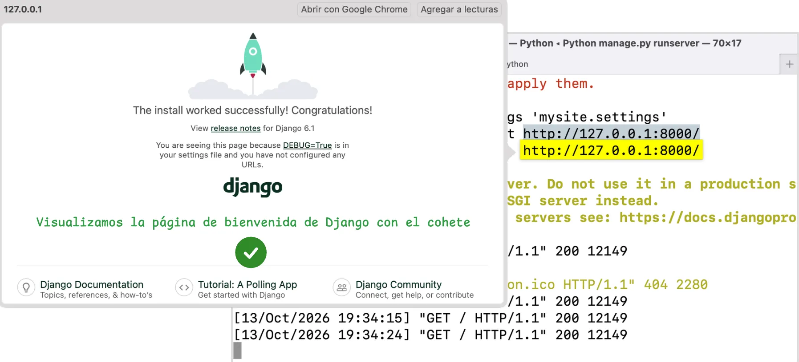

# Lanzar el servidor de desarrollo

Una vez creado el proyecto, inicia el servidor de desarrollo con el siguiente comando:

Para verificar que nuestro proyecto funcione. Cambiamos al directorio del proyecto generado, y dentro ejecutamos el siguiente comando:

=== "Comando"
	```bash
	python manage.py runserver
	```
=== "Output"
	```{ .plaintext .no-copy hl_lines="10" }
	Watching for file changes with StatReloader
	Performing system checks...
	
	System check identified no issues (0 silenced).
	
	You have 18 unapplied migration(s). Your project may not work properly until you apply the migrations for app(s): admin, auth, contenttypes, sessions.
	Run 'python manage.py migrate' to apply them.
	July 17, 2024 - 03:53:10
	Django version 4.2.14, using settings 'mysite.settings'
	Starting development server at http://127.0.0.1:8000/
	Quit the server with CONTROL-C.
	```

???+ note "Nota"

    De forma predeterminada, cuando lanzamos el servidor de desarrollo se utiliza el puerto 8000.

    Si deseamos cambiar el puerto del servidor, lo pasamos como argumento al comando `runserver`:

    ```shell
    python manage.py runserver 8080
    ```

???+ info "Recarga automática"

    El servidor de desarrollo recarga automáticamente el código Python para cada solicitud según sea necesario. Sin embargo, algunas cosas como agregar nuevos archivos no activan el reinicio, por lo que tendríamos que reiniciar el servidor.

Si accedemos a <http://127.0.0.1:8080/>, veremos la página de bienvenida predeterminada de Django.


