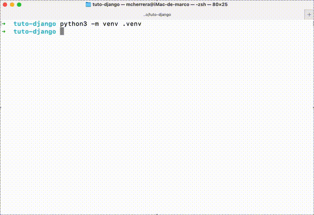

# Instalar Django en el Entorno Virtual

Una vez con [el entorno virtual configurado y activado](configurar-entorno-virtual.md){data-preview}, lo recomendado es utilizar `pip` para la instalación de Django:

--8<-- "snippets/commands/pip-install-django.md"

Para verificar que Django está instalado, ejecuta el siguiente comando. Este comprobará que Python puede localizar el módulo Django:

--8<-- "snippets/commands/check-django-version.md"

/// caption
Instalación de Django y comprobación de la versión instalada
///
