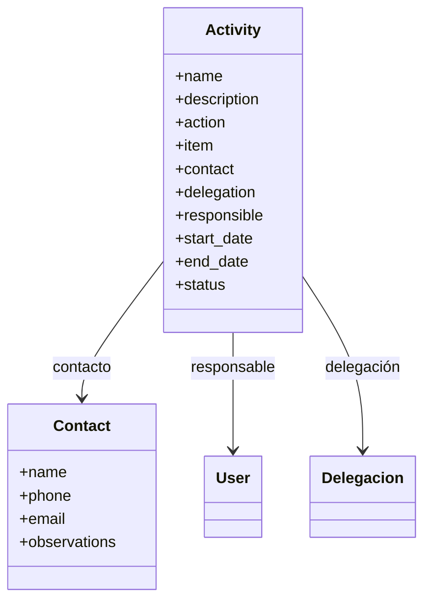
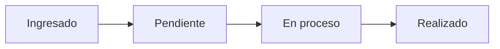
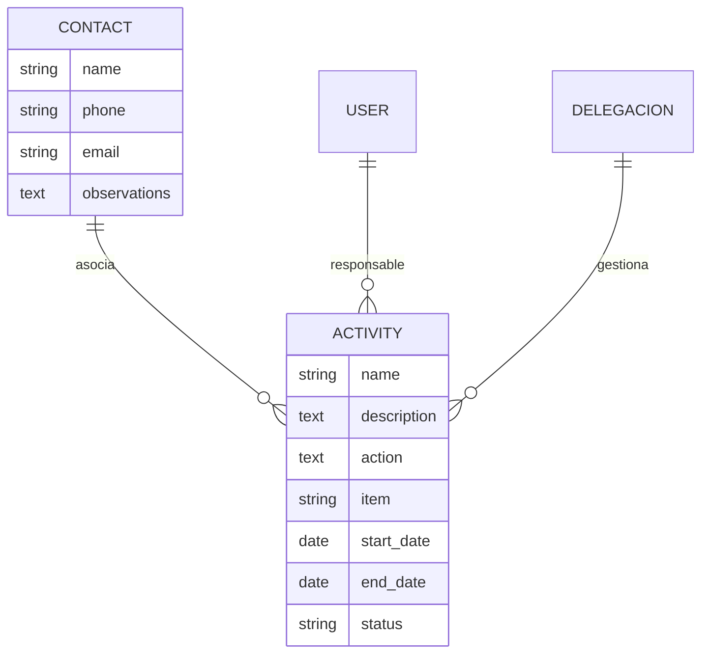
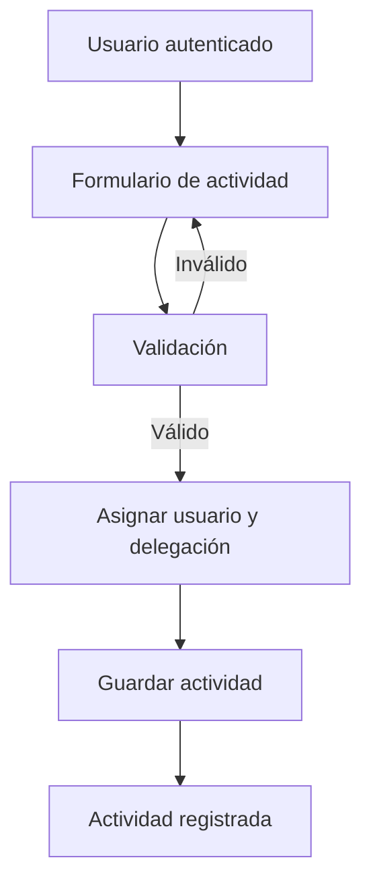
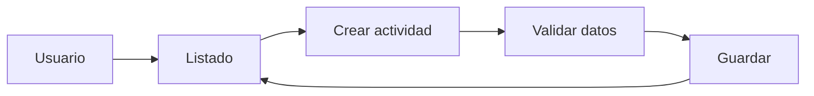

El módulo de **Actividades** ( *activities* ) es el componente encargado de gestionar el registro y administración de las actividades municipales del Sistema de Gestión de Resultados.


## Creación del módulo Activities

Este módulo se creó mediante el comando `startapp` de Django:

```bash title="Terminal"
(.venv) python manage.py startapp activities
```

Este comando genera la estructura inicial de una aplicación Django lista para trabajar:

```{ .python .no-copy }
 activities
├──  migrations #(1)!
│   └──  __init__.py
├──  templates #(2)!
│   └──  activities
├──  __init__.py
├──  admin.py #(3)!
├──  apps.py #(4)!
├──  forms.py #(5)!
├──  models.py #(6)!
├──  tests.py #(7)!
├──  urls.py #(8)!
└──  views.py #(9)!
```

1. Se generarán las migraciones necesarias para aplicar los cambios del modelo `Activity` en la base de datos.
2. Se crearán las interfaces HTML utilizadas para listar, registrar y gestionar las actividades.
3. Se configurará la administración del modelo `Activity` mediante Django Admin.
4. Se definirá la configuración y los metadatos de la aplicación `activities`.
5. Se implementarán los formularios para registrar y validar los datos de las actividades.
6. Se definirá el modelo `Activity` y sus relaciones con usuarios y delegaciones.
7. Se implementarán pruebas para comprobar el funcionamiento del módulo.
8. Se definirán las rutas para acceder a las funcionalidades de `activities`.
9. Se implementarán las vistas encargadas de gestionar el listado, registro y administración de actividades.


Esta estructura permite separar los modelos de datos, formularios, vistas, rutas y elementos administrativos del módulo.

## Modelo de datos

El modelo de datos del módulo se compone de las entidades `Activity` y `Contact`. La actividad mantiene relaciones con los usuarios responsables y las delegaciones definidas en el módulo `accounts`.

### Contacto

El modelo `Contact` permite almacenar los datos de una persona representante en una actividad.

```python title="activities/models"
class Contact(models.Model):
    name = models.CharField("Nombre", max_length=200)
    phone = models.CharField("Teléfono", max_length=20)
    email = models.EmailField("Correo", blank=True)
    observations = models.TextField("Observaciones", blank=True)
```

El contacto registra nombre, teléfono, correo electrónico y observaciones.

??? info "Ejemplo de contacto"

    === ":material-language-python: Código"

        ```python
        contact = Contact.objects.create(
            name="Carlos González",
            phone="+56987654321",
            email="carlos.gonzalez@example.com",
            observations="Presidente de la Junta de Vecinos Villa El Sol.",
        )
        ```

    === ":material-card-account-details: Datos registrados"

        - **Nombre:** Carlos González
        - **Teléfono:** +56987654321
        - **Correo:** carlos.gonzalez@example.com
        - **Observaciones:** Presidente de la Junta de Vecinos Villa El Sol.


### Actividad

El modelo `Activity` permite almacenar y gestionar la información asociada a las actividades municipales registradas en el sistema.

```python title="activities/models.py"
class Activity(models.Model):

    class Status(models.TextChoices):
        INGRESADO = "INGRESADO", "Ingresado"
        PENDIENTE = "PENDIENTE", "Pendiente"
        EN_PROCESO = "EN_PROCESO", "En proceso"
        REALIZADO = "REALIZADO", "Realizado"

    name = models.CharField("Actividad", max_length=200)
    description = models.TextField("Solicitud / problema", blank=True)
    action = models.TextField("Acción", blank=True)
    item = models.CharField("Ítem", max_length=200, blank=True)

    contact = models.ForeignKey(
        Contact,
        on_delete=models.PROTECT,
        related_name="activities",
        verbose_name="Contacto",
        null=True,
    )

    delegation = models.ForeignKey(
        Delegacion,
        on_delete=models.PROTECT,
        related_name="activities",
        verbose_name="Delegación",
    )

    responsible = models.ForeignKey(
        User,
        on_delete=models.PROTECT,
        related_name="responsible_activities",
        verbose_name="Responsable",
    )

    start_date = models.DateField("Fecha")
    end_date = models.DateField(
        "Fecha de término",
        null=True,
        blank=True,
    )

    status = models.CharField(
        "Estado",
        max_length=20,
        choices=Status.choices,
        default=Status.INGRESADO,
    )
```

### Actividad

El modelo `Activity` representa el registro principal del módulo.



La actividad almacena la información de la solicitud, la acción realizada, el ítem asociado, el contacto, la delegación responsable, el usuario encargado, las fechas y el estado del registro.

### Estados

El modelo utiliza `TextChoices` para definir los estados permitidos:

```python
class Status(models.TextChoices):
    INGRESADO = "INGRESADO", "Ingresado"
    PENDIENTE = "PENDIENTE", "Pendiente"
    EN_PROCESO = "EN_PROCESO", "En proceso"
    REALIZADO = "REALIZADO", "Realizado"
```

Esto permite mantener un conjunto controlado de estados para representar el avance de cada actividad.



El estado inicial de una actividad es **Ingresado** y puede avanzar posteriormente según el proceso de gestión.

### Relaciones

Las relaciones utilizan `ForeignKey` con `on_delete=models.PROTECT`, evitando que un contacto, usuario o delegación pueda eliminarse mientras existan actividades asociadas.




La actividad almacena su nombre, descripción, delegación asociada, usuario responsable, fechas de inicio y término y su estado de activación.

## Registro de actividades

El registro se realiza mediante un formulario Django. Para mantener las reglas de negocio, algunos datos son determinados automáticamente a partir del usuario autenticado.



La delegación y el responsable no son seleccionados libremente por el usuario cuando corresponden a información determinada por su sesión.

## Permisos

El módulo incorpora permisos específicos para controlar las operaciones disponibles.

```text
manage_activities
validate_activities
```

Estos permisos permiten diferenciar las acciones de gestión y validación de actividades según el cargo y los permisos asignados al usuario.

## URLs

Las rutas del módulo se encuentran definidas en `urls.py` y utilizan el espacio de nombres `activities`.

```python
app_name = "activities"
```

Esto permite utilizar las rutas mediante nombres, por ejemplo:

```django

```

## Administración

El modelo `Activity` se encuentra integrado con **Django Admin**, permitiendo administrar los registros desde el panel de administración del sistema.

La configuración del módulo mantiene separadas las funciones administrativas de las operaciones disponibles para los usuarios finales.

## Flujo general



El módulo constituye la base para las funcionalidades de seguimiento, validación y control de las actividades del SGR.

Para el `index` queda resumido, y este artículo ya entra directamente en la **implementación del módulo `activities`**.
