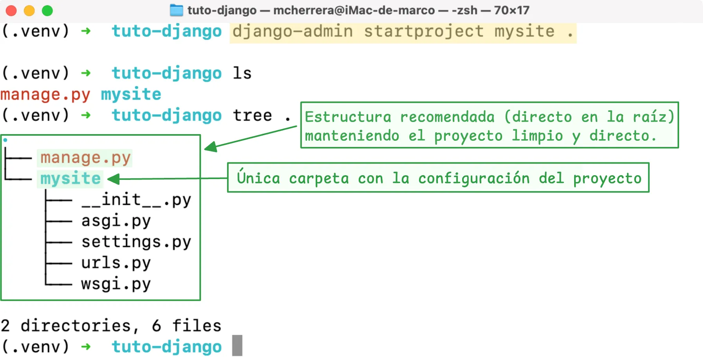
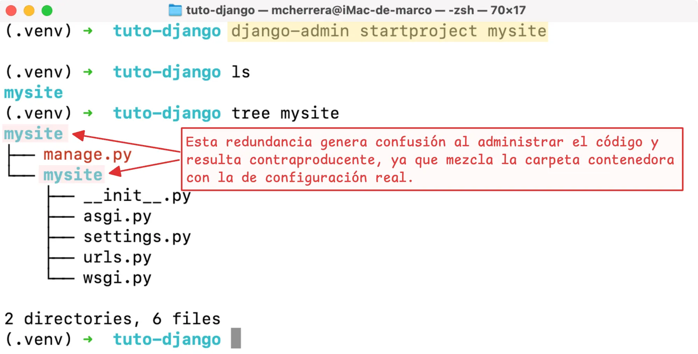

=== "Crear en la carpeta actual"

    ```bash
    (.venv) django-admin startproject mysite .
    ```

    <div class="grid cards nh" markdown>

    <div markdown class="mt-0 mb-0">

    ```{ .python .no-copy title="Estructura del proyecto generado" }
     myproject
    ├──  mysite
    │   ├──  __init__.py#(1)!
    │   ├──  asgi.py#(2)!
    │   ├──  settings.py#(3)!
    │   ├──  urls.py#(4)!
    │   └──  wsgi.py#(5)!
    └──  manage.py#(6)!
    ```

    1. Identifica el directorio como un paquete Python.
    2. Permite la integración con servidores ASGI.
    3. Contiene la configuración del proyecto.
    4. Define las rutas principales.
    5. Permite la integración con servidores WSGI.
    6.  Ejecuta comandos administrativos del proyecto.

    </div>


    - **Estructura recomendada**

        ---

        Al utilizar el punto (`.`) al final del comando, los archivos se crean en el directorio actual, evitamos duplicar directorios y facilita la gestión de rutas.

    </div>

    {: .border-img }

=== "Crear en una nueva carpeta"

    ```bash
    (.venv) django-admin startproject mysite
    ```

    <div class="grid cards nh" markdown>

    <div markdown class="mt-0 mb-0">

    ```{ .python .no-copy title="Estructura del proyecto generado" hl_lines="2 3 9" }
     myproject
    └──  mysite
        ├──  mysite
        │   ├──  __init__.py#(1)!
        │   ├──  asgi.py#(2)!
        │   ├──  settings.py#(3)!
        │   ├──  urls.py#(4)!
        │   └──  wsgi.py#(5)!
        └──  manage.py#(6)!
    ```

    1. Identifica el directorio como un paquete Python.
    2. Permite la integración con servidores ASGI.
    3. Contiene la configuración del proyecto.
    4. Define las rutas principales.
    5. Permite la integración con servidores WSGI.
    6.  Ejecuta comandos administrativos del proyecto.

    </div>


    - **Estructura contraproducente**

        ---

        Esta forma duplica carpetas e incómoda el flujo de trabajo. Nos obliga a entrar a una subcarpeta (`cd mysite`)   solo para usar el `manage.py`, además de enredar el manejo de rutas.

    </div>

    {: .border-img }
